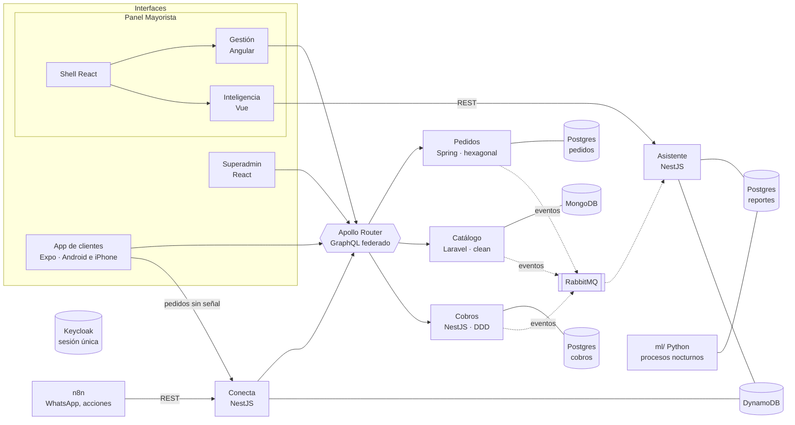
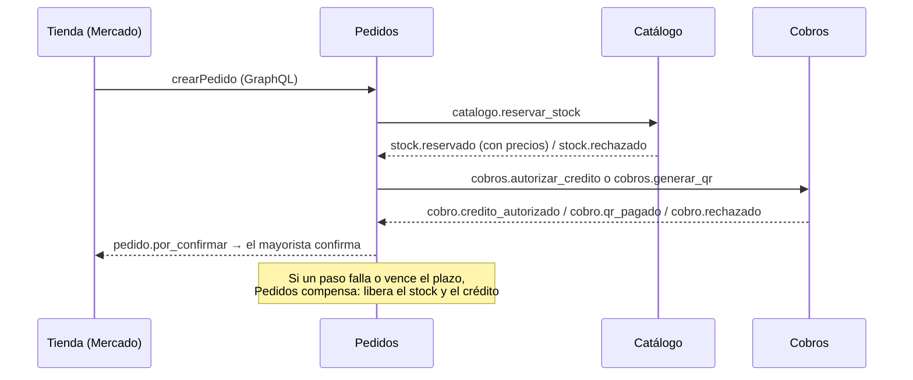

# Arquitectura

## Reglas que sostienen todo

1. **Cada dato tiene un solo dueño.** Ningún servicio lee la base de otro. Si necesita un dato ajeno, lo pide por GraphQL (a través del Router) o lo recibe por evento.
2. **Las apps hablan con un solo punto: el Router.** Una pantalla pide en una sola consulta datos de Pedidos, Catálogo y Cobros; el Router los junta con Federation 2.
3. **Toda escritura que llega de afuera es idempotente.** Conecta guarda la `Idempotency-Key` con una escritura condicional en DynamoDB: un reintento devuelve la respuesta original y no duplica.
4. **Los eventos salen por outbox.** El servicio guarda el cambio y el evento en la misma transacción; un publicador lo manda después a RabbitMQ. Quien lo consume lo anota en su inbox para no procesarlo dos veces.
5. **Sesión única.** Keycloak emite el token. Cada servicio lo valida contra las llaves públicas del realm (JWKS) y toma la empresa de `org_id`.

## La saga de compra

`SagaDeCompra` (Pedidos) es la máquina de estados que decide el siguiente paso y las compensaciones. `RevisorDePlazos` cancela lo que se quedó esperando.

**Estado actual:** Pedidos publica los comandos y mueve la saga con las respuestas. Faltan los consumidores: Catálogo (reservar y liberar stock) y Cobros (autorizar y liberar crédito, QR). Hasta entonces, un pedido nuevo queda pendiente y en Bs 0.

## Red privada de precios

`PoliticaDePrecios` (Catálogo) decide qué escalas ve cada empresa:

- El mayorista ve sus precios base.
- Una tienda aprobada ve las escalas con el porcentaje de su lista: NUEVOS 100 %, FRECUENTES 97 %, VIP 95 %.
- Una tienda sin relación, o con la solicitud pendiente o rechazada, no ve precios.
- Una empresa que es mayorista y tienda a la vez no ve sus propios productos en Mercado.

## Reportes y agentes

El proyector del Asistente escucha todos los eventos y llena la base `reportes` (CQRS). El ML escribe ahí sus predicciones. Una pregunta en lenguaje natural se convierte en SQL; la guardia la revisa (solo SELECT sobre tablas permitidas) y se corre como `mcp_lector`, con seguridad por fila según la empresa, 5 segundos y 1000 filas como máximo. Los agentes proponen acciones (por ejemplo, recordatorios de cobranza); una persona las aprueba y n8n las ejecuta.

## Observabilidad

Los servicios mandan trazas OpenTelemetry a Jaeger (http://localhost:16686): una consulta del Panel se ve pasando por el Router y cada subgrafo.
