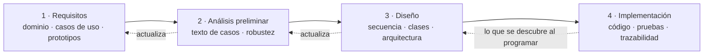
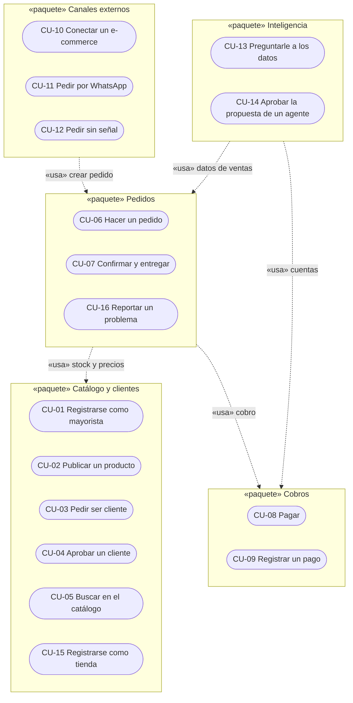
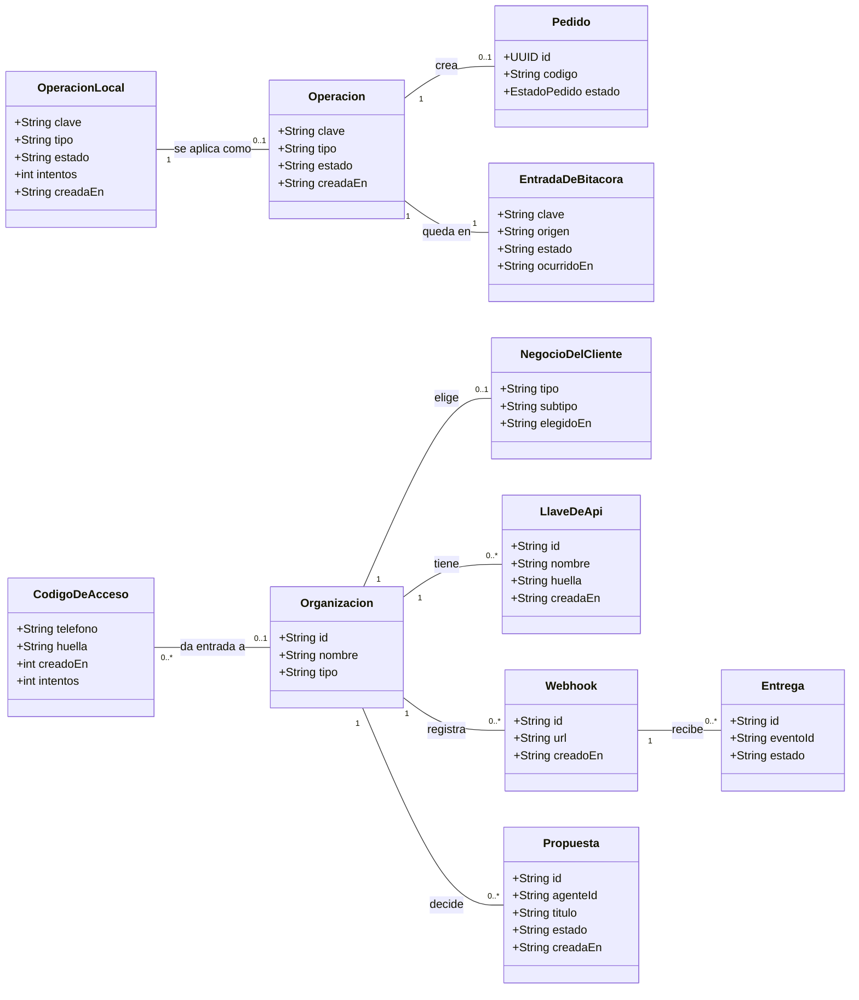
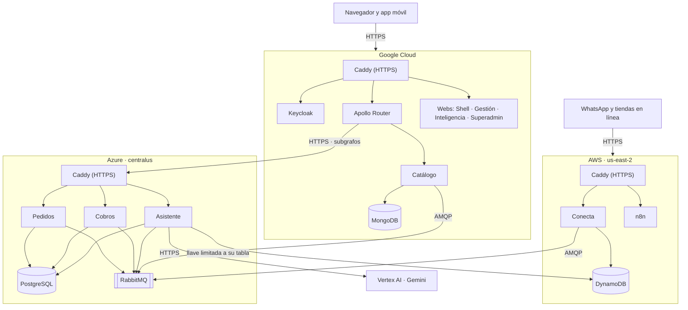

<!-- solo-md:inicio -->
# Documento del proyecto · Abasto (ICONIX)

Este archivo es la **fuente del documento Word** de la materia. Todo cambio del documento se hace aquí y después se regenera el Word:

```bash
cd docsProyecto/generador && node generar-word.mjs
```

El Word sale en `docsProyecto/Abasto_Documento_ICONIX.docx`. El generador convierte los diagramas Mermaid en imágenes. Las líneas `<!-- diagramas: ruta -->` traen los diagramas de esos archivos (por ejemplo, los de `docs/iconix/`), así cada diagrama vive en un solo lugar. Lo que está entre `solo-md:inicio` y `solo-md:fin` (este bloque) no sale en el Word.

## Estado del documento

Actualizado: 07/11/2026.

| Parte | Estado | Qué falta |
|---|---|---|
| Carátula | ⚠️ | Apellidos y registro de Abdalid, sigla de la materia |
| 1. Perfil | ✅ | — |
| 2. Fundamentación teórica | ✅ | — |
| 3. Elementos del SGBD | ✅ | — |
| 4. Seguimiento y control | ✅ | — |
| 5. ICONIX · Requisitos | ✅ | — |
| 6. ICONIX · Análisis y diseño preliminar (robustez) | ✅ | Los 16 casos |
| 7. ICONIX · Diseño (secuencia, clases, arquitectura) | ✅ | — |
| 8. ICONIX · Implementación y pruebas | ✅ | — |
| 9. Despliegue en tres nubes | ⚠️ | Las tres nubes arriba (08/11). Falta el APK de la app con las direcciones de la nube |
| 10. Conclusiones | ✅ | — |
| Anexos | ⚠️ | Códigos QR del repositorio y del Panel (se agregan como imagen cuando estén) |

## Historial

- 10/11/2026 · Revisión contra el manual de ICONIX: ficha de cada caso de uso en el capítulo 6 (en vista de usuario, con poscondiciones), diagrama de paquetes de casos de uso (5.7.1), modelo de dominio actualizado después de la robustez (6.17) y la prueba de cada requisito funcional (5.2).
- 09/11/2026 · Capítulos 8.3.2 y 9: el Analista pregunta de vuelta cuando la pregunta es ambigua, entra a Vertex con una llave de API y reintenta si Vertex no responde.
- 08/11/2026 · Abdalid se suma al equipo: carátula y capítulo 4.1 (organización por áreas, con Abdalid en calidad y documentación). Registros de Andrés y Jhoel en la carátula.
- 08/11/2026 · El modelo de lenguaje de los reportes pasa de Claude (Anthropic) a Gemini en Vertex AI (Google Cloud): capítulos 7 (diagrama de clases del Asistente), 8 (tecnologías y reportes generativos), 9 (diagrama, reglas y costo) y conclusiones.
- 08/11/2026 · Capítulo 9 con Google Cloud desplegado: estado, direcciones nuevas, prueba de la compra y costo. Capítulo 3: la máquina de Google. Capítulo 4: hito del 08/11.
- 08/11/2026 · Capítulos 3 y 9: el reparto de nubes pasa al plan final que decidió Jhoel (Google con Catálogo, Keycloak, Router y webs; AWS con Conecta y n8n). Antes mostraba el reparto temporal.
- 07/11/2026 · Primera versión, armada desde `docs/` (ICONIX, requisitos, trazabilidad, arquitectura, despliegue) y con la estructura de los documentos de referencia de la materia.
<!-- solo-md:fin -->

<!-- portada
universidad: UNIVERSIDAD AUTÓNOMA GABRIEL RENÉ MORENO
facultad: FACULTAD DE INGENIERÍA EN CIENCIAS DE LA COMPUTACIÓN Y TELECOMUNICACIONES
grupo: GRUPO #13
trabajo: SEGUNDO PARCIAL · METODOLOGÍA ICONIX
titulo: ABASTO
subtitulo: Red mayorista B2B para Bolivia con microservicios, microfrontends e inteligencia artificial
materia: INGENIERÍA DE SOFTWARE II
docente: ING. ROLANDO ANTONIO MARTÍNEZ CANEDO
integrantes: QUISPE CABRERA JOSÉ ANDRÉS · Registro: 222009519|RODAS CABRERA JHOEL · Registro: 221045661|ABDALID ⟨apellidos⟩ · Registro: ⟨completar⟩
lugar: SANTA CRUZ DE LA SIERRA - BOLIVIA
fecha: NOVIEMBRE - 2026
-->

# 1. Perfil

## 1.1 Introducción

En Bolivia, buena parte del comercio de barrio se abastece en mercados mayoristas: la tienda, la salteñería o la pensión van al mercado, compran por quintal, fardo, caja o docena y vuelven con la mercadería. Los precios se negocian cara a cara y cambian según quién compra. Casi nada de ese proceso deja registro: el mayorista anota en un cuaderno lo que le fían, no sabe qué producto se le va a acabar y la tienda pierde medio día en cada compra.

**Abasto** es una red mayorista B2B que lleva esa relación a una aplicación. Las tiendas, los productores y los hogares compran al por mayor desde una app en el teléfono: buscan (también con una foto), piden, pagan con QR, a crédito o contra entrega, y siguen el pedido hasta su puerta. Los mayoristas gestionan todo desde un Panel web: productos con precios por presentación, clientes, pedidos, compras, cuentas por cobrar e inteligencia del negocio. Abasto, como empresa, aprueba a los mayoristas y mira la tracción desde un Superadmin.

El sistema está construido sobre una **arquitectura de microservicios** con cinco servicios escritos en tres lenguajes (Spring Boot, Laravel y NestJS), un Panel armado con **microfrontends** (React, Angular y Vue), **GraphQL federado** como única puerta de las aplicaciones, mensajería con **RabbitMQ** y una **saga** que coordina la compra entre tres servicios. Suma **agentes inteligentes** que vigilan el negocio y proponen acciones, **reportes generativos** que se piden por texto o por voz, **IA local** en el teléfono y en el navegador, **machine learning** supervisado y no supervisado, **deep learning** con TensorFlow para reconocer productos por foto y **automatizaciones con n8n**. Todo funciona con mala señal o sin señal, sin registrar nada dos veces.

El desarrollo sigue la metodología **ICONIX**, que va del modelo de dominio y los casos de uso a los diagramas de robustez, secuencia y clases, y de ahí al código, con trazabilidad entre cada paso. Este documento recorre ese camino: el perfil del proyecto, la fundamentación teórica, los elementos de datos, el seguimiento, cada fase de ICONIX, el despliegue en tres nubes y las conclusiones.

## 1.2 Descripción del problema

El mercado mayorista boliviano tiene problemas que se repiten en cada eslabón:

- **Precios privados y negociados.** Cada mayorista maneja precios distintos según el cliente y no quiere publicarlos para todos, ni entrar en una guerra de precios con el puesto de al lado. Las plataformas de comercio electrónico comunes muestran un solo precio público y comparan vendedores, justo lo que el mayorista no quiere.
- **Compra presencial y lenta.** La tienda tiene que ir al mercado para saber qué hay y a cuánto. Pierde tiempo, transporte y ventas mientras su local está cerrado.
- **Crédito informal.** El fiado se anota en cuadernos. El mayorista no sabe cuánto le deben, quién se atrasa ni quién le va a pagar tarde. La tienda no sabe cuánto crédito le queda.
- **Decisiones a ciegas.** El mayorista no ve qué se vende más, qué se le va a acabar ni cuánto pedir al proveedor. Los reportes, si existen, los arma a mano.
- **Mala conectividad.** En mercados y barrios la señal se corta. Una aplicación que se cae o que registra el mismo pedido dos veces al reintentar no sirve.
- **Varios canales.** Muchos pedidos llegan por WhatsApp o desde tiendas en línea, y hay que volver a cargarlos a mano.

Se necesita un sistema que respete la relación comercial privada, que funcione con mala señal, que coordine pedido, stock y cobro sin perder consistencia, y que ayude al mayorista a decidir con datos.

## 1.3 Objetivos

### 1.3.1 Objetivo general

Desarrollar Abasto, una red mayorista B2B para Bolivia basada en microservicios y microfrontends, que permita a las tiendas comprar al por mayor desde una aplicación móvil y a los mayoristas gestionar y entender su negocio con apoyo de inteligencia artificial, aplicando la metodología ICONIX.

### 1.3.2 Objetivos específicos

- Modelar el dominio del comercio mayorista (organizaciones, relación comercial, listas de precios, productos con escalas, pedidos, crédito y cobros) y derivar de él los casos de uso del sistema.
- Diseñar e implementar cinco microservicios en Spring Boot, Laravel y NestJS, cada uno dueño de sus datos, con arquitecturas hexagonal, clean y DDD validadas automáticamente.
- Construir un Panel Mayorista con microfrontends (Shell en React, Gestión en Angular, Inteligencia en Vue) que consuma GraphQL federado, y una sola sesión para todas las aplicaciones.
- Coordinar la compra entre Pedidos, Catálogo y Cobros con una saga orquestada que compense si un paso falla.
- Garantizar el funcionamiento sin señal en el teléfono y en la web, con sincronización e idempotencia.
- Incorporar agentes inteligentes, reportes generativos por texto y voz exportables a Excel, y un servidor MCP seguro.
- Aplicar machine learning supervisado (demanda y mora), no supervisado (segmentos de tiendas) y deep learning con TensorFlow (reconocimiento de productos por foto en el teléfono).
- Automatizar procesos con n8n: pedidos por WhatsApp y ejecución de las acciones aprobadas de los agentes.
- Desplegar el sistema en tres nubes (AWS, Azure y Google Cloud) de forma que cada módulo se actualice sin reiniciar el resto.

## 1.4 Alcance

Abasto tiene tres interfaces y cinco servicios. Cada módulo del alcance indica dónde vive.

### 1.4.1 App de clientes (Expo, Android e iPhone)

Es el producto que usan las tiendas, los productores y los hogares. Entrar con el celular y un código, elegir el tipo de negocio, buscar productos por texto o por foto, ver a los vendedores, armar el carrito, pagar con QR, a crédito o contra entrega, seguir el pedido y reportar un problema. Incluye «Mi negocio» (inventario que se llena solo con lo que se compra, caja, fiado, recetas y planificador), un asistente de compra con IA local y una bandeja que guarda los pedidos sin señal.

### 1.4.2 Gestionar productos y red privada de precios (Catálogo)

El mayorista publica productos con escalas por presentación (unidad, cuarta, docena, caja, fardo) y foto. Una tienda solo ve los precios de un mayorista que la aprobó, con su lista: NUEVOS 100 %, FRECUENTES 97 % o VIP 95 %. Nunca se comparan mayoristas ni se ordena por el más barato.

### 1.4.3 Gestionar clientes y crédito (Catálogo y Cobros)

El mayorista aprueba o rechaza las solicitudes de las tiendas, asigna la lista de precios y, si quiere, una línea de crédito con plazo de 15 o 30 días.

### 1.4.4 Gestionar pedidos (Pedidos)

La tienda pide; la saga reserva el stock, cobra y deja el pedido esperando al mayorista, que lo confirma o rechaza y lo lleva por preparación, despacho y entrega. Incluye la lista de compras del día y los reclamos.

### 1.4.5 Gestionar cobros y cuentas por cobrar (Cobros)

Cobro por QR que vence a los 30 minutos, autorización y liberación de crédito, cuentas por cobrar por cada pedido a crédito o contra entrega y registro de pagos en efectivo, transferencia o QR.

### 1.4.6 Conectar canales externos (Conecta)

API pública con llaves para que una tienda conecte su e-commerce (plugin de WooCommerce), avisos firmados con reintentos, servidor MCP de compras, pedidos por WhatsApp a través de n8n y la sincronización de las bandejas sin señal, todo con idempotencia.

### 1.4.7 Inteligencia del negocio (Asistente)

Reportes generativos por texto o voz con tabla, gráfico y exportación a Excel; tableros con predicciones de machine learning; agentes de Cobranza, Reposición, Catálogo y Analista que proponen acciones para aprobar; servidor MCP de reportes; proyector que arma la base de reportes con los eventos del sistema.

### 1.4.8 Administración de Abasto (Superadmin)

Verificar mayoristas, suspender tiendas, resolver reclamos, ver la tracción (pedidos, ventas, tiendas que repiten), las integraciones y los usuarios.

### 1.4.9 Machine learning (procesos programados)

Predicción de demanda, riesgo de mora y segmentos de tiendas, que corren de noche y escriben en la base de reportes; entrenamiento del modelo de visión que la app usa sin internet.

## 1.5 Metodología ICONIX

### 1.5.1 Qué es ICONIX

ICONIX es un proceso de desarrollo orientado a objetos, dirigido por casos de uso, propuesto por Doug Rosenberg. Usa un subconjunto pequeño de UML (modelo de dominio, casos de uso, robustez, secuencia y clases) y exige **trazabilidad**: cada clase sale de un objeto del diagrama de robustez, cada objeto de robustez sale del texto de un caso de uso y cada caso de uso se apoya en el modelo de dominio. Es iterativo e incremental, como los métodos ágiles, pero pone más cuidado en el análisis y el diseño antes de escribir código.

### 1.5.2 Por qué ICONIX en Abasto

- **El docente lo pidió** para el segundo parcial.
- **La arquitectura es el riesgo, no el código.** Con cinco servicios, tres frameworks de frontend y una saga, un error de diseño se paga caro. ICONIX obliga a pensar los mensajes entre piezas (secuencia) antes de programarlas.
- **Trazabilidad requisito → caso de uso → código → prueba.** Cada caso de uso de Abasto tiene su robustez, su secuencia, las clases reales que lo implementan y la prueba automática que lo cubre.
- **Pocos diagramas, todos útiles.** Un equipo de tres personas no puede mantener decenas de diagramas. ICONIX usa solo los necesarios, y en Abasto se guardan como texto (Mermaid) dentro del repositorio, se revisan como el código y la CI comprueba que se dibujen.

### 1.5.3 Fases y revisiones

| Fase | Qué se produce | Revisión al cerrar |
|---|---|---|
| 1. Análisis de requisitos | Requisitos funcionales y no funcionales, modelo de dominio, prototipos de interfaz, diagrama y lista de casos de uso | Revisión de requisitos |
| 2. Análisis y diseño preliminar | Texto de cada caso de uso (curso básico y alternos) y su diagrama de robustez; modelo de dominio actualizado | Revisión del diseño preliminar |
| 3. Diseño | Diagrama de secuencia de cada caso, diagrama de clases por servicio, arquitectura | Revisión crítica del diseño |
| 4. Implementación | Código, pruebas unitarias, de integración y punta a punta, trazabilidad | Entrega |



Los capítulos 5 a 8 siguen estas cuatro fases.

# 2. Fundamentación teórica

## 2.1 Microservicios

Un microservicio es una aplicación pequeña e independiente que resuelve una parte del negocio, tiene su propia base de datos y se comunica con los demás por la red. Frente al monolito, se puede desarrollar, probar, desplegar y escalar cada parte por separado, y cada una puede usar el lenguaje que más le conviene.

### 2.1.1 Patrones que usa Abasto

- **Base de datos por servicio.** Ningún servicio lee la base de otro: pide los datos por GraphQL o los recibe por eventos.
- **API Gateway.** Las aplicaciones hablan con un solo punto, el Apollo Router, que compone las respuestas de varios servicios.
- **Mensajería asíncrona.** Los servicios se avisan con eventos y comandos por RabbitMQ.
- **Outbox e inbox.** El servicio guarda el cambio y el evento en la misma transacción; un publicador lo manda después. Quien lo recibe anota su id para no procesarlo dos veces.
- **Saga.** Una transacción que cruza varios servicios se divide en pasos locales con compensaciones (ver 2.6).

### 2.1.2 Beneficios y limitaciones

| Beneficios | Limitaciones |
|---|---|
| Despliegue y escalado independiente por módulo | Más piezas que operar y vigilar |
| Cada servicio usa la tecnología que le conviene | Consistencia eventual: los datos tardan en propagarse |
| Un fallo queda aislado en su servicio | No hay transacciones ACID entre servicios: hace falta una saga |
| Equipos trabajan en paralelo sin pisarse | Más contratos que versionar (GraphQL, eventos, REST) |

## 2.2 Microfrontends

Los microfrontends llevan la idea de los microservicios a la interfaz: una aplicación web se arma con partes que se desarrollan y despliegan por separado, incluso con frameworks distintos. Un **shell** (contenedor) carga cada parte en tiempo de ejecución. En Abasto, el Shell en React carga Gestión (Angular) e Inteligencia (Vue) como **Web Components**: cada una se registra como una etiqueta HTML propia (`<abasto-gestion>`, `<abasto-inteligencia>`) con Shadow DOM para que sus estilos no se mezclen. La lista de remotos se lee al cargar (`remotos.json`), así que se puede publicar una nueva versión de Gestión sin tocar el Shell.

## 2.3 GraphQL y federación

GraphQL es un lenguaje de consulta para APIs: el cliente pide exactamente los campos que necesita y recibe solo eso, en una sola llamada. Resuelve dos problemas típicos de REST: traer de más (*overfetching*) y tener que hacer varias llamadas para armar una pantalla (*underfetching*). Con **Apollo Federation 2**, cada servicio publica su parte del esquema (subgrafo) y el **Router** las junta en un supergrafo: una pantalla pide el pedido (Pedidos), sus productos (Catálogo) y su cobro (Cobros) en una sola consulta.

## 2.4 REST, OpenAPI y AsyncAPI

REST se usa donde conviene un contrato simple y universal: la API pública de Conecta para los e-commerce y la API del Asistente para reportes y agentes. Ambas se describen con **OpenAPI**. Los eventos y comandos de RabbitMQ se describen con **AsyncAPI**, que cumple el mismo papel para la mensajería.

## 2.5 Arquitecturas de código: DDD, hexagonal y clean

- **DDD (Domain-Driven Design).** Pone el modelo del negocio en el centro: agregados que protegen sus reglas, objetos valor (como `Dinero`), eventos de dominio y un lenguaje común entre negocio y código.
- **Hexagonal (puertos y adaptadores).** El núcleo define puertos (interfaces) y el mundo exterior se conecta con adaptadores: GraphQL, base de datos, mensajería. El núcleo no conoce ninguna tecnología.
- **Clean architecture.** Capas concéntricas (entidades, casos de uso, adaptadores, frameworks) con una regla: las dependencias apuntan siempre hacia adentro. El framework queda en el borde.

Las tres comparten la idea de proteger el dominio; difieren en qué ponen en primer plano. La elección de cada una para cada servicio se justifica en 7.4.

## 2.6 Transacciones distribuidas: el patrón saga

En un monolito, si un paso falla se hace *rollback*. Entre microservicios no se puede: cada uno ya confirmó su parte en su propia base. Una **saga** divide la transacción en pasos locales; si uno falla, se ejecutan **compensaciones** que deshacen lo anterior (liberar el stock reservado, devolver el crédito). Puede ser **coreografiada** (cada servicio reacciona a eventos) u **orquestada** (un coordinador decide el siguiente paso). Abasto usa una saga orquestada por Pedidos, con plazos para lo que se queda esperando.

## 2.7 Sin señal: PWA, sincronización e idempotencia

- **PWA (aplicación web progresiva).** Una web que se instala y funciona sin conexión gracias a un *service worker* que guarda los archivos y responde desde la caché.
- **Bandeja de salida (outbox del cliente).** Lo que se hace sin señal queda guardado en el equipo y se envía cuando vuelve la conexión.
- **Idempotencia.** Repetir una operación no produce un efecto adicional. Cada escritura que llega de afuera trae una `Idempotency-Key`; si el servidor ya la aplicó, devuelve la respuesta original. Así, un reintento por mala señal nunca crea un segundo pedido ni cobra dos veces.

## 2.8 Sesión única: OIDC y Keycloak

**OpenID Connect** es un estándar de identidad sobre OAuth 2.0. **Keycloak** es un servidor de identidad de código abierto que lo implementa: emite tokens firmados que cada servicio valida con las llaves públicas del realm (JWKS). Con **PKCE**, las aplicaciones públicas (web y móvil) inician sesión sin guardar secretos. Entrar a una aplicación abre las demás sin volver a pedir la contraseña.

## 2.9 Inteligencia artificial

### 2.9.1 Agentes inteligentes

Un agente es un programa con una **misión**, unas **habilidades** (herramientas que puede usar) y **límites** (lo que no puede hacer solo). En Abasto los agentes vigilan el negocio («monitorear mi negocio»), encuentran situaciones (una cuenta que vence mañana, un producto que se va a acabar) y **proponen** acciones. Una persona aprueba y n8n ejecuta.

### 2.9.2 Reportes generativos

Un modelo de lenguaje convierte una pregunta en lenguaje natural («¿qué tiendas me tienen que pagar mañana?») en una consulta SQL. Una **guardia** revisa la consulta antes de ejecutarla (solo lectura, solo tablas permitidas) y el resultado se muestra en tabla y gráfico y se exporta a Excel.

### 2.9.3 MCP (Model Context Protocol)

Protocolo abierto para que un asistente de IA use herramientas y datos externos de forma estándar. Un servidor MCP publica herramientas; un cliente (por ejemplo, un asistente de IA de escritorio) las llama. Como da acceso a datos reales, exige autenticación, permisos mínimos, límites y auditoría.

### 2.9.4 IA local

Modelos que corren dentro del dispositivo, sin enviar datos a un servidor y sin internet: en el teléfono (TensorFlow Lite, ML Kit, modelos de lenguaje pequeños con llama.cpp) y en el navegador (Whisper con transformers.js y ONNX).

## 2.10 Machine learning y deep learning

- **Supervisado:** aprende de ejemplos con respuesta conocida. Regresión con *Gradient Boosting* para la demanda; regresión logística para la probabilidad de mora.
- **No supervisado:** encuentra grupos sin etiquetas. *K-means* sobre recencia, frecuencia y monto (RFM) para segmentar tiendas.
- **Deep learning:** redes neuronales profundas. *Transfer learning* sobre **MobileNetV3** con TensorFlow para reconocer productos en fotos, exportado a **TFLite** para correr en el teléfono.

## 2.11 Automatización con n8n

n8n es una herramienta de automatización por flujos (*workflows*): nodos que reciben un disparador (un webhook, un mensaje), transforman datos y llaman a otros servicios. En Abasto automatiza el pedido por WhatsApp y la ejecución de las acciones que aprueba el mayorista.

## 2.12 Contenedores y nube

**Docker** empaqueta cada servicio con todo lo que necesita en una imagen que corre igual en cualquier máquina; **Docker Compose** levanta varios contenedores juntos. Los proveedores de nube (**AWS**, **Microsoft Azure**, **Google Cloud**) alquilan máquinas virtuales y servicios administrados (como DynamoDB) por uso. Abasto corre un contenedor por módulo en máquinas virtuales de las tres nubes, con **Caddy** como entrada HTTPS.

## 2.13 Herramientas CASE y de apoyo

| Herramienta | Uso en Abasto |
|---|---|
| Mermaid | Diagramas UML de ICONIX como texto dentro del repositorio |
| Enterprise Architect | Los diagramas UML de ICONIX (dominio, casos de uso, robustez, secuencia, clases y despliegue), generados desde los de Mermaid |
| Claude Code | Asistente de programación con IA, usado por el equipo |
| GitHub y GitHub Actions | Control de versiones e integración continua |
| Trello | Tablero de tareas por fase |
| Claude Design | Maquetas navegables de las interfaces |
| Visual Studio Code, Android Studio | Edición de código y compilación de la app |
| Rover | Composición del supergrafo GraphQL |
| Playwright | Pruebas punta a punta del sistema levantado |

# 3. Elementos del SGBD

Cada servicio elige la base que mejor encaja con sus datos. Se usan tres sistemas de bases de datos, como pidió el docente, y ninguno es MySQL.

## 3.1 Hardware

**Desarrollo.** Cada integrante levanta todo el sistema en su computadora con Docker. Cada contenedor tiene un tope de memoria y la máquina de WSL tiene 6 GB; en reposo todo usa unos 2 GB.

**Producción (demostración).** Una máquina virtual por nube, con Ubuntu 24.04 y discos de 30 GB:

| Nube | Máquina | Qué guarda |
|---|---|---|
| Google Cloud | Compute Engine e2-standard-2 (2 vCPU, 8 GB) | MongoDB del Catálogo y Postgres de Keycloak |
| AWS | EC2 m7i-flex.large (2 vCPU, 8 GB) | DynamoDB administrado (Conecta y Asistente) |
| Azure | Standard_B2pls_v2 (2 vCPU ARM, 4 GB + 4 GB de swap) | Postgres de Pedidos, Cobros y reportes |

## 3.2 Software

### 3.2.1 PostgreSQL 17

Base relacional para los datos que necesitan transacciones e integridad: **Pedidos** (pedidos, líneas, saga, outbox e inbox, con migraciones Flyway), **Cobros** (líneas de crédito, cobros QR, cuentas por cobrar y pagos, con Prisma), la base **reportes** del Asistente (proyecciones y predicciones del ML) y **Keycloak**. Cada servicio tiene su propia base y su propio usuario. La base de reportes tiene un rol de solo lectura (`mcp_lector`) con **seguridad por fila** (RLS): cada empresa ve solo sus filas.

### 3.2.2 MongoDB 8

Base documental para el **Catálogo**. Un producto lleva una lista variable de escalas de precio, usos y datos de abastecimiento, que encajan naturalmente en un documento. Corre como *replica set* de un nodo para permitir transacciones al reservar stock.

### 3.2.3 DynamoDB

Base clave-valor administrada de AWS. **Conecta** guarda ahí las claves de idempotencia con una escritura condicional (si la clave ya existe, no se escribe otra vez) y la bitácora de lo que entra de afuera. El **Asistente** guarda las propuestas de los agentes y la auditoría de cada consulta. En desarrollo se usa DynamoDB Local; en la nube, el DynamoDB real de AWS.

### 3.2.4 Propiedad de los datos

| Dato | Dueño | Base |
|---|---|---|
| Pedidos, líneas, saga, reclamos | Pedidos | PostgreSQL `pedidos` |
| Organizaciones, productos, escalas, relaciones comerciales | Catálogo | MongoDB |
| Crédito, cobros QR, cuentas por cobrar, pagos, «Mi negocio» | Cobros | PostgreSQL `cobros` |
| Idempotencia, bitácora, llaves de API, avisos | Conecta | DynamoDB |
| Reportes proyectados, predicciones | Asistente y ML | PostgreSQL `reportes` |
| Propuestas de los agentes, auditoría | Asistente | DynamoDB |
| Usuarios, roles, sesión | Keycloak | PostgreSQL `keycloak` |

# 4. Mecanismo de seguimiento y control

## 4.1 Organización

El equipo tiene tres integrantes y una estructura descentralizada democrática: no hay un jefe fijo y cada área tiene un coordinador. Desde el 29/10 el trabajo se reparte por área: **Andrés coordina lo comercial**, **Jhoel la inteligencia artificial** y **Abdalid la calidad y la documentación**. El archivo `.github/CODEOWNERS` registra el dueño de cada carpeta.

| Integrante | Responsabilidad |
|---|---|
| José Andrés Quispe Cabrera | App de clientes (pantallas, sesión, modo sin señal); Panel Shell y Gestión; Superadmin; servicios Catálogo, Pedidos, Cobros y Conecta; n8n de WhatsApp; infraestructura, Router, Keycloak y CI |
| Jhoel Rodas Cabrera | IA local del teléfono (modelo TFLite, ML Kit, asistente de compra); IA local del navegador (Whisper); Panel de Inteligencia; servicio Asistente (agentes, reportes generativos, MCP, proyector); machine learning; despliegue en tres nubes |
| Abdalid Escobar Callecusi | Calidad y documentación: modelado ICONIX, pruebas de aceptación sobre el despliegue y documento del proyecto; apoyo en el proyector de reportes del Asistente (saldo de las cuentas por cobrar) |

Los casos de uso, los requisitos del docente y la arquitectura se deciden entre los tres, y no se reabren sin hablarlo.

## 4.2 Herramientas de gestión

- **Trello** (tablero «abasto»): una tarjeta por tarea, agrupadas por fase.
- **GitHub** (`AndyQdev/abasto`): un solo repositorio con todo el sistema. Todos trabajan directo en `main` con commits pequeños y *Conventional Commits*.
- **Archivos de estado** (`docs/equipo/andres.md` y `jhoel.md`): qué está haciendo cada uno, qué terminó, qué cambió en los contratos y qué necesita del otro. Si uno toca una carpeta del otro, lo avisa ahí en el mismo commit.
- **Comunicación:** WhatsApp y reuniones presenciales.

## 4.3 Ritmo de trabajo e hitos

ICONIX se aplicó de forma iterativa: cada caso de uso pasó por sus cuatro fases, y el modelo de dominio se actualizó con lo que se aprendía al programar.

| Fecha | Hito |
|---|---|
| 15/10/2026 | Clase con los requisitos del segundo parcial |
| 21/10/2026 | Primer commit: monorepositorio, Docker, Keycloak y esqueletos de los servicios |
| 29/10/2026 | Replanteo: la app de clientes pasa a ser el producto; reparto comercial / IA |
| 03/11/2026 | Saga de compra completa, cuentas por cobrar, agentes con n8n |
| 06/11/2026 | Los 16 casos de uso con pantalla, prueba y diagramas ICONIX |
| 07/11/2026 | Despliegue en AWS y Azure |
| 08/11/2026 | Despliegue en Google Cloud: Catálogo y la puerta de entrada (Keycloak, Router y webs) |
| 10/11/2026 | Presentación |

## 4.4 Indicadores de seguimiento

- **Casos de uso terminados.** Un caso está terminado cuando tiene su texto, robustez, secuencia, código y una prueba automática que pasa en la CI.
- **Requisitos del docente cumplidos.** `docs/requisitos.md` y `docs/trazabilidad.md` marcan cada requisito con el caso de uso, el código y la prueba que lo demuestran.
- **CI en verde.** GitHub Actions corre las pruebas de lo que cambió (por carpeta); las pruebas punta a punta corren antes de integrar a `main`.
- **Reglas de arquitectura.** ArchUnit, Deptrac y dependency-cruiser hacen fallar la CI si una capa importa lo que no debe.

# 5. ICONIX · Análisis de requisitos

## 5.1 Requisitos del docente y dónde se cumplen

| # | Requisito | Dónde se cumple en Abasto |
|---|---|---|
| 1 | Microservicios: al menos Spring Boot, NestJS y PHP | Pedidos (Spring Boot), Catálogo (Laravel), Cobros, Conecta y Asistente (NestJS) |
| 2 | Microfrontends con un shell y al menos React, Angular y un tercero | Panel: Shell React que carga Gestión (Angular) e Inteligencia (Vue) |
| 3 | GraphQL obligatorio en el sistema de gestión | Gestión lee y escribe por el Apollo Router (federación de Pedidos, Catálogo y Cobros) |
| 4 | Funcionalidades construidas como agentes | Agentes de Cobranza, Reposición, Catálogo y Analista en el Asistente (CU-14) |
| 5 | IA local en dispositivos móviles | App: TFLite propio, ML Kit y modelo de lenguaje local según el teléfono |
| 6 | IA local en el navegador | Inteligencia: Whisper transcribe la voz dentro del navegador |
| 7 | Funcionar sin señal en web y móvil, con sincronización | Panel PWA; bandeja de pedidos en la app (CU-12) |
| 8 | Idempotencia | `Idempotency-Key` en toda escritura externa; Conecta en DynamoDB; inbox en cada servicio |
| 9 | Transacción entre tres o más microservicios | Saga de compra: Pedidos → Catálogo → Cobros, con compensación (CU-06) |
| 10 | Machine learning supervisado y no supervisado | Demanda (Gradient Boosting), mora (regresión logística), segmentos (K-means) |
| 11 | Deep learning con TensorFlow sobre imágenes | MobileNetV3 con transfer learning → TFLite en la app (CU-05) |
| 12 | Automatización con n8n | Pedido por WhatsApp (CU-11) y acciones aprobadas de los agentes (CU-14) |
| 13 | Reportes generativos por texto o voz, en pantalla y en Excel | Inteligencia › Reportes (CU-13) |
| 14 | Protocolo MCP, con cuidado | `abasto-reportes` (Asistente) y `abasto-compras` (Conecta) |
| 15 | PostgreSQL, MongoDB y DynamoDB, sin MySQL | Ver capítulo 3 |
| 16 | Una sola cuenta para todas las aplicaciones | Keycloak con OIDC + PKCE |
| 17 | Arquitecturas DDD, hexagonal y clean | Cobros (DDD), Pedidos (hexagonal), Catálogo (clean) |
| 18 | Arquitectura de datos para reportes | CQRS: el proyector arma la base `reportes` con los eventos |
| 19 | Metodología ICONIX | Capítulos 5 a 8 y `docs/iconix/` |
| 20 | Despliegue en Google Cloud, Azure y AWS sin reiniciar todo al cambiar un módulo | Capítulo 9 |

## 5.2 Requisitos funcionales

| Código | Requisito | Caso de uso | Prueba que lo demuestra |
|---|---|---|---|
| RF-01 | Registrar mayoristas y verificarlos antes de que vendan | CU-01 | `RegistroDeOrganizacionesTest.php`, `registro-mayorista.spec.ts` |
| RF-02 | Publicar productos con escalas por presentación, stock y foto | CU-02 | `GestionDeProductosTest.php`, `FotoDeProductoTest.php` |
| RF-03 | Pedir ser cliente de un mayorista | CU-03 | `RedPrivadaTest.php`, `red-privada.spec.ts` |
| RF-04 | Aprobar clientes con lista de precios y crédito | CU-04 | `asignar-credito.spec.ts`, `credito.spec.ts` |
| RF-05 | Buscar en el catálogo por texto o por foto, sin internet | CU-05 | `modelo.test.ts`, `imagen.test.ts` |
| RF-06 | Hacer un pedido coordinado entre stock y cobro | CU-06 | `SagaDeCompraTest.java`, `compra.spec.ts` |
| RF-07 | Confirmar, rechazar y entregar pedidos | CU-07 | `SagaDeCompraTest.java`, `compra.spec.ts` |
| RF-08 | Pagar con QR, a crédito o contra entrega | CU-08 | `cobro-qr.spec.ts`, `compra.spec.ts` |
| RF-09 | Registrar pagos de cuentas por cobrar | CU-09 | `cuentas-por-cobrar.spec.ts`, `cuentas.spec.ts` |
| RF-10 | Conectar un e-commerce por API, WooCommerce o MCP | CU-10 | `integraciones.spec.ts`, `tienda-en-linea.spec.ts` |
| RF-11 | Recibir pedidos por WhatsApp | CU-11 | `sincronizar-lote.spec.ts`, `n8n-whatsapp.spec.ts` |
| RF-12 | Pedir sin señal y sincronizar al volver | CU-12 | `bandeja.spec.ts`, `sincronizar-lote.spec.ts` |
| RF-13 | Responder preguntas de negocio por texto o voz y exportarlas a Excel | CU-13 | `responder-pregunta.spec.ts`, `guardia-sql.spec.ts`, `ia-navegador-sin-senal.spec.ts` |
| RF-14 | Proponer acciones con agentes y ejecutarlas al aprobarlas | CU-14 | `agentes.spec.ts`, `Agentes.spec.ts` |
| RF-15 | Registrarse como tienda con el celular | CU-15 | `EntrarConTelefonoTest.php`, `registro-tienda.spec.ts` |
| RF-16 | Reportar y resolver problemas con un pedido | CU-16 | `ReclamosServicioTest.java`, `reclamos.spec.ts` |

Cada requisito funcional se demuestra con una prueba automática del servicio y, cuando cruza servicios, con una de punta a punta (Playwright). Todas las pruebas corren con `pnpm test:todo` y `pnpm e2e`.

## 5.3 Requisitos no funcionales

- **Disponibilidad con mala señal.** La app y el Panel siguen funcionando sin conexión y sincronizan al volver.
- **Consistencia.** Ninguna operación se registra dos veces; la compra se deshace si un paso falla.
- **Seguridad.** Sesión con tokens firmados; cada servicio filtra por la empresa del token (`org_id`); la base de reportes aplica seguridad por fila; las consultas generadas por IA pasan por una guardia de solo lectura con tope de 5 segundos y 1.000 filas, y quedan auditadas.
- **Privacidad de precios.** Una tienda solo ve los precios del mayorista que la aprobó.
- **Mantenibilidad.** Cada servicio respeta su arquitectura y la CI lo comprueba; cada caso de uso tiene prueba automática.
- **Despliegue independiente.** Cada módulo es su propio contenedor: actualizarlo no reinicia a los demás.
- **Usabilidad.** Interfaz en español de Bolivia con tuteo; montos «Bs 1.728,00», fechas dd/mm/aaaa y cantidades siempre con unidad.

## 5.4 Actores del sistema

| Actor | Descripción |
|---|---|
| **Tienda** (o persona) | Compra al por mayor desde la app: tiendas de barrio, productores (salteñerías, panaderías, pensiones) y hogares |
| **Mayorista** | Vende: publica productos, aprueba clientes, confirma pedidos, cobra y usa la inteligencia del negocio desde el Panel |
| **Admin de Abasto** | Verifica mayoristas, suspende tiendas, resuelve reclamos y mira la tracción desde el Superadmin |
| **WhatsApp / n8n** | Canal externo que convierte un mensaje en un pedido |
| **E-commerce o agente de IA** | Tienda en línea o asistente que compra por la API o por MCP con la llave de una tienda |
| **Agentes del sistema** | Vigilan el negocio y dejan propuestas para que el mayorista decida |

## 5.5 Prototipos de interfaz

Las pantallas web salen de maquetas navegables hechas antes de programar (`docs/uix-mockup/`): el Panel Mayorista, el Superadmin y la app. El Panel vigente es la versión 7 «Halo»: cabecera verde bosque, menú blanco flotante, accesos a la derecha y tarjetas grandes.


## 5.6 Modelo de dominio

El modelo de dominio muestra los conceptos del negocio tal como existen en el código de Catálogo, Pedidos y Cobros, con sus atributos clave y multiplicidades.

Fuente: `docs/iconix/dominio.md`.

<!-- diagramas: docs/iconix/dominio.md -->

Conceptos principales:

- **Organizacion.** Tienda, mayorista u organización de la casa (Abasto); `tipo` distingue el papel y `verificacion` guarda el estado.
- **RelacionComercial.** Une una tienda con un mayorista y guarda la lista de precios. Solo una relación `APROBADA` permite ver precios.
- **Producto y EscalaDePrecio.** Un producto tiene una o más escalas (presentación, unidades, precio). Puede ser de `STOCK` o `BAJO_PEDIDO`.
- **Pedido, LineaDePedido y SagaDeCompra.** El pedido lleva su clave de idempotencia y sigue la máquina de estados de la saga.
- **ReservaDeStock.** La respuesta de Catálogo a la saga: qué se reservó y a qué precio.
- **LineaDeCredito, CobroQr, CuentaPorCobrar y Pago.** El lado del dinero, en Cobros. `Dinero` siempre en centavos.
- **Reclamo.** Un problema reportado sobre un pedido.

## 5.7 Casos de uso

<!-- diagramas: docs/iconix/casos-de-uso.md -->

| Caso | Actor | Interfaz | Servicios | Dueño |
|---|---|---|---|---|
| CU-01 Registrarse como mayorista y ser verificado | Mayorista → Admin | Panel (registro) → Superadmin | Catálogo, Keycloak | Andrés |
| CU-02 Publicar un producto con escalas y foto | Mayorista | Panel › Gestión | Catálogo | Andrés |
| CU-03 Pedir ser cliente de un mayorista | Tienda | App | Catálogo | Andrés |
| CU-04 Aprobar un cliente con lista de precios y crédito | Mayorista | Panel › Gestión | Catálogo, Cobros | Andrés |
| CU-05 Buscar en el catálogo (texto o foto) | Tienda | App | Catálogo + IA local | Andrés · Jhoel |
| CU-06 Hacer un pedido | Tienda | App | Pedidos, Catálogo, Cobros | Andrés |
| CU-07 Confirmar o rechazar un pedido y entregarlo | Mayorista | Panel › Gestión | Pedidos | Andrés |
| CU-08 Pagar con QR, a crédito o contra entrega | Tienda | App | Cobros | Andrés |
| CU-09 Registrar un pago de una cuenta por cobrar | Mayorista | Panel › Gestión | Cobros | Andrés |
| CU-10 Conectar un e-commerce (API, WooCommerce, MCP) | Tienda | App | Conecta | Andrés |
| CU-11 Pedir por WhatsApp | Tienda | WhatsApp → n8n | Conecta, Pedidos | Andrés |
| CU-12 Pedir sin señal | Tienda | App | Conecta, Pedidos | Andrés |
| CU-13 Preguntarle a los datos (texto o voz) | Mayorista | Panel › Inteligencia | Asistente + IA del navegador | Jhoel |
| CU-14 Aprobar la propuesta de un agente | Mayorista | Panel › Inteligencia | Asistente, n8n | Jhoel |
| CU-15 Registrarse como tienda | Tienda | App | Catálogo, Keycloak | Andrés |
| CU-16 Reportar un problema con un pedido | Tienda → Admin | App → Superadmin | Pedidos | Andrés |

### 5.7.1 Paquetes de casos de uso

Los 16 casos se agrupan en un paquete por módulo, el mismo corte que los microservicios. Cada paquete se puede leer, diseñar y probar por separado. Las flechas punteadas muestran qué paquete usa a otro.

| Paquete | Casos de uso | Servicio |
|---|---|---|
| Catálogo y clientes | CU-01, CU-02, CU-03, CU-04, CU-05, CU-15 | Catálogo |
| Pedidos | CU-06, CU-07, CU-16 | Pedidos |
| Cobros | CU-08, CU-09 | Cobros |
| Canales externos | CU-10, CU-11, CU-12 | Conecta |
| Inteligencia | CU-13, CU-14 | Asistente |



# 6. ICONIX · Análisis y diseño preliminar

En esta fase cada caso de uso se escribe con su curso básico y sus cursos alternos, y se dibuja su **diagrama de robustez**: el actor habla con una **frontera** (pantalla), la frontera con **controles** (la lógica) y los controles con **entidades** (los datos). Las reglas de ICONIX se respetan: un actor solo habla con fronteras, y las entidades solo con controles. Los nombres son los de las clases reales del código.

Cada caso tiene su **ficha de caso de uso** (nombre, autor, fecha, descripción, actores, precondiciones, flujo normal, flujos alternativos y poscondiciones), escrita desde lo que ve el usuario, y a continuación su diagrama de robustez. Los flujos alternativos se numeran con el paso del que salen: «4a» es lo que pasa si el paso 4 no sale bien. El detalle técnico de cada caso (clases y mensajes de error exactos) está en `docs/iconix/casos-de-uso.md`.

## 6.1 CU-01 · Registrarse como mayorista y ser verificado

| Nombre | CU-01 · Registrarse como mayorista y ser verificado |
|---|---|
| Autor | Andrés Quispe |
| Fecha | 06/11/2026 |
| Descripción | Una empresa mayorista se registra en el Panel y Abasto la verifica antes de que pueda vender. |
| Actores | Mayorista y Admin de Abasto. |
| Precondiciones | Ninguna: el registro es público. |
| Flujo normal | 1. El mayorista abre «Registra tu empresa» en el Panel.<br>2. El sistema muestra el formulario: empresa, NIT, ciudad, representante, teléfono, correo y contraseña.<br>3. El mayorista llena los datos y los envía.<br>4. El sistema valida los datos, comprueba que el NIT y el correo no estén en uso, crea la cuenta y deja la empresa «en revisión».<br>5. El sistema le muestra al mayorista que su cuenta está en revisión.<br>6. El admin abre Superadmin › Mayoristas, revisa el NIT, habla con el representante y toca «Verificar».<br>7. El sistema marca la empresa como verificada. |
| Flujos alternativos | 4a. Si faltan datos o no son válidos, el sistema marca qué corregir.<br>4b. Si el NIT o el correo ya están registrados, el sistema lo avisa y no crea la cuenta.<br>6a. Si el admin rechaza, el sistema le pide el motivo; el mayorista lo ve al entrar al Panel. |
| Poscondiciones | La empresa queda verificada y sus productos aparecen en la app. |

<!-- diagramas: docs/iconix/robustez/CU-01.md -->

## 6.2 CU-02 · Publicar un producto con escalas y foto

| Nombre | CU-02 · Publicar un producto con escalas y foto |
|---|---|
| Autor | Andrés Quispe |
| Fecha | 06/11/2026 |
| Descripción | El mayorista publica un producto con su precio por presentación (unidad, docena, caja…), su stock y su foto. |
| Actores | Mayorista. |
| Precondiciones | El mayorista está verificado y entró al Panel. |
| Flujo normal | 1. El mayorista abre Gestión › Productos.<br>2. El sistema muestra sus productos.<br>3. El mayorista toca «Nuevo producto».<br>4. El sistema muestra el formulario.<br>5. El mayorista escribe código, nombre, rubro, descripción, stock y si lo tiene en depósito o lo consigue bajo pedido; agrega una o más escalas (presentación, unidades y precio) y la foto.<br>6. El sistema valida los datos y guarda el producto: con stock queda activo; sin stock queda «sin stock», salvo que sea bajo pedido.<br>7. El sistema agrega el producto a la lista. |
| Flujos alternativos | 5a. Si no sube foto, la app muestra la ilustración de su rubro.<br>6a. Si falta el código, el stock es negativo, una escala no tiene unidades o el precio no es mayor a cero, el sistema dice qué corregir.<br>6b. Si ya tiene un producto con ese código, el sistema lo avisa y no lo guarda. |
| Poscondiciones | El producto queda publicado y las tiendas que el mayorista aprobó lo ven con su precio. |

<!-- diagramas: docs/iconix/robustez/CU-02.md -->

## 6.3 CU-03 · Pedir ser cliente de un mayorista

| Nombre | CU-03 · Pedir ser cliente de un mayorista |
|---|---|
| Autor | Andrés Quispe |
| Fecha | 06/11/2026 |
| Descripción | Una tienda le pide a un mayorista que la acepte como cliente para ver sus precios. |
| Actores | Tienda. |
| Precondiciones | La tienda entró a la app y el mayorista está verificado. |
| Flujo normal | 1. La tienda abre la ficha del vendedor.<br>2. El sistema muestra sus productos sin precio (red privada) y el botón «Pedir ser cliente».<br>3. La tienda toca «Pedir ser cliente».<br>4. El sistema registra la solicitud y le muestra a la tienda que espera respuesta.<br>5. El sistema muestra la solicitud en Panel › Clientes del mayorista. |
| Flujos alternativos | 1a. Si el vendedor es Abasto, la tienda ve los precios sin pedir nada.<br>4a. Si ya era cliente aprobada, no cambia nada; si la habían rechazado, la solicitud vuelve a quedar pendiente.<br>4b. Una empresa no puede pedir ser cliente de sí misma: el sistema lo rechaza. |
| Poscondiciones | La solicitud queda pendiente para que el mayorista la responda (CU-04). |

<!-- diagramas: docs/iconix/robustez/CU-03.md -->

## 6.4 CU-04 · Aprobar un cliente con lista de precios y crédito

| Nombre | CU-04 · Aprobar un cliente con lista de precios y crédito |
|---|---|
| Autor | Andrés Quispe |
| Fecha | 06/11/2026 |
| Descripción | El mayorista acepta a una tienda como cliente, le asigna una lista de precios y, si quiere, le da crédito. |
| Actores | Mayorista. |
| Precondiciones | Una tienda pidió ser su cliente (CU-03). |
| Flujo normal | 1. El mayorista abre Gestión › Clientes.<br>2. El sistema muestra las solicitudes pendientes.<br>3. El mayorista elige la lista de precios (Nuevos 100 %, Frecuentes 97 % o VIP 95 %) y, si quiere, el crédito con su límite y su plazo (15 o 30 días).<br>4. El mayorista toca «Aprobar».<br>5. El sistema aprueba a la tienda con esa lista y, si hubo crédito, abre su línea de crédito.<br>6. El sistema pasa la tienda a «Te compran» con su crédito disponible. |
| Flujos alternativos | 4a. Si el mayorista toca «Rechazar», el sistema deja la solicitud rechazada.<br>5a. Si la solicitud ya no existe, el sistema avisa «Esa tienda no pidió ser tu cliente».<br>5b. Si el crédito no se pudo guardar, la tienda queda aprobada y el sistema avisa que el crédito se da después desde su tarjeta.<br>6a. Más tarde, desde «Te compran», el mayorista puede cambiar el crédito; no puede dejar un límite menor a lo que la tienda ya usa. |
| Poscondiciones | La tienda ve los precios del mayorista con su lista y, si tiene crédito, puede comprarle a crédito. |

<!-- diagramas: docs/iconix/robustez/CU-04.md -->

## 6.5 CU-05 · Buscar en el catálogo (texto o foto)

| Nombre | CU-05 · Buscar en el catálogo (texto o foto) |
|---|---|
| Autor | Andrés Quispe y Jhoel Rodas |
| Fecha | 06/11/2026 |
| Descripción | La tienda busca productos escribiendo o sacando una foto, incluso sin internet. |
| Actores | Tienda. |
| Precondiciones | La tienda entró a la app y el catálogo se cargó al menos una vez. |
| Flujo normal | 1. La tienda abre Buscar y escribe lo que necesita.<br>2. El sistema muestra los productos que coinciden, agrupados por vendedor; el precio aparece solo si ese vendedor la aprobó.<br>3. Para buscar con foto, la tienda toca la cámara y saca una foto del producto o la elige de la galería.<br>4. El sistema, en el teléfono y sin internet, lee el texto de la etiqueta y reconoce el producto en la imagen.<br>5. El sistema muestra los productos más parecidos, del más seguro al menos seguro.<br>6. La tienda abre el producto y lo puede agregar al carrito. |
| Flujos alternativos | 1a. Sin señal, la búsqueda usa el catálogo guardado en el teléfono.<br>2a. Los vendedores se ordenan por nombre, nunca por el más barato.<br>3a. Si la tienda no da permiso a la cámara, el sistema le explica cómo activarlo.<br>5a. Si no reconoce la imagen, el sistema muestra solo lo que encontró con el texto leído. |
| Poscondiciones | La tienda encuentra el producto que buscaba. |

<!-- diagramas: docs/iconix/robustez/CU-05.md -->

## 6.6 CU-06 · Hacer un pedido

| Nombre | CU-06 · Hacer un pedido |
|---|---|
| Autor | Andrés Quispe |
| Fecha | 06/11/2026 |
| Descripción | La tienda compra lo que tiene en el carrito: un pedido por vendedor, con el stock reservado y el pago resuelto. |
| Actores | Tienda. |
| Precondiciones | Hay productos en el carrito y la tienda entró a la app. |
| Flujo normal | 1. La tienda abre el carrito y toca «Finalizar».<br>2. El sistema agrupa el carrito por vendedor y muestra el total de cada uno.<br>3. La tienda elige la dirección de entrega y cómo paga: QR, crédito o contra entrega.<br>4. La tienda toca «Hacer pedido».<br>5. El sistema crea un pedido por vendedor, reserva el stock y fija los precios.<br>6. El sistema cobra según lo elegido (CU-08) y deja el pedido esperando la confirmación del mayorista.<br>7. El sistema muestra el pedido en Compras, con su seguimiento. |
| Flujos alternativos | 4a. Sin señal, el pedido queda guardado en el teléfono y se envía solo al volver la señal (CU-12).<br>5a. Si un producto ya no tiene stock, el sistema rechaza el pedido con el motivo y no cobra nada.<br>5b. Si el pedido llega dos veces, el sistema lo crea una sola vez.<br>6a. Si el crédito no alcanza o el QR vence sin pagarse, el sistema rechaza el pedido y libera el stock.<br>6b. Si el mayorista no responde en 2 horas, el sistema rechaza el pedido, devuelve el cobro y libera el stock. |
| Poscondiciones | El pedido queda «por confirmar», con el stock reservado y el cobro hecho, autorizado o para cobrar al entregar. |

<!-- diagramas: docs/iconix/robustez/CU-06.md -->

## 6.7 CU-07 · Confirmar o rechazar un pedido y entregarlo

| Nombre | CU-07 · Confirmar o rechazar un pedido y entregarlo |
|---|---|
| Autor | Andrés Quispe |
| Fecha | 06/11/2026 |
| Descripción | El mayorista acepta o rechaza un pedido y avanza su entrega hasta la puerta de la tienda. |
| Actores | Mayorista. |
| Precondiciones | El mayorista tiene un pedido por confirmar. |
| Flujo normal | 1. El mayorista abre Gestión › Pedidos.<br>2. El sistema muestra sus pedidos por estado.<br>3. El mayorista abre un pedido por confirmar y toca «Confirmar».<br>4. El sistema confirma el pedido y la tienda lo ve en su seguimiento.<br>5. El mayorista avanza la entrega: «Preparar», «Despachar» y «Marcar entregado».<br>6. El sistema registra cada paso y la tienda lo ve al momento. |
| Flujos alternativos | 3a. Si el mayorista rechaza, escribe el motivo; el sistema rechaza el pedido, devuelve el pago o libera el crédito, libera el stock y la tienda ve el motivo.<br>3b. Si el pedido ya no espera confirmación (por ejemplo, venció el plazo de 2 horas), el sistema lo avisa.<br>5a. Un pedido que no está confirmado o que ya se entregó no se puede avanzar. |
| Poscondiciones | El pedido queda entregado o rechazado con su motivo. Si era a crédito o contra entrega, al confirmarse se abre su cuenta por cobrar (CU-09). |

<!-- diagramas: docs/iconix/robustez/CU-07.md -->

## 6.8 CU-08 · Pagar con QR, a crédito o contra entrega

| Nombre | CU-08 · Pagar con QR, a crédito o contra entrega |
|---|---|
| Autor | Andrés Quispe |
| Fecha | 06/11/2026 |
| Descripción | La tienda paga su pedido con QR, a crédito o contra entrega. |
| Actores | Tienda. |
| Precondiciones | La tienda está haciendo un pedido (CU-06). |
| Flujo normal | 1. En Finalizar, la tienda elige cómo paga.<br>2. Con crédito, el sistema muestra el cupo disponible y reserva el monto del pedido.<br>3. Con QR, el sistema genera un QR que vence a los 30 minutos y lo muestra en el seguimiento; la tienda lo paga y el sistema lo marca pagado.<br>4. Con contra entrega, no se cobra ahora: se cobra al entregar.<br>5. El sistema deja el pedido esperando al mayorista. |
| Flujos alternativos | 2a. Si el cupo no alcanza, el sistema rechaza el pedido y libera el stock.<br>3a. Si el QR vence sin pagarse, el sistema rechaza el pedido; ese QR ya no se puede pagar.<br>3b. Otra tienda no puede pagar ese QR. |
| Poscondiciones | El pedido queda pagado, con el crédito reservado o para cobrar al entregar. El pago por QR hoy se simula: falta conectar un banco. |

<!-- diagramas: docs/iconix/robustez/CU-08.md -->

## 6.9 CU-09 · Registrar un pago de una cuenta por cobrar

| Nombre | CU-09 · Registrar un pago de una cuenta por cobrar |
|---|---|
| Autor | Andrés Quispe |
| Fecha | 06/11/2026 |
| Descripción | El mayorista anota lo que una tienda le pagó de un pedido a crédito o contra entrega. |
| Actores | Mayorista. |
| Precondiciones | El mayorista confirmó un pedido a crédito o contra entrega, así que existe su cuenta por cobrar. |
| Flujo normal | 1. El mayorista abre Gestión › Cuentas por cobrar.<br>2. El sistema muestra cuánto le deben, lo vencido, lo que vence en 7 días y una tarjeta por cuenta, lo más atrasado primero.<br>3. El mayorista abre una cuenta.<br>4. El sistema muestra el pedido, lo pagado, lo que falta y los pagos anteriores.<br>5. El mayorista escribe el monto (o toca «Todo» o «La mitad»), elige efectivo, transferencia o QR y toca «Registrar».<br>6. El sistema registra el pago, actualiza el saldo y muestra «todavía debe…» o «terminó de pagar». |
| Flujos alternativos | 5a. Si el monto pasa lo que se debe, el sistema no deja registrarlo.<br>6a. Si el mismo pago llega dos veces, se cuenta una sola vez.<br>6b. Si dos personas cobran la misma cuenta a la vez y juntas pasan el saldo, el sistema frena el segundo pago.<br>6c. Si la cuenta era a crédito y queda pagada, la tienda recupera ese cupo. |
| Poscondiciones | El saldo de la cuenta queda al día; si se pagó todo, la cuenta queda pagada. |

<!-- diagramas: docs/iconix/robustez/CU-09.md -->

## 6.10 CU-10 · Conectar un e-commerce (API, WooCommerce, MCP)

| Nombre | CU-10 · Conectar un e-commerce (API, WooCommerce, MCP) |
|---|---|
| Autor | Andrés Quispe |
| Fecha | 06/11/2026 |
| Descripción | La tienda conecta su tienda en línea (WooCommerce, su propio sistema o un agente de IA) para vender con el catálogo de Abasto. |
| Actores | Tienda, su tienda en línea o un agente de IA. |
| Precondiciones | La tienda tiene cuenta (CU-15). |
| Flujo normal | 1. La tienda abre Cuenta › Conectar mi tienda en línea y saca una llave.<br>2. El sistema muestra la llave una sola vez.<br>3. La tienda pega la llave en el plugin de WooCommerce, en su sistema o en un agente con MCP.<br>4. La tienda en línea lee el catálogo con los precios de la tienda.<br>5. Cuando la tienda en línea vende, le manda el pedido a Abasto.<br>6. El sistema crea el pedido y le avisa a la tienda en línea de cada cambio de estado. |
| Flujos alternativos | 1a. La tienda puede revocar la llave cuando quiera: deja de funcionar al momento.<br>4a. Con una llave inventada o revocada, el sistema no entrega datos.<br>5a. Si el mismo pedido llega dos veces, el sistema lo crea una sola vez.<br>6a. Si un aviso no llega, el sistema lo reintenta varias veces; después se puede reenviar a mano. |
| Poscondiciones | La tienda en línea vende con el catálogo de Abasto y sus pedidos llegan solos. |

<!-- diagramas: docs/iconix/robustez/CU-10.md -->

## 6.11 CU-11 · Pedir por WhatsApp

| Nombre | CU-11 · Pedir por WhatsApp |
|---|---|
| Autor | Andrés Quispe |
| Fecha | 06/11/2026 |
| Descripción | La tienda hace un pedido mandando un mensaje de WhatsApp. |
| Actores | Tienda, por WhatsApp. |
| Precondiciones | El flujo de WhatsApp de n8n está activo. |
| Flujo normal | 1. La tienda manda un mensaje con lo que quiere, por ejemplo «2 unidades AB-101, 1 unidad AB-102».<br>2. El sistema (n8n) entiende cada línea: producto, presentación y cantidad.<br>3. El sistema crea el pedido a nombre de la tienda, contra entrega.<br>4. El mayorista ve el pedido en Panel › Pedidos y en la bitácora de Conecta. |
| Flujos alternativos | 1a. Si WhatsApp reenvía el mismo mensaje, el sistema no duplica el pedido y la bitácora dice «Repetido: no se duplicó».<br>2a. Si el mensaje no es un pedido o la presentación no existe, no se crea nada y la bitácora muestra el motivo. |
| Poscondiciones | El pedido queda creado una sola vez y a la vista del mayorista. Falta conectar un número real de WhatsApp: hoy se prueba con un mensaje enviado al flujo. |

<!-- diagramas: docs/iconix/robustez/CU-11.md -->

## 6.12 CU-12 · Pedir sin señal

| Nombre | CU-12 · Pedir sin señal |
|---|---|
| Autor | Andrés Quispe |
| Fecha | 06/11/2026 |
| Descripción | La tienda hace un pedido sin señal y el sistema lo envía solo cuando vuelve la conexión. |
| Actores | Tienda. |
| Precondiciones | La app ya cargó el catálogo y el teléfono no tiene señal. |
| Flujo normal | 1. La tienda arma el carrito y toca «Hacer pedido».<br>2. El sistema guarda el pedido en el teléfono como pendiente y se lo muestra a la tienda.<br>3. Cuando vuelve la señal, el sistema envía los pedidos pendientes.<br>4. El sistema crea cada pedido una sola vez y lo muestra en Compras. |
| Flujos alternativos | 3a. Si sigue sin señal, el pedido queda pendiente y se reintenta más tarde.<br>4a. Si el pedido ya se había creado, el sistema devuelve el mismo y no lo duplica.<br>4b. Si llega un pedido distinto con la misma clave, el sistema lo rechaza. |
| Poscondiciones | El pedido queda creado una sola vez, aunque se haya enviado varias veces. |

<!-- diagramas: docs/iconix/robustez/CU-12.md -->

## 6.13 CU-13 · Preguntarle a los datos (texto o voz)

| Nombre | CU-13 · Preguntarle a los datos (texto o voz) |
|---|---|
| Autor | Jhoel Rodas |
| Fecha | 06/11/2026 |
| Descripción | El mayorista le hace una pregunta de su negocio al Analista, escrita o por voz, y recibe un reporte. |
| Actores | Mayorista. |
| Precondiciones | El mayorista entró al Panel. |
| Flujo normal | 1. El mayorista abre Inteligencia › Reportes y escribe una pregunta, por ejemplo «¿Qué tiendas me tienen que pagar mañana?», o la dice por el micrófono.<br>2. Si habló, el sistema transcribe la voz en el navegador, sin internet.<br>3. El sistema (el Analista) convierte la pregunta en una consulta, revisa que solo lea datos de esa empresa y la ejecuta.<br>4. El sistema muestra la respuesta con tabla, gráfico y una explicación.<br>5. El mayorista puede exportar el resultado a Excel. |
| Flujos alternativos | 1a. Sin señal, la pregunta queda esperando y se responde al volver la señal; los últimos reportes se ven sin señal.<br>3a. Si la pregunta es ambigua, el sistema dice qué le falta y ofrece de 2 a 4 preguntas que sí puede responder; si solo falta el período, asume los últimos 30 días y lo dice.<br>3b. Si la consulta no es segura, el sistema la rechaza con el motivo.<br>3c. Si el modelo no responde a tiempo, el sistema pide volver a preguntar.<br>4a. Si hay más de 1000 filas, el sistema muestra las primeras y lo avisa. |
| Poscondiciones | El mayorista tiene su respuesta y la pregunta queda registrada en la auditoría. |

<!-- diagramas: docs/iconix/robustez/CU-13.md -->

## 6.14 CU-14 · Aprobar la propuesta de un agente

| Nombre | CU-14 · Aprobar la propuesta de un agente |
|---|---|
| Autor | Jhoel Rodas |
| Fecha | 06/11/2026 |
| Descripción | Los agentes revisan el negocio y proponen acciones; el mayorista aprueba las que quiere y el sistema las ejecuta. |
| Actores | Mayorista. |
| Precondiciones | El mayorista entró al Panel. |
| Flujo normal | 1. El mayorista abre Inteligencia › Agentes y toca «Revisar ahora».<br>2. El sistema corre los agentes de cobranza, reposición y catálogo sobre los datos del negocio.<br>3. El sistema muestra las propuestas nuevas, por ejemplo «Recordarle a Almacén Mery que su cuenta vence mañana».<br>4. El mayorista toca «Aprobar».<br>5. El sistema ejecuta la acción con n8n (el WhatsApp de cobranza, el pedido al proveedor o pausar un producto) y muestra lo que hizo. |
| Flujos alternativos | 2a. Si nada es nuevo, el sistema dice «Todo en orden».<br>2b. Si un agente falla, los demás siguen y el sistema muestra cuál no pudo revisar.<br>3a. Lo que ya espera una decisión no se vuelve a proponer.<br>4a. Si el mayorista toca «Rechazar», la propuesta queda rechazada y no se ejecuta nada.<br>4b. Si la propuesta ya estaba decidida, el sistema lo avisa.<br>5a. Si n8n no está disponible, la propuesta queda aprobada y el sistema lo dice. |
| Poscondiciones | La propuesta queda decidida y, si se aprobó, la acción quedó ejecutada. |

<!-- diagramas: docs/iconix/robustez/CU-14.md -->

## 6.15 CU-15 · Registrarse como tienda

| Nombre | CU-15 · Registrarse como tienda |
|---|---|
| Autor | Andrés Quispe |
| Fecha | 06/11/2026 |
| Descripción | Una tienda, un productor o un hogar crea su cuenta con el celular, sin correo ni contraseña. |
| Actores | Tienda o persona. |
| Precondiciones | Ninguna. |
| Flujo normal | 1. La persona abre la app y escribe su celular.<br>2. El sistema genera un código de 6 dígitos que dura 5 minutos y se lo hace llegar (hoy se muestra en la app, en modo prueba).<br>3. La persona escribe el código y, la primera vez, su nombre.<br>4. El sistema crea su cuenta y deja la sesión abierta.<br>5. La persona elige qué negocio tiene (hogar, tienda o productor) y su dirección.<br>6. El sistema guarda su negocio y le muestra el Inicio de su tipo. |
| Flujos alternativos | 1a. Si el celular no es de Bolivia, el sistema lo avisa.<br>2a. Si pide otro código muy pronto, el sistema le pide esperar.<br>3a. Si el código es incorrecto, el sistema lo avisa y, después de muchos intentos, lo bloquea; si venció, pide otro.<br>4a. Si Abasto suspendió la cuenta, no puede entrar. |
| Poscondiciones | La persona tiene cuenta y puede comprar; en otro celular sus datos se cargan solos. |

<!-- diagramas: docs/iconix/robustez/CU-15.md -->

## 6.16 CU-16 · Reportar un problema con un pedido

| Nombre | CU-16 · Reportar un problema con un pedido |
|---|---|
| Autor | Andrés Quispe |
| Fecha | 06/11/2026 |
| Descripción | La tienda reporta un problema con un pedido y Abasto lo resuelve. |
| Actores | Tienda y Admin de Abasto. |
| Precondiciones | La tienda tiene un pedido en curso o entregado. |
| Flujo normal | 1. En el seguimiento del pedido, la tienda toca «Tengo un problema con este pedido».<br>2. El sistema muestra los motivos: llegó incompleto, llegó dañado, no llegó, le cobraron mal u otro problema.<br>3. La tienda elige el motivo y, si quiere, cuenta qué pasó.<br>4. El sistema registra el reclamo y marca el pedido en el Panel del mayorista.<br>5. El admin abre Superadmin › Reclamos, habla con la tienda y anota cuánto devolvió, cómo y su respuesta.<br>6. El sistema cierra el reclamo y la tienda ve la respuesta en el seguimiento. |
| Flujos alternativos | 3a. Si elige «Otro», el sistema le pide contar qué pasó.<br>4a. Si el pedido todavía se está procesando, el sistema no deja reclamar aún.<br>4b. Hay un reclamo por pedido: reclamar otra vez muestra el mismo.<br>5a. Si Abasto no le da la razón, rechaza el reclamo con su respuesta.<br>5b. Lo devuelto no puede pasar el total del pedido. |
| Poscondiciones | El reclamo queda resuelto con su respuesta. El sistema solo anota la devolución: no cambia el cobro ni el crédito. |

<!-- diagramas: docs/iconix/robustez/CU-16.md -->

## 6.17 Modelo de dominio actualizado

Al dibujar la robustez de los 16 casos aparecieron objetos que el modelo de dominio de 5.6 no tenía. ICONIX pide volver a ese modelo y sumarlos antes del diseño: estas son las clases nuevas y con qué clase del modelo anterior se relacionan. Las demás (Organizacion, Producto, Pedido, LineaDeCredito, CuentaPorCobrar, Reclamo…) siguen igual.

| Clase nueva | Salió de la robustez de | Qué agrega al dominio |
|---|---|---|
| `CodigoDeAcceso` | CU-15 | El código de 6 dígitos para entrar con el celular, con su vencimiento y sus intentos |
| `NegocioDelCliente` | CU-15 | Qué negocio tiene el cliente (hogar, tienda o productor); cambia el Inicio de la app |
| `OperacionLocal` | CU-06 · CU-12 | El pedido guardado en el teléfono mientras no hay señal, con su clave |
| `Operacion` (clave de idempotencia) | CU-10 · CU-11 · CU-12 | Lo que ya se aplicó con cada clave, para no duplicar un pedido |
| `EntradaDeBitacora` | CU-11 | Lo que entró de afuera (WhatsApp, tienda en línea, app sin señal) y qué pasó con cada cosa |
| `LlaveDeApi`, `Webhook` y `Entrega` | CU-10 | La llave de la tienda en línea, la dirección de sus avisos y cada aviso enviado |
| `Propuesta` | CU-14 | La acción que propone un agente, esperando que el mayorista la apruebe |



# 7. ICONIX · Diseño

## 7.1 Diagramas de secuencia

Cada caso de uso tiene su diagrama de secuencia con los mensajes reales entre la pantalla, los servicios, la mensajería y las bases. Los participantes son las clases de la robustez; los mensajes, los métodos, mutaciones, comandos y eventos que existen en el código.

### 7.1.1 CU-01 · Registrarse como mayorista y ser verificado

<!-- diagramas: docs/iconix/secuencia/CU-01.md -->

### 7.1.2 CU-02 · Publicar un producto con escalas y foto

<!-- diagramas: docs/iconix/secuencia/CU-02.md -->

### 7.1.3 CU-03 · Pedir ser cliente de un mayorista

<!-- diagramas: docs/iconix/secuencia/CU-03.md -->

### 7.1.4 CU-04 · Aprobar un cliente con lista de precios y crédito

<!-- diagramas: docs/iconix/secuencia/CU-04.md -->

### 7.1.5 CU-05 · Buscar en el catálogo (texto o foto)

<!-- diagramas: docs/iconix/secuencia/CU-05.md -->

### 7.1.6 CU-06 · Hacer un pedido (saga de compra)

<!-- diagramas: docs/iconix/secuencia/CU-06.md -->

### 7.1.7 CU-07 · Confirmar o rechazar un pedido y entregarlo

<!-- diagramas: docs/iconix/secuencia/CU-07.md -->

### 7.1.8 CU-08 · Pagar con QR, a crédito o contra entrega

<!-- diagramas: docs/iconix/secuencia/CU-08.md -->

### 7.1.9 CU-09 · Registrar un pago de una cuenta por cobrar

<!-- diagramas: docs/iconix/secuencia/CU-09.md -->

### 7.1.10 CU-10 · Conectar un e-commerce

<!-- diagramas: docs/iconix/secuencia/CU-10.md -->

### 7.1.11 CU-11 · Pedir por WhatsApp

<!-- diagramas: docs/iconix/secuencia/CU-11.md -->

### 7.1.12 CU-12 · Pedir sin señal

<!-- diagramas: docs/iconix/secuencia/CU-12.md -->

### 7.1.13 CU-13 · Preguntarle a los datos (texto o voz)

<!-- diagramas: docs/iconix/secuencia/CU-13.md -->

### 7.1.14 CU-14 · Aprobar la propuesta de un agente

<!-- diagramas: docs/iconix/secuencia/CU-14.md -->

### 7.1.15 CU-15 · Registrarse como tienda

<!-- diagramas: docs/iconix/secuencia/CU-15.md -->

### 7.1.16 CU-16 · Reportar un problema con un pedido

<!-- diagramas: docs/iconix/secuencia/CU-16.md -->

## 7.2 Diagramas de clases

Las clases de cada servicio, tal como están en el código, agrupadas por capa. Salen de los controles y entidades de la robustez y de los participantes de la secuencia.

Fuente: `docs/iconix/clases.md`.

<!-- diagramas: docs/iconix/clases.md -->

## 7.3 Arquitectura del sistema

### 7.3.1 Vista general

<!-- diagramas: docs/arquitectura.md -->

El primer diagrama muestra las piezas y cómo se hablan; el segundo, la saga de compra. Cinco reglas sostienen todo:

1. **Cada dato tiene un solo dueño.** Ningún servicio lee la base de otro.
2. **Las aplicaciones hablan con un solo punto: el Router.** Una pantalla pide en una sola consulta datos de Pedidos, Catálogo y Cobros.
3. **Toda escritura que llega de afuera es idempotente.**
4. **Los eventos salen por outbox** y quien los consume los anota en su inbox.
5. **Sesión única.** Keycloak emite el token y cada servicio lo valida y toma la empresa de `org_id`.

### 7.3.2 Los cuatro niveles de arquitectura

| Nivel | Cómo se resuelve en Abasto |
|---|---|
| **Backend** | Cinco microservicios, cada uno con su arquitectura interna (hexagonal, clean, DDD, capas) |
| **Frontend** | Microfrontends: Shell React con Gestión (Angular) e Inteligencia (Vue) como Web Components; app móvil Expo; Superadmin React |
| **Datos** | Una base por servicio; GraphQL federado para lo que se consulta en línea; **CQRS** para los reportes: el proyector del Asistente escucha todos los eventos y arma la base `reportes`, que también recibe las predicciones del ML |
| **Integración y despliegue** | Eventos y comandos en RabbitMQ con outbox e inbox; contratos AsyncAPI, OpenAPI y GraphQL; un contenedor por módulo en tres nubes; trazas con OpenTelemetry y Jaeger |

### 7.3.3 Servicios

| Servicio | Tecnología | Arquitectura | API | Base |
|---|---|---|---|---|
| Pedidos | Java 21, Spring Boot 4 | Hexagonal | GraphQL federado | PostgreSQL + Flyway |
| Catálogo | PHP 8.4, Laravel 13, Lighthouse | Clean | GraphQL federado | MongoDB |
| Cobros | TypeScript, NestJS 12, Prisma | DDD | GraphQL federado | PostgreSQL |
| Conecta | TypeScript, NestJS 12 | Capas | REST (OpenAPI) + MCP + WebSocket | DynamoDB |
| Asistente | TypeScript, NestJS 12 | Capas + CQRS | REST (OpenAPI) + MCP | PostgreSQL + DynamoDB |
| ML | Python 3.12 | Procesos programados | — | PostgreSQL `reportes` |

### 7.3.4 Aplicaciones

| Aplicación | Tecnología | Quién la usa |
|---|---|---|
| App de clientes | Expo / React Native (Android e iPhone) | Tiendas, productores y hogares |
| Panel · Shell | React 19 + Vite, PWA | Mayorista |
| Panel · Gestión | Angular 21 (Angular Elements) | Mayorista |
| Panel · Inteligencia | Vue 3 | Mayorista |
| Superadmin | React 19 + Vite | Admin de Abasto |

### 7.3.5 Comunicación entre piezas

- **GraphQL federado.** Las aplicaciones hablan con el Apollo Router, que compone los subgrafos de Pedidos, Catálogo y Cobros. El token y la clave de idempotencia se propagan a cada subgrafo.
- **REST.** Solo en Conecta (API pública y sincronización) y en el Asistente (reportes, agentes, Excel).
- **Mensajería.** Comandos en el exchange `abasto.comandos` (por ejemplo `catalogo.reservar_stock`, `cobros.autorizar_credito`) y eventos en `abasto.eventos` (`pedido.creado`, `stock.reservado`, `cobro.qr_pagado`…). Cada mensaje lleva `id`, `tipo`, `version`, `ocurridoEn`, `correlationId`, `orgId` y `datos`.
- **MCP.** `abasto-reportes` (Asistente, solo lectura de reportes) y `abasto-compras` (Conecta, buscar y comprar con la llave de una tienda).
- **Contratos.** `contracts/asyncapi.yaml`, `contracts/openapi/*.yaml`, `infra/router/supergraph.graphql` y `contracts/microfrontends.md`.

## 7.4 Por qué cada arquitectura en cada servicio

**Cobros es DDD.** Cobros maneja dinero y reglas que no se pueden romper: lo pagado nunca pasa lo que se debe, una línea de crédito no presta más que su límite, una reserva se libera una sola vez, un pago repetido no se cuenta dos veces. DDD encaja porque esas reglas viven dentro de **agregados** (`LineaDeCredito`, `CobroQr`, `CuentaPorCobrar`) que las protegen, con **objetos valor** como `Dinero` (siempre en centavos y con moneda) y **eventos de dominio** (`cobro.credito_autorizado`, `cobro.pago_registrado`) que salen por el outbox. El lenguaje del código es el del negocio: cupo, saldo, vencimiento.

**Pedidos es hexagonal.** El corazón de Pedidos es la `SagaDeCompra`, una máquina de estados que habla con muchas cosas de afuera: recibe mutaciones GraphQL, publica comandos y recibe respuestas por RabbitMQ, guarda en PostgreSQL con outbox e inbox y revisa plazos con un temporizador. La arquitectura hexagonal deja la saga en el centro, sin saber nada de esas tecnologías: solo conoce **puertos** (guardar un pedido, publicar un mensaje, saber la hora), y cada tecnología es un **adaptador**. Así la saga se prueba sola, sin base ni RabbitMQ, y se puede cambiar el adaptador de mensajería sin tocarla. ArchUnit hace fallar la CI si el dominio importa Spring.

**Catálogo es clean.** Catálogo tiene muchos casos de uso con reglas propias (registrar y verificar organizaciones, publicar productos, la red privada de precios, reservar stock) sobre un framework grande como Laravel. Clean architecture pone cada caso de uso en su propia clase (`CrearProducto`, `ReservarStock`, `GestionarClientes`) y deja Laravel, Lighthouse y MongoDB en la capa de afuera, con las dependencias siempre hacia adentro. La `PoliticaDePrecios` y las entidades no saben que existe Laravel. Deptrac hace fallar la CI si se rompe esa regla.

**Conecta y Asistente usan capas.** Su trabajo es integrar y consultar, no proteger reglas de negocio complejas: dominio, aplicación, infraestructura e interfaz bastan. El Asistente separa además la escritura (proyector) de la lectura (reportes): CQRS.

## 7.5 Diseño de la saga de compra

| Paso | Qué espera | Si sale bien | Si falla |
|---|---|---|---|
| `RESERVANDO_STOCK` | `stock.reservado` o `stock.rechazado` | Fija precios; pide el cobro (o espera al mayorista si es contra entrega) | Rechaza el pedido; nada que compensar |
| `COBRANDO` | `cobro.credito_autorizado`, `cobro.qr_pagado` o `cobro.rechazado` | Emite `pedido.por_confirmar` | Compensa: libera el stock |
| `ESPERANDO_MAYORISTA` | Confirmación o rechazo, con plazo de 2 horas | `CONFIRMADO` y `pedido.confirmado` | Compensa: libera el crédito o devuelve el QR, y libera el stock |
| `COMPENSANDO` | `cobro.credito_liberado`, `cobro.qr_devuelto`, `stock.liberado` | `COMPENSADA` y `pedido.rechazado` | Reintenta |

# 8. ICONIX · Implementación y pruebas

## 8.1 Estructura del repositorio

Todo el sistema vive en un solo repositorio (monorepositorio poliglota):

| Carpeta | Qué tiene |
|---|---|
| `apps/` | App de clientes (Expo), Panel Shell (React), Gestión (Angular), Inteligencia (Vue) y Superadmin (React) |
| `services/` | Pedidos, Catálogo, Cobros, Conecta y Asistente |
| `packages/` | Código compartido: sesión (OIDC), bandeja sin señal, lógica de compra y tokens de diseño |
| `contracts/` | AsyncAPI, OpenAPI y el contrato de microfrontends |
| `infra/` | Postgres, Keycloak, RabbitMQ, Router, n8n, DynamoDB y el despliegue en la nube |
| `ml/` | Machine learning en Python |
| `e2e/` | Pruebas punta a punta con Playwright |
| `docs/` | Arquitectura, ICONIX, requisitos, trazabilidad, despliegue y este documento |

## 8.2 Tecnologías

| Ámbito | Tecnologías |
|---|---|
| Backend | Java 21 y Spring Boot 4 (Gradle, JPA, Flyway); PHP 8.4 y Laravel 13 (Lighthouse, MongoDB); TypeScript y NestJS 12 (Apollo Server, Prisma, AWS SDK, Zod) |
| Frontend web | React 19, Angular 21, Vue 3, Vite, Workbox (PWA), oidc-client-ts |
| Móvil | Expo y React Native; TensorFlow Lite, ML Kit, llama.rn |
| Datos y mensajería | PostgreSQL 17, MongoDB 8, DynamoDB, RabbitMQ 4.1 |
| Integración | Apollo Router (Federation 2), Keycloak 26, n8n, OpenTelemetry y Jaeger |
| IA | Gemini en Vertex AI (Google Cloud) para reportes, con un modelo simulado si no está configurado; Whisper (transformers.js); MCP SDK |
| Machine learning | Python 3.12, scikit-learn, pandas, TensorFlow (MobileNetV3) |
| Infraestructura | Docker, Docker Compose, Caddy, AWS, Azure, Google Cloud |
| Calidad | Vitest, JUnit 5, Testcontainers, Pest, pytest, Jest, Playwright, ArchUnit, Deptrac, dependency-cruiser, PHPStan, oxlint, ruff |

## 8.3 Inteligencia artificial implementada

### 8.3.1 Agentes

Cuatro agentes definidos en `services/asistente/src/agentes/dominio/agente.ts`, cada uno con misión, habilidades, horario y acciones marcadas con `requiereAprobacion`:

| Agente | Misión | Propone |
|---|---|---|
| Cobranza | Que te paguen a tiempo | Recordatorio por WhatsApp de las cuentas que vencen mañana |
| Reposición | Que nunca te quedes sin stock | Pedido al proveedor de lo que no alcanza para la demanda prevista (dos semanas) |
| Catálogo | Que las tiendas no pidan lo que no tienes | Pausar los productos sin stock que se siguen vendiendo |
| Analista | Responder lo que preguntes de tu negocio | No corre solo: responde en Reportes |

Las propuestas se guardan en DynamoDB, que funciona como memoria de los agentes. Al aprobar, n8n ejecuta la acción.

### 8.3.2 Reportes generativos

Pregunta (texto o voz) → modelo de lenguaje → SQL → guardia → PostgreSQL de solo lectura → tabla, gráfico y Excel. El modelo de lenguaje es **Gemini en Vertex AI** (Google Cloud), detrás del puerto `ModeloDeLenguaje`: el adaptador `ModeloVertex` pide la respuesta como JSON con un esquema fijo (`sql`, `explicacion`, `grafico`) y la valida antes de usarla. El Asistente corre en Azure y entra a Vertex con una llave de API de Vertex (`VERTEX_API_KEY`) que vive solo en el servidor; también acepta una cuenta de servicio de Google. Usa `gemini-3.8-flash` con razonamiento bajo, que responde en 3 a 5 segundos; el modelo se cambia con una variable, sin tocar código.

Cuando la pregunta es ambigua, el Analista **no adivina**. Si la pregunta no dice qué medir («dame un reporte», «¿y la otra tienda?»), responde con lo que le falta saber y ofrece de dos a cuatro preguntas que sí puede responder, que el Panel muestra como botones. Si solo falta el período («¿cuánto vendí?»), asume los últimos 30 días y lo dice en la explicación. Si Vertex no responde a tiempo, reintenta una vez y, si vuelve a fallar, avisa que se puede preguntar de nuevo. Si Vertex no está configurado, usa un modelo simulado que reconoce un conjunto de preguntas y dice «no entendí» ante las demás.

### 8.3.3 Tableros de inteligencia

Inteligencia › Tableros muestra nueve tarjetas: ventas de 30 días, lo que se te puede acabar, demanda prevista (ML), cómo compran tus tiendas (K-means), quién te debe, riesgo de que te paguen tarde (ML de mora), lo que más se vende, cómo te pagan y tiendas nuevas o que dejaron de comprar.

### 8.3.4 IA local en el teléfono

El asistente de compra entiende pedidos escritos, recetas y fotos con un modelo de lenguaje que se elige según la memoria del teléfono (LFM2.5-VL 450M, Qwen3.5 0.8B o 2B, Gemma 4), con reglas en español como respaldo. El modelo nunca elige productos ni precios: solo devuelve una intención en JSON atada a un esquema, y el código arma el carrito. Para las fotos, el modelo propio MobileNetV3 en TFLite y ML Kit corren dentro del teléfono.

### 8.3.5 IA local en el navegador

Whisper (`whisper-base` con transformers.js) transcribe la voz dentro del navegador; el audio no sale del equipo. La PWA guarda la librería y el modelo la primera vez, así que también funciona sin internet; sin señal, la pregunta queda en «Esperan señal» y se responde al volver.

### 8.3.6 Machine learning

| Modelo | Tipo | Algoritmo | Dónde se ve |
|---|---|---|---|
| Demanda | Supervisado | Gradient Boosting | Tableros y agente Reposición |
| Riesgo de mora | Supervisado | Regresión logística | Tableros («riesgo de que te paguen tarde») |
| Segmentos de tiendas | No supervisado | K-means sobre RFM | Tableros («cómo compran tus tiendas») |
| Reconocer productos | Deep learning | MobileNetV3 con transfer learning (TensorFlow → TFLite) | App › Buscar por foto |

Los modelos tabulares corren de noche (`ml/src/abasto_ml/nocturno.py`) y escriben en la base `reportes`. Los datos de entrenamiento son sintéticos con semilla fija; el de mora ya se aplica a las cuentas reales. El reconocedor cubre 137 de los 138 productos del catálogo y se entrenó con fotos de celular simuladas a partir de las del catálogo.

## 8.4 Pruebas

Todo caso de uso lleva prueba automática, y un error se arregla escribiendo primero la prueba que lo reproduce.

| Nivel | Herramientas | Qué prueba |
|---|---|---|
| Unitarias | JUnit 5, Pest, Vitest, Jest, pytest | Reglas del dominio: saga, red privada, crédito, guardia SQL, modelos de ML |
| Integración | Testcontainers, pruebas e2e de servicio | GraphQL, outbox, idempotencia en DynamoDB, consultas de reportes |
| Arquitectura | ArchUnit, Deptrac, dependency-cruiser | Que ninguna capa importe lo que no debe |
| Punta a punta | Playwright (19 archivos de prueba) | Compra completa, red privada, crédito, cuentas, Panel con tres frameworks, sin señal, Whisper sin red, WhatsApp con n8n real, WooCommerce real, reclamos, registro |

```bash
pnpm test            # TypeScript: servicios NestJS, apps web y paquetes
pnpm test:pedidos    # Spring Boot (JUnit + ArchUnit)
pnpm test:catalogo   # Laravel (Pest + Deptrac)
pnpm test:ml         # Python (pytest)
pnpm e2e             # punta a punta con Playwright
pnpm arquitectura    # capas
```

## 8.5 Trazabilidad

| Requisito | Caso de uso | Prueba que lo demuestra |
|---|---|---|
| Microservicios en tres lenguajes | transversal | `SagaDeCompraTest.java`, `SagaDeStockTest.php`, `atender-comando.spec.ts` |
| Microfrontends | transversal | `e2e/pruebas/panel.spec.ts` (cambia de Angular a Vue sin recargar) |
| GraphQL | CU-07 | `e2e/pruebas/compra.spec.ts`, `SubgrafoTest.php` |
| Agentes | CU-14 | `agentes.spec.ts`, `Agentes.spec.ts` |
| IA local móvil | CU-05 | `apps/app/src/ia/modelo.test.ts`, `imagen.test.ts` |
| IA local navegador | CU-13 | `usar-voz.spec.ts`, `e2e/pruebas/ia-navegador-sin-senal.spec.ts` |
| Sin señal | CU-12 | `offline.spec.ts`, `e2e/pruebas/panel-sin-senal.spec.ts`, `bandeja.spec.ts` |
| Idempotencia | CU-11 · CU-12 | `sincronizar-lote.spec.ts`, `registro.dynamodb.e2e-spec.ts` |
| Saga | CU-06 | `SagaDeCompraTest.java`, `e2e/pruebas/compra.spec.ts` |
| ML y deep learning | CU-05 · CU-13 | `ml/tests/test_modelos.py`, `ml/tests/test_vision.py` |
| n8n | CU-11 · CU-14 | `e2e/pruebas/n8n-whatsapp.spec.ts`, `ejecutor.n8n.spec.ts` |
| Reportes generativos | CU-13 | `responder-pregunta.spec.ts`, `guardia-sql.spec.ts` |
| MCP | CU-10 · CU-13 | `servidor-mcp.spec.ts` (Asistente y Conecta), `tienda-en-linea.spec.ts` |
| Sesión única | CU-01 · CU-15 | `e2e/pruebas/panel.spec.ts`, `acceso.test.ts` |
| DDD, hexagonal y clean | transversal | `ArquitecturaTest.java`, `pnpm arquitectura` |

La tabla completa, con el código y cómo mostrar cada punto en la demostración, está en `docs/trazabilidad.md`.

# 9. Despliegue en tres nubes

## 9.1 Qué va en cada nube y por qué

La regla es una sola: **cada servicio queda en la misma nube que su base de datos**. Lo que cruza de una nube a otra aguanta la distancia: el Router hace una llamada por pantalla a cada servicio, los servicios validan el token con la llave pública guardada y RabbitMQ es asíncrono.

| Nube | Qué corre | Por qué ahí |
|---|---|---|
| **Google Cloud** | Catálogo y MongoDB, Keycloak, Apollo Router y las webs (Shell, Gestión, Inteligencia, Superadmin) | Es la puerta de entrada (sesión, GraphQL y webs). El Catálogo tiene su propia base y nadie más la usa |
| **AWS** (Ohio) | Conecta con DynamoDB y n8n | DynamoDB es de AWS; Conecta y n8n son la entrada desde afuera (API pública, WhatsApp) |
| **Azure** (Central US) | Pedidos, Cobros, Asistente, PostgreSQL y RabbitMQ | Los tres servicios comparten el servidor PostgreSQL; RabbitMQ va con quien más lo usa |

Así cada nube tiene una parte central del sistema: Google recibe a los usuarios, Azure lleva el negocio (pedidos, cobros y la IA del Asistente) y AWS conecta con el exterior.



## 9.2 Cómo se desplegó

- **Una máquina virtual por nube** con Docker Compose y **un contenedor por módulo**, cada uno con su tope de memoria. Actualizar un módulo (`docker compose up -d --build cobros`) reinicia solo ese contenedor; una web se actualiza reemplazando su carpeta. Así se cumple que al cambiar un microfrontend o un servicio no se reinicia el sistema.
- **HTTPS sin comprar dominio:** cada máquina usa su IP con guiones y `sslip.io` (por ejemplo `panel.34-136-24-10.sslip.io`), y Caddy saca los certificados de Let's Encrypt solo.
- **El Shell lee la lista de microfrontends al cargar** (`remotos.json`), así que cambiar la dirección de Gestión o Inteligencia no exige reconstruir el Shell.
- **Sin llaves guardadas en AWS:** Conecta usa el rol de la máquina para hablar con DynamoDB. El Asistente, que está en Azure, usa una llave limitada a su propia tabla.
- **El modelo de lenguaje es un servicio de Google:** el Asistente llama a Gemini en Vertex AI por HTTPS con una llave de API de Vertex. La llave vive solo en el `.env` de la máquina de Azure (permisos de solo dueño), llegó por SSH y nunca pasó por el repositorio.
- **RabbitMQ** solo acepta conexiones desde las IP de las otras nubes, con usuario y clave propios. Las conexiones que cruzan de nube mantienen un latido (*heartbeat* o *keepalive*), porque el firewall de Google corta las conexiones quietas a los 10 minutos.
- **Keycloak** corre en modo producción con el mismo realm de desarrollo, y un script agrega las direcciones públicas a los clientes.
- **Ningún secreto en el repositorio:** cada nube tiene su `.env`, que los integrantes se pasan por un medio privado.

El paso a paso, los problemas que aparecieron y cómo se resolvieron, cómo actualizar cada módulo y cómo borrar todo están en `docs/despliegue.md`.

## 9.3 Estado y direcciones

| Nube | Máquina | Estado |
|---|---|---|
| Google Cloud | Compute Engine e2-standard-2 (2 vCPU, 8 GB), us-central1 | En línea desde el 08/11/2026 |
| AWS | EC2 m7i-flex.large (2 vCPU, 8 GB), us-east-2 | En línea desde el 07/11/2026 |
| Azure | Standard_B2pls_v2 (2 vCPU ARM, 4 GB), centralus | En línea desde el 07/11/2026 |

| Aplicación | Dirección |
|---|---|
| Panel Mayorista | https://panel.34-136-24-10.sslip.io |
| Superadmin | https://superadmin.34-136-24-10.sslip.io |
| Keycloak | https://auth.34-136-24-10.sslip.io |
| Apollo Router | https://api.34-136-24-10.sslip.io |
| Conecta (API pública) | https://conecta.3-140-59-13.sslip.io |
| n8n | https://n8n.3-140-59-13.sslip.io |

Se probó una compra completa desde afuera: la tienda pide por el Router (Google), Pedidos (Azure) inicia la saga, el Catálogo (Google) reserva, Cobros (Azure) genera el QR, se paga y el vendedor confirma. La saga tardó menos de 4 segundos.

## 9.4 Costo

Se usaron los créditos de estudiante de cada nube y se eligió lo justo: una máquina pequeña por nube, bases dentro de la misma máquina (salvo DynamoDB, que es administrado y casi gratis a esta escala) y sin balanceadores. AWS cuesta unos 2,50 USD por día encendida, Google unos 1,85 USD y Azure unos 0,80 USD. Gemini en Vertex AI se paga por uso: las preguntas de la demo y de la revisión cuestan centavos. Todo se borra después de la revisión del proyecto.

# 10. Conclusiones y recomendaciones

## 10.1 Conclusiones

- **ICONIX dio orden a un sistema grande.** Pasar cada caso de uso por robustez y secuencia antes de programarlo hizo visibles los mensajes entre servicios, y la trazabilidad dejó claro, en cada momento, qué requisito estaba cumplido y con qué prueba.
- **La arquitectura sostiene los requisitos difíciles.** La base por servicio, el Router, el outbox con inbox, la saga y la idempotencia son lo que permite que una compra cruce tres servicios en tres lenguajes, con mala señal, sin perder ni duplicar nada.
- **La IA se usa con límites.** Los agentes proponen y una persona decide; el modelo de lenguaje del teléfono no elige precios; las consultas generadas pasan por una guardia, con seguridad por fila y auditoría. La IA local permite que todo funcione sin internet.
- **Cada tecnología tiene una razón.** DDD donde hay reglas de dinero, hexagonal donde un núcleo habla con muchas tecnologías, clean donde hay muchos casos de uso sobre un framework grande; MongoDB para un catálogo flexible, DynamoDB para la idempotencia, PostgreSQL para lo transaccional.
- **El despliegue en tres nubes es posible con poco costo** si cada servicio vive junto a su base y cada módulo es su propio contenedor.

## 10.2 Recomendaciones

- Conectar WhatsApp real (código de entrada y pedidos) y un banco real para el QR.
- Medir el reconocimiento por foto con fotos reales de celular y sumar el producto que falta.
- Evaluar el agente Analista con Gemini en Vertex AI sobre el conjunto de 20 preguntas (meta: 18 de 20).
- Pasar a servicios administrados (base de datos, RabbitMQ) si el sistema crece, y a un orquestador de contenedores cuando haya más de una máquina por nube.
- Mantener ICONIX vivo: cada caso de uso nuevo entra con su texto, robustez, secuencia y prueba.

# Anexos

## A. Repositorio y recursos

| Recurso | Dónde |
|---|---|
| Código fuente | https://github.com/AndyQdev/abasto (privado) |
| Panel Mayorista en la nube | https://panel.34-136-24-10.sslip.io |
| Diagramas ICONIX (fuente) | `docs/iconix/` |
| Requisitos y trazabilidad | `docs/requisitos.md`, `docs/trazabilidad.md` |
| Despliegue | `docs/despliegue.md` |

## B. Usuarios de prueba

| Usuario | Rol | Empresa |
|---|---|---|
| `lospozos@abasto.bo` | Mayorista y tienda | Distribuidora Los Pozos |
| `laramada@abasto.bo` | Mayorista | Importadora La Ramada |
| `donarosa@abasto.bo` | Tienda | Tienda Doña Rosa |
| `ventas@abasto.bo` | Mayorista (Abasto vende) y admin | Abasto |
| `admin@abasto.bo` | Admin | Abasto (Superadmin) |

## C. Glosario

| Término | Significado |
|---|---|
| Mayorista | Empresa que vende al por mayor y publica su catálogo con escalas |
| Tienda | Empresa o persona que compra al mayorista |
| Red privada de precios | Cada tienda ve solo los precios del mayorista que la aprobó |
| Lista de precios | Nivel asignado a una tienda: NUEVOS, FRECUENTES o VIP |
| Presentación | Unidad de venta: unidad, cuarta, docena, caja, fardo |
| Saga | Transacción en pasos entre servicios, con compensaciones si algo falla |
| Outbox / inbox | Tabla donde se guarda el evento junto al cambio / registro de mensajes ya procesados |
| Idempotencia | Repetir una operación no produce un efecto adicional |
| Subgrafo / supergrafo | Parte del esquema GraphQL de un servicio / esquema compuesto que carga el Router |
| Microfrontend | Parte de una interfaz que se desarrolla y despliega por separado |
| CQRS | Separar la escritura de la lectura; el proyector llena la base de reportes |
| RLS | Seguridad por fila: cada empresa ve solo sus filas |
| MCP | Protocolo para que un asistente de IA use herramientas y datos externos |
| TFLite | Formato de TensorFlow para correr modelos en el teléfono |
| PWA | Aplicación web que se instala y funciona sin conexión |

## D. Bibliografía

- Rosenberg, D. y Stephens, M. (2007). *Use Case Driven Object Modeling with UML: Theory and Practice*. Apress.
- Richardson, C. (2018). *Microservices Patterns*. Manning.
- Evans, E. (2003). *Domain-Driven Design: Tackling Complexity in the Heart of Software*. Addison-Wesley.
- Martin, R. C. (2017). *Clean Architecture*. Prentice Hall.
- Cockburn, A. (2005). *Hexagonal Architecture*. https://alistair.cockburn.us/hexagonal-architecture/
- Geers, M. (2020). *Micro Frontends in Action*. Manning.
- Apollo GraphQL. *Apollo Federation documentation*. https://www.apollographql.com/docs/federation/
- Keycloak. *Server Administration Guide*. https://www.keycloak.org/documentation
- Model Context Protocol. *Specification*. https://modelcontextprotocol.io
- Howard, A. et al. (2019). *Searching for MobileNetV3*. ICCV.
- n8n. *Documentation*. https://docs.n8n.io
