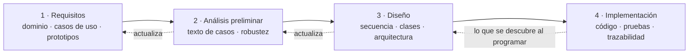
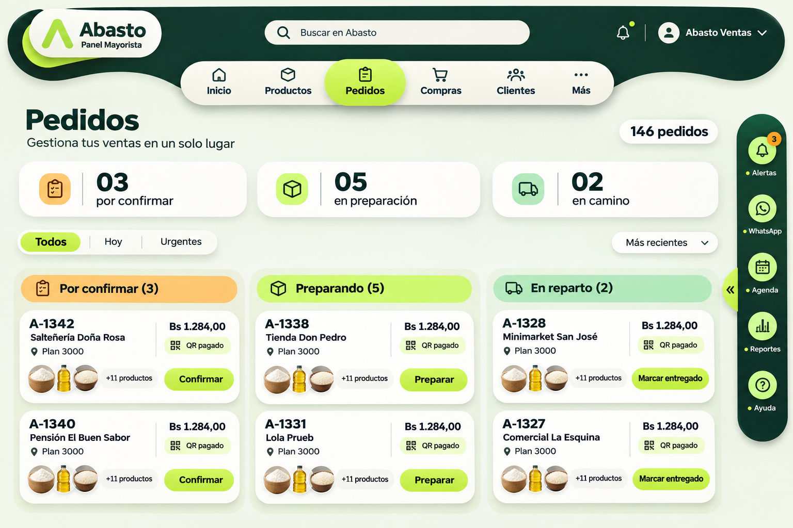
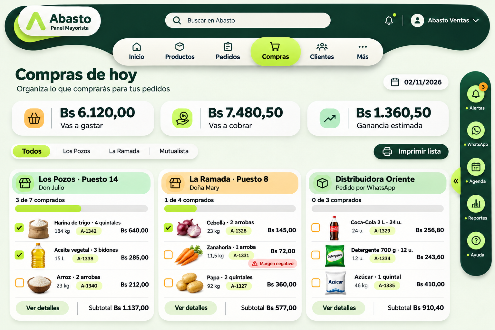
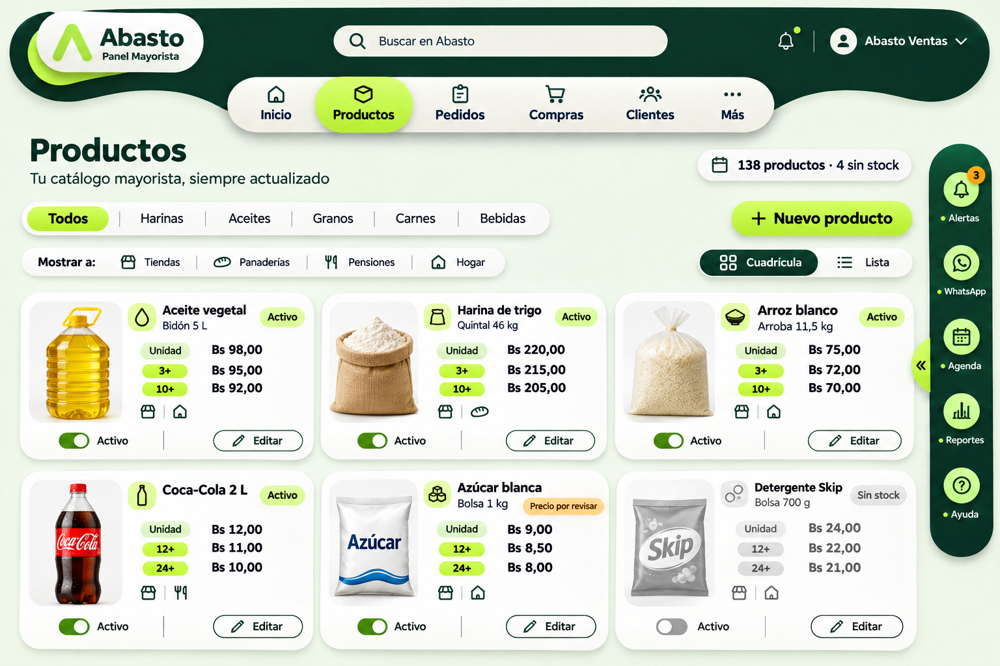
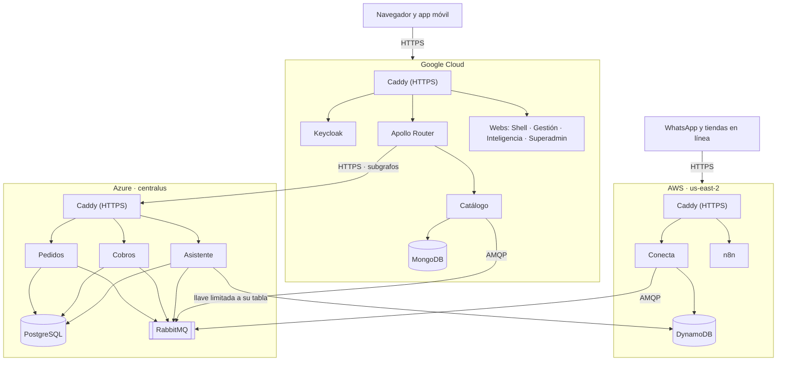

<!-- solo-md:inicio -->
# Documento del proyecto · Abasto (ICONIX)

Este archivo es la **fuente del documento Word** de la materia. Todo cambio del documento se hace aquí y después se regenera el Word:

```bash
cd docsProyecto/generador && node generar-word.mjs
```

El Word sale en `docsProyecto/Abasto_Documento_ICONIX.docx`. El generador convierte los diagramas Mermaid en imágenes. Las líneas `<!-- diagramas: ruta -->` traen los diagramas de esos archivos (por ejemplo, los de `docs/iconix/`), así cada diagrama vive en un solo lugar. Lo que está entre `solo-md:inicio` y `solo-md:fin` (este bloque) no sale en el Word.

## Estado del documento

Actualizado: 07/11/2026.

| Parte | Estado | Qué falta |
|---|---|---|
| Carátula | ⚠️ | Números de registro de los dos, sigla y grupo de la materia |
| 1. Perfil | ✅ | — |
| 2. Fundamentación teórica | ✅ | — |
| 3. Elementos del SGBD | ✅ | — |
| 4. Seguimiento y control | ✅ | — |
| 5. ICONIX · Requisitos | ✅ | — |
| 6. ICONIX · Análisis y diseño preliminar (robustez) | ✅ | Los 16 casos |
| 7. ICONIX · Diseño (secuencia, clases, arquitectura) | ✅ | — |
| 8. ICONIX · Implementación y pruebas | ✅ | — |
| 9. Despliegue en tres nubes | ⚠️ | Ya describe el plan final (Google = puerta de entrada). Falta desplegar en Google, mudar Keycloak, Router y webs desde AWS, poner las direcciones nuevas y el APK |
| 10. Conclusiones | ✅ | — |
| Anexos | ⚠️ | Códigos QR del repositorio y del Panel (se agregan como imagen cuando estén) |

## Historial

- 08/11/2026 · Capítulos 3 y 9: el reparto de nubes pasa al plan final que decidió Jhoel (Google con Catálogo, Keycloak, Router y webs; AWS con Conecta y n8n). Antes mostraba el reparto temporal.
- 07/11/2026 · Primera versión, armada desde `docs/` (ICONIX, requisitos, trazabilidad, arquitectura, despliegue) y con la estructura de los documentos de referencia de la materia.
<!-- solo-md:fin -->

<!-- portada
universidad: UNIVERSIDAD AUTÓNOMA GABRIEL RENÉ MORENO
facultad: FACULTAD DE INGENIERÍA EN CIENCIAS DE LA COMPUTACIÓN Y TELECOMUNICACIONES
grupo: GRUPO #13
trabajo: SEGUNDO PARCIAL · METODOLOGÍA ICONIX
titulo: ABASTO
subtitulo: Red mayorista B2B para Bolivia con microservicios, microfrontends e inteligencia artificial
materia: INGENIERÍA DE SOFTWARE II
docente: ING. ROLANDO ANTONIO MARTÍNEZ CANEDO
integrantes: QUISPE CABRERA JOSÉ ANDRÉS · Registro: ⟨completar⟩|RODAS CABRERA JHOEL · Registro: ⟨completar⟩
lugar: SANTA CRUZ DE LA SIERRA - BOLIVIA
fecha: NOVIEMBRE - 2026
-->

# 1. Perfil

## 1.1 Introducción

En Bolivia, buena parte del comercio de barrio se abastece en mercados mayoristas: la tienda, la salteñería o la pensión van al mercado, compran por quintal, fardo, caja o docena y vuelven con la mercadería. Los precios se negocian cara a cara y cambian según quién compra. Casi nada de ese proceso deja registro: el mayorista anota en un cuaderno lo que le fían, no sabe qué producto se le va a acabar y la tienda pierde medio día en cada compra.

**Abasto** es una red mayorista B2B que lleva esa relación a una aplicación. Las tiendas, los productores y los hogares compran al por mayor desde una app en el teléfono: buscan (también con una foto), piden, pagan con QR, a crédito o contra entrega, y siguen el pedido hasta su puerta. Los mayoristas gestionan todo desde un Panel web: productos con precios por presentación, clientes, pedidos, compras, cuentas por cobrar e inteligencia del negocio. Abasto, como empresa, aprueba a los mayoristas y mira la tracción desde un Superadmin.

El sistema está construido sobre una **arquitectura de microservicios** con cinco servicios escritos en tres lenguajes (Spring Boot, Laravel y NestJS), un Panel armado con **microfrontends** (React, Angular y Vue), **GraphQL federado** como única puerta de las aplicaciones, mensajería con **RabbitMQ** y una **saga** que coordina la compra entre tres servicios. Suma **agentes inteligentes** que vigilan el negocio y proponen acciones, **reportes generativos** que se piden por texto o por voz, **IA local** en el teléfono y en el navegador, **machine learning** supervisado y no supervisado, **deep learning** con TensorFlow para reconocer productos por foto y **automatizaciones con n8n**. Todo funciona con mala señal o sin señal, sin registrar nada dos veces.

El desarrollo sigue la metodología **ICONIX**, que va del modelo de dominio y los casos de uso a los diagramas de robustez, secuencia y clases, y de ahí al código, con trazabilidad entre cada paso. Este documento recorre ese camino: el perfil del proyecto, la fundamentación teórica, los elementos de datos, el seguimiento, cada fase de ICONIX, el despliegue en tres nubes y las conclusiones.

## 1.2 Descripción del problema

El mercado mayorista boliviano tiene problemas que se repiten en cada eslabón:

- **Precios privados y negociados.** Cada mayorista maneja precios distintos según el cliente y no quiere publicarlos para todos, ni entrar en una guerra de precios con el puesto de al lado. Las plataformas de comercio electrónico comunes muestran un solo precio público y comparan vendedores, justo lo que el mayorista no quiere.
- **Compra presencial y lenta.** La tienda tiene que ir al mercado para saber qué hay y a cuánto. Pierde tiempo, transporte y ventas mientras su local está cerrado.
- **Crédito informal.** El fiado se anota en cuadernos. El mayorista no sabe cuánto le deben, quién se atrasa ni quién le va a pagar tarde. La tienda no sabe cuánto crédito le queda.
- **Decisiones a ciegas.** El mayorista no ve qué se vende más, qué se le va a acabar ni cuánto pedir al proveedor. Los reportes, si existen, los arma a mano.
- **Mala conectividad.** En mercados y barrios la señal se corta. Una aplicación que se cae o que registra el mismo pedido dos veces al reintentar no sirve.
- **Varios canales.** Muchos pedidos llegan por WhatsApp o desde tiendas en línea, y hay que volver a cargarlos a mano.

Se necesita un sistema que respete la relación comercial privada, que funcione con mala señal, que coordine pedido, stock y cobro sin perder consistencia, y que ayude al mayorista a decidir con datos.

## 1.3 Objetivos

### 1.3.1 Objetivo general

Desarrollar Abasto, una red mayorista B2B para Bolivia basada en microservicios y microfrontends, que permita a las tiendas comprar al por mayor desde una aplicación móvil y a los mayoristas gestionar y entender su negocio con apoyo de inteligencia artificial, aplicando la metodología ICONIX.

### 1.3.2 Objetivos específicos

- Modelar el dominio del comercio mayorista (organizaciones, relación comercial, listas de precios, productos con escalas, pedidos, crédito y cobros) y derivar de él los casos de uso del sistema.
- Diseñar e implementar cinco microservicios en Spring Boot, Laravel y NestJS, cada uno dueño de sus datos, con arquitecturas hexagonal, clean y DDD validadas automáticamente.
- Construir un Panel Mayorista con microfrontends (Shell en React, Gestión en Angular, Inteligencia en Vue) que consuma GraphQL federado, y una sola sesión para todas las aplicaciones.
- Coordinar la compra entre Pedidos, Catálogo y Cobros con una saga orquestada que compense si un paso falla.
- Garantizar el funcionamiento sin señal en el teléfono y en la web, con sincronización e idempotencia.
- Incorporar agentes inteligentes, reportes generativos por texto y voz exportables a Excel, y un servidor MCP seguro.
- Aplicar machine learning supervisado (demanda y mora), no supervisado (segmentos de tiendas) y deep learning con TensorFlow (reconocimiento de productos por foto en el teléfono).
- Automatizar procesos con n8n: pedidos por WhatsApp y ejecución de las acciones aprobadas de los agentes.
- Desplegar el sistema en tres nubes (AWS, Azure y Google Cloud) de forma que cada módulo se actualice sin reiniciar el resto.

## 1.4 Alcance

Abasto tiene tres interfaces y cinco servicios. Cada módulo del alcance indica dónde vive.

### 1.4.1 App de clientes (Expo, Android e iPhone)

Es el producto que usan las tiendas, los productores y los hogares. Entrar con el celular y un código, elegir el tipo de negocio, buscar productos por texto o por foto, ver a los vendedores, armar el carrito, pagar con QR, a crédito o contra entrega, seguir el pedido y reportar un problema. Incluye «Mi negocio» (inventario que se llena solo con lo que se compra, caja, fiado, recetas y planificador), un asistente de compra con IA local y una bandeja que guarda los pedidos sin señal.

### 1.4.2 Gestionar productos y red privada de precios (Catálogo)

El mayorista publica productos con escalas por presentación (unidad, cuarta, docena, caja, fardo) y foto. Una tienda solo ve los precios de un mayorista que la aprobó, con su lista: NUEVOS 100 %, FRECUENTES 97 % o VIP 95 %. Nunca se comparan mayoristas ni se ordena por el más barato.

### 1.4.3 Gestionar clientes y crédito (Catálogo y Cobros)

El mayorista aprueba o rechaza las solicitudes de las tiendas, asigna la lista de precios y, si quiere, una línea de crédito con plazo de 15 o 30 días.

### 1.4.4 Gestionar pedidos (Pedidos)

La tienda pide; la saga reserva el stock, cobra y deja el pedido esperando al mayorista, que lo confirma o rechaza y lo lleva por preparación, despacho y entrega. Incluye la lista de compras del día y los reclamos.

### 1.4.5 Gestionar cobros y cuentas por cobrar (Cobros)

Cobro por QR que vence a los 30 minutos, autorización y liberación de crédito, cuentas por cobrar por cada pedido a crédito o contra entrega y registro de pagos en efectivo, transferencia o QR.

### 1.4.6 Conectar canales externos (Conecta)

API pública con llaves para que una tienda conecte su e-commerce (plugin de WooCommerce), avisos firmados con reintentos, servidor MCP de compras, pedidos por WhatsApp a través de n8n y la sincronización de las bandejas sin señal, todo con idempotencia.

### 1.4.7 Inteligencia del negocio (Asistente)

Reportes generativos por texto o voz con tabla, gráfico y exportación a Excel; tableros con predicciones de machine learning; agentes de Cobranza, Reposición, Catálogo y Analista que proponen acciones para aprobar; servidor MCP de reportes; proyector que arma la base de reportes con los eventos del sistema.

### 1.4.8 Administración de Abasto (Superadmin)

Verificar mayoristas, suspender tiendas, resolver reclamos, ver la tracción (pedidos, ventas, tiendas que repiten), las integraciones y los usuarios.

### 1.4.9 Machine learning (procesos programados)

Predicción de demanda, riesgo de mora y segmentos de tiendas, que corren de noche y escriben en la base de reportes; entrenamiento del modelo de visión que la app usa sin internet.

## 1.5 Metodología ICONIX

### 1.5.1 Qué es ICONIX

ICONIX es un proceso de desarrollo orientado a objetos, dirigido por casos de uso, propuesto por Doug Rosenberg. Usa un subconjunto pequeño de UML (modelo de dominio, casos de uso, robustez, secuencia y clases) y exige **trazabilidad**: cada clase sale de un objeto del diagrama de robustez, cada objeto de robustez sale del texto de un caso de uso y cada caso de uso se apoya en el modelo de dominio. Es iterativo e incremental, como los métodos ágiles, pero pone más cuidado en el análisis y el diseño antes de escribir código.

### 1.5.2 Por qué ICONIX en Abasto

- **El docente lo pidió** para el segundo parcial.
- **La arquitectura es el riesgo, no el código.** Con cinco servicios, tres frameworks de frontend y una saga, un error de diseño se paga caro. ICONIX obliga a pensar los mensajes entre piezas (secuencia) antes de programarlas.
- **Trazabilidad requisito → caso de uso → código → prueba.** Cada caso de uso de Abasto tiene su robustez, su secuencia, las clases reales que lo implementan y la prueba automática que lo cubre.
- **Pocos diagramas, todos útiles.** Un equipo de dos personas no puede mantener decenas de diagramas. ICONIX usa solo los necesarios, y en Abasto se guardan como texto (Mermaid) dentro del repositorio, se revisan como el código y la CI comprueba que se dibujen.

### 1.5.3 Fases y revisiones

| Fase | Qué se produce | Revisión al cerrar |
|---|---|---|
| 1. Análisis de requisitos | Requisitos funcionales y no funcionales, modelo de dominio, prototipos de interfaz, diagrama y lista de casos de uso | Revisión de requisitos |
| 2. Análisis y diseño preliminar | Texto de cada caso de uso (curso básico y alternos) y su diagrama de robustez; modelo de dominio actualizado | Revisión del diseño preliminar |
| 3. Diseño | Diagrama de secuencia de cada caso, diagrama de clases por servicio, arquitectura | Revisión crítica del diseño |
| 4. Implementación | Código, pruebas unitarias, de integración y punta a punta, trazabilidad | Entrega |



Los capítulos 5 a 8 siguen estas cuatro fases.

# 2. Fundamentación teórica

## 2.1 Microservicios

Un microservicio es una aplicación pequeña e independiente que resuelve una parte del negocio, tiene su propia base de datos y se comunica con los demás por la red. Frente al monolito, se puede desarrollar, probar, desplegar y escalar cada parte por separado, y cada una puede usar el lenguaje que más le conviene.

### 2.1.1 Patrones que usa Abasto

- **Base de datos por servicio.** Ningún servicio lee la base de otro: pide los datos por GraphQL o los recibe por eventos.
- **API Gateway.** Las aplicaciones hablan con un solo punto, el Apollo Router, que compone las respuestas de varios servicios.
- **Mensajería asíncrona.** Los servicios se avisan con eventos y comandos por RabbitMQ.
- **Outbox e inbox.** El servicio guarda el cambio y el evento en la misma transacción; un publicador lo manda después. Quien lo recibe anota su id para no procesarlo dos veces.
- **Saga.** Una transacción que cruza varios servicios se divide en pasos locales con compensaciones (ver 2.6).

### 2.1.2 Beneficios y limitaciones

| Beneficios | Limitaciones |
|---|---|
| Despliegue y escalado independiente por módulo | Más piezas que operar y vigilar |
| Cada servicio usa la tecnología que le conviene | Consistencia eventual: los datos tardan en propagarse |
| Un fallo queda aislado en su servicio | No hay transacciones ACID entre servicios: hace falta una saga |
| Equipos trabajan en paralelo sin pisarse | Más contratos que versionar (GraphQL, eventos, REST) |

## 2.2 Microfrontends

Los microfrontends llevan la idea de los microservicios a la interfaz: una aplicación web se arma con partes que se desarrollan y despliegan por separado, incluso con frameworks distintos. Un **shell** (contenedor) carga cada parte en tiempo de ejecución. En Abasto, el Shell en React carga Gestión (Angular) e Inteligencia (Vue) como **Web Components**: cada una se registra como una etiqueta HTML propia (`<abasto-gestion>`, `<abasto-inteligencia>`) con Shadow DOM para que sus estilos no se mezclen. La lista de remotos se lee al cargar (`remotos.json`), así que se puede publicar una nueva versión de Gestión sin tocar el Shell.

## 2.3 GraphQL y federación

GraphQL es un lenguaje de consulta para APIs: el cliente pide exactamente los campos que necesita y recibe solo eso, en una sola llamada. Resuelve dos problemas típicos de REST: traer de más (*overfetching*) y tener que hacer varias llamadas para armar una pantalla (*underfetching*). Con **Apollo Federation 2**, cada servicio publica su parte del esquema (subgrafo) y el **Router** las junta en un supergrafo: una pantalla pide el pedido (Pedidos), sus productos (Catálogo) y su cobro (Cobros) en una sola consulta.

## 2.4 REST, OpenAPI y AsyncAPI

REST se usa donde conviene un contrato simple y universal: la API pública de Conecta para los e-commerce y la API del Asistente para reportes y agentes. Ambas se describen con **OpenAPI**. Los eventos y comandos de RabbitMQ se describen con **AsyncAPI**, que cumple el mismo papel para la mensajería.

## 2.5 Arquitecturas de código: DDD, hexagonal y clean

- **DDD (Domain-Driven Design).** Pone el modelo del negocio en el centro: agregados que protegen sus reglas, objetos valor (como `Dinero`), eventos de dominio y un lenguaje común entre negocio y código.
- **Hexagonal (puertos y adaptadores).** El núcleo define puertos (interfaces) y el mundo exterior se conecta con adaptadores: GraphQL, base de datos, mensajería. El núcleo no conoce ninguna tecnología.
- **Clean architecture.** Capas concéntricas (entidades, casos de uso, adaptadores, frameworks) con una regla: las dependencias apuntan siempre hacia adentro. El framework queda en el borde.

Las tres comparten la idea de proteger el dominio; difieren en qué ponen en primer plano. La elección de cada una para cada servicio se justifica en 7.4.

## 2.6 Transacciones distribuidas: el patrón saga

En un monolito, si un paso falla se hace *rollback*. Entre microservicios no se puede: cada uno ya confirmó su parte en su propia base. Una **saga** divide la transacción en pasos locales; si uno falla, se ejecutan **compensaciones** que deshacen lo anterior (liberar el stock reservado, devolver el crédito). Puede ser **coreografiada** (cada servicio reacciona a eventos) u **orquestada** (un coordinador decide el siguiente paso). Abasto usa una saga orquestada por Pedidos, con plazos para lo que se queda esperando.

## 2.7 Sin señal: PWA, sincronización e idempotencia

- **PWA (aplicación web progresiva).** Una web que se instala y funciona sin conexión gracias a un *service worker* que guarda los archivos y responde desde la caché.
- **Bandeja de salida (outbox del cliente).** Lo que se hace sin señal queda guardado en el equipo y se envía cuando vuelve la conexión.
- **Idempotencia.** Repetir una operación no produce un efecto adicional. Cada escritura que llega de afuera trae una `Idempotency-Key`; si el servidor ya la aplicó, devuelve la respuesta original. Así, un reintento por mala señal nunca crea un segundo pedido ni cobra dos veces.

## 2.8 Sesión única: OIDC y Keycloak

**OpenID Connect** es un estándar de identidad sobre OAuth 2.0. **Keycloak** es un servidor de identidad de código abierto que lo implementa: emite tokens firmados que cada servicio valida con las llaves públicas del realm (JWKS). Con **PKCE**, las aplicaciones públicas (web y móvil) inician sesión sin guardar secretos. Entrar a una aplicación abre las demás sin volver a pedir la contraseña.

## 2.9 Inteligencia artificial

### 2.9.1 Agentes inteligentes

Un agente es un programa con una **misión**, unas **habilidades** (herramientas que puede usar) y **límites** (lo que no puede hacer solo). En Abasto los agentes vigilan el negocio («monitorear mi negocio»), encuentran situaciones (una cuenta que vence mañana, un producto que se va a acabar) y **proponen** acciones. Una persona aprueba y n8n ejecuta.

### 2.9.2 Reportes generativos

Un modelo de lenguaje convierte una pregunta en lenguaje natural («¿qué tiendas me tienen que pagar mañana?») en una consulta SQL. Una **guardia** revisa la consulta antes de ejecutarla (solo lectura, solo tablas permitidas) y el resultado se muestra en tabla y gráfico y se exporta a Excel.

### 2.9.3 MCP (Model Context Protocol)

Protocolo abierto para que un asistente de IA use herramientas y datos externos de forma estándar. Un servidor MCP publica herramientas; un cliente (por ejemplo, Claude) las llama. Como da acceso a datos reales, exige autenticación, permisos mínimos, límites y auditoría.

### 2.9.4 IA local

Modelos que corren dentro del dispositivo, sin enviar datos a un servidor y sin internet: en el teléfono (TensorFlow Lite, ML Kit, modelos de lenguaje pequeños con llama.cpp) y en el navegador (Whisper con transformers.js y ONNX).

## 2.10 Machine learning y deep learning

- **Supervisado:** aprende de ejemplos con respuesta conocida. Regresión con *Gradient Boosting* para la demanda; regresión logística para la probabilidad de mora.
- **No supervisado:** encuentra grupos sin etiquetas. *K-means* sobre recencia, frecuencia y monto (RFM) para segmentar tiendas.
- **Deep learning:** redes neuronales profundas. *Transfer learning* sobre **MobileNetV3** con TensorFlow para reconocer productos en fotos, exportado a **TFLite** para correr en el teléfono.

## 2.11 Automatización con n8n

n8n es una herramienta de automatización por flujos (*workflows*): nodos que reciben un disparador (un webhook, un mensaje), transforman datos y llaman a otros servicios. En Abasto automatiza el pedido por WhatsApp y la ejecución de las acciones que aprueba el mayorista.

## 2.12 Contenedores y nube

**Docker** empaqueta cada servicio con todo lo que necesita en una imagen que corre igual en cualquier máquina; **Docker Compose** levanta varios contenedores juntos. Los proveedores de nube (**AWS**, **Microsoft Azure**, **Google Cloud**) alquilan máquinas virtuales y servicios administrados (como DynamoDB) por uso. Abasto corre un contenedor por módulo en máquinas virtuales de las tres nubes, con **Caddy** como entrada HTTPS.

## 2.13 Herramientas CASE y de apoyo

| Herramienta | Uso en Abasto |
|---|---|
| Mermaid | Diagramas UML de ICONIX como texto dentro del repositorio |
| Claude Code | Asistente de programación con IA, usado por los dos integrantes |
| GitHub y GitHub Actions | Control de versiones e integración continua |
| Trello | Tablero de tareas por fase |
| Claude Design | Maquetas navegables de las interfaces |
| Visual Studio Code, Android Studio | Edición de código y compilación de la app |
| Rover | Composición del supergrafo GraphQL |
| Playwright | Pruebas punta a punta del sistema levantado |

# 3. Elementos del SGBD

Cada servicio elige la base que mejor encaja con sus datos. Se usan tres sistemas de bases de datos, como pidió el docente, y ninguno es MySQL.

## 3.1 Hardware

**Desarrollo.** Cada integrante levanta todo el sistema en su computadora con Docker. Cada contenedor tiene un tope de memoria y la máquina de WSL tiene 6 GB; en reposo todo usa unos 2 GB.

**Producción (demostración).** Una máquina virtual por nube, con Ubuntu 24.04 y discos de 30 GB:

| Nube | Máquina | Qué guarda |
|---|---|---|
| Google Cloud | Pendiente | MongoDB del Catálogo y Postgres de Keycloak |
| AWS | EC2 m7i-flex.large (2 vCPU, 8 GB) | DynamoDB administrado (Conecta y Asistente) |
| Azure | Standard_B2pls_v2 (2 vCPU ARM, 4 GB + 4 GB de swap) | Postgres de Pedidos, Cobros y reportes |

## 3.2 Software

### 3.2.1 PostgreSQL 17

Base relacional para los datos que necesitan transacciones e integridad: **Pedidos** (pedidos, líneas, saga, outbox e inbox, con migraciones Flyway), **Cobros** (líneas de crédito, cobros QR, cuentas por cobrar y pagos, con Prisma), la base **reportes** del Asistente (proyecciones y predicciones del ML) y **Keycloak**. Cada servicio tiene su propia base y su propio usuario. La base de reportes tiene un rol de solo lectura (`mcp_lector`) con **seguridad por fila** (RLS): cada empresa ve solo sus filas.

### 3.2.2 MongoDB 8

Base documental para el **Catálogo**. Un producto lleva una lista variable de escalas de precio, usos y datos de abastecimiento, que encajan naturalmente en un documento. Corre como *replica set* de un nodo para permitir transacciones al reservar stock.

### 3.2.3 DynamoDB

Base clave-valor administrada de AWS. **Conecta** guarda ahí las claves de idempotencia con una escritura condicional (si la clave ya existe, no se escribe otra vez) y la bitácora de lo que entra de afuera. El **Asistente** guarda las propuestas de los agentes y la auditoría de cada consulta. En desarrollo se usa DynamoDB Local; en la nube, el DynamoDB real de AWS.

### 3.2.4 Propiedad de los datos

| Dato | Dueño | Base |
|---|---|---|
| Pedidos, líneas, saga, reclamos | Pedidos | PostgreSQL `pedidos` |
| Organizaciones, productos, escalas, relaciones comerciales | Catálogo | MongoDB |
| Crédito, cobros QR, cuentas por cobrar, pagos, «Mi negocio» | Cobros | PostgreSQL `cobros` |
| Idempotencia, bitácora, llaves de API, avisos | Conecta | DynamoDB |
| Reportes proyectados, predicciones | Asistente y ML | PostgreSQL `reportes` |
| Propuestas de los agentes, auditoría | Asistente | DynamoDB |
| Usuarios, roles, sesión | Keycloak | PostgreSQL `keycloak` |

# 4. Mecanismo de seguimiento y control

## 4.1 Organización

El equipo tiene dos integrantes. Desde el 29/10 el trabajo se reparte por área: **Andrés lleva todo lo comercial** y **Jhoel toda la inteligencia artificial**. El archivo `.github/CODEOWNERS` registra el dueño de cada carpeta.

| Integrante | Responsabilidad |
|---|---|
| José Andrés Quispe Cabrera | App de clientes (pantallas, sesión, modo sin señal); Panel Shell y Gestión; Superadmin; servicios Catálogo, Pedidos, Cobros y Conecta; n8n de WhatsApp; infraestructura, Router, Keycloak y CI |
| Jhoel Rodas Cabrera | IA local del teléfono (modelo TFLite, ML Kit, asistente de compra); IA local del navegador (Whisper); Panel de Inteligencia; servicio Asistente (agentes, reportes generativos, MCP, proyector); machine learning; despliegue en tres nubes |

Los casos de uso, los requisitos del docente y la arquitectura se deciden entre los dos, y no se reabren sin hablarlo.

## 4.2 Herramientas de gestión

- **Trello** (tablero «abasto»): una tarjeta por tarea, agrupadas por fase.
- **GitHub** (`AndyQdev/abasto`): un solo repositorio con todo el sistema. Los dos trabajan directo en `main` con commits pequeños y *Conventional Commits*.
- **Archivos de estado** (`docs/equipo/andres.md` y `jhoel.md`): qué está haciendo cada uno, qué terminó, qué cambió en los contratos y qué necesita del otro. Si uno toca una carpeta del otro, lo avisa ahí en el mismo commit.
- **Comunicación:** WhatsApp y reuniones presenciales.

## 4.3 Ritmo de trabajo e hitos

ICONIX se aplicó de forma iterativa: cada caso de uso pasó por sus cuatro fases, y el modelo de dominio se actualizó con lo que se aprendía al programar.

| Fecha | Hito |
|---|---|
| 15/10/2026 | Clase con los requisitos del segundo parcial |
| 21/10/2026 | Primer commit: monorepositorio, Docker, Keycloak y esqueletos de los servicios |
| 29/10/2026 | Replanteo: la app de clientes pasa a ser el producto; reparto comercial / IA |
| 03/11/2026 | Saga de compra completa, cuentas por cobrar, agentes con n8n |
| 06/11/2026 | Los 16 casos de uso con pantalla, prueba y diagramas ICONIX |
| 07/11/2026 | Despliegue en AWS y Azure |
| 10/11/2026 | Presentación |

## 4.4 Indicadores de seguimiento

- **Casos de uso terminados.** Un caso está terminado cuando tiene su texto, robustez, secuencia, código y una prueba automática que pasa en la CI.
- **Requisitos del docente cumplidos.** `docs/requisitos.md` y `docs/trazabilidad.md` marcan cada requisito con el caso de uso, el código y la prueba que lo demuestran.
- **CI en verde.** GitHub Actions corre las pruebas de lo que cambió (por carpeta); las pruebas punta a punta corren antes de integrar a `main`.
- **Reglas de arquitectura.** ArchUnit, Deptrac y dependency-cruiser hacen fallar la CI si una capa importa lo que no debe.

# 5. ICONIX · Análisis de requisitos

## 5.1 Requisitos del docente y dónde se cumplen

| # | Requisito | Dónde se cumple en Abasto |
|---|---|---|
| 1 | Microservicios: al menos Spring Boot, NestJS y PHP | Pedidos (Spring Boot), Catálogo (Laravel), Cobros, Conecta y Asistente (NestJS) |
| 2 | Microfrontends con un shell y al menos React, Angular y un tercero | Panel: Shell React que carga Gestión (Angular) e Inteligencia (Vue) |
| 3 | GraphQL obligatorio en el sistema de gestión | Gestión lee y escribe por el Apollo Router (federación de Pedidos, Catálogo y Cobros) |
| 4 | Funcionalidades construidas como agentes | Agentes de Cobranza, Reposición, Catálogo y Analista en el Asistente (CU-14) |
| 5 | IA local en dispositivos móviles | App: TFLite propio, ML Kit y modelo de lenguaje local según el teléfono |
| 6 | IA local en el navegador | Inteligencia: Whisper transcribe la voz dentro del navegador |
| 7 | Funcionar sin señal en web y móvil, con sincronización | Panel PWA; bandeja de pedidos en la app (CU-12) |
| 8 | Idempotencia | `Idempotency-Key` en toda escritura externa; Conecta en DynamoDB; inbox en cada servicio |
| 9 | Transacción entre tres o más microservicios | Saga de compra: Pedidos → Catálogo → Cobros, con compensación (CU-06) |
| 10 | Machine learning supervisado y no supervisado | Demanda (Gradient Boosting), mora (regresión logística), segmentos (K-means) |
| 11 | Deep learning con TensorFlow sobre imágenes | MobileNetV3 con transfer learning → TFLite en la app (CU-05) |
| 12 | Automatización con n8n | Pedido por WhatsApp (CU-11) y acciones aprobadas de los agentes (CU-14) |
| 13 | Reportes generativos por texto o voz, en pantalla y en Excel | Inteligencia › Reportes (CU-13) |
| 14 | Protocolo MCP, con cuidado | `abasto-reportes` (Asistente) y `abasto-compras` (Conecta) |
| 15 | PostgreSQL, MongoDB y DynamoDB, sin MySQL | Ver capítulo 3 |
| 16 | Una sola cuenta para todas las aplicaciones | Keycloak con OIDC + PKCE |
| 17 | Arquitecturas DDD, hexagonal y clean | Cobros (DDD), Pedidos (hexagonal), Catálogo (clean) |
| 18 | Arquitectura de datos para reportes | CQRS: el proyector arma la base `reportes` con los eventos |
| 19 | Metodología ICONIX | Capítulos 5 a 8 y `docs/iconix/` |
| 20 | Despliegue en Google Cloud, Azure y AWS sin reiniciar todo al cambiar un módulo | Capítulo 9 |

## 5.2 Requisitos funcionales

| Código | Requisito | Caso de uso |
|---|---|---|
| RF-01 | Registrar mayoristas y verificarlos antes de que vendan | CU-01 |
| RF-02 | Publicar productos con escalas por presentación, stock y foto | CU-02 |
| RF-03 | Pedir ser cliente de un mayorista | CU-03 |
| RF-04 | Aprobar clientes con lista de precios y crédito | CU-04 |
| RF-05 | Buscar en el catálogo por texto o por foto, sin internet | CU-05 |
| RF-06 | Hacer un pedido coordinado entre stock y cobro | CU-06 |
| RF-07 | Confirmar, rechazar y entregar pedidos | CU-07 |
| RF-08 | Pagar con QR, a crédito o contra entrega | CU-08 |
| RF-09 | Registrar pagos de cuentas por cobrar | CU-09 |
| RF-10 | Conectar un e-commerce por API, WooCommerce o MCP | CU-10 |
| RF-11 | Recibir pedidos por WhatsApp | CU-11 |
| RF-12 | Pedir sin señal y sincronizar al volver | CU-12 |
| RF-13 | Responder preguntas de negocio por texto o voz y exportarlas a Excel | CU-13 |
| RF-14 | Proponer acciones con agentes y ejecutarlas al aprobarlas | CU-14 |
| RF-15 | Registrarse como tienda con el celular | CU-15 |
| RF-16 | Reportar y resolver problemas con un pedido | CU-16 |

## 5.3 Requisitos no funcionales

- **Disponibilidad con mala señal.** La app y el Panel siguen funcionando sin conexión y sincronizan al volver.
- **Consistencia.** Ninguna operación se registra dos veces; la compra se deshace si un paso falla.
- **Seguridad.** Sesión con tokens firmados; cada servicio filtra por la empresa del token (`org_id`); la base de reportes aplica seguridad por fila; las consultas generadas por IA pasan por una guardia de solo lectura con tope de 5 segundos y 1.000 filas, y quedan auditadas.
- **Privacidad de precios.** Una tienda solo ve los precios del mayorista que la aprobó.
- **Mantenibilidad.** Cada servicio respeta su arquitectura y la CI lo comprueba; cada caso de uso tiene prueba automática.
- **Despliegue independiente.** Cada módulo es su propio contenedor: actualizarlo no reinicia a los demás.
- **Usabilidad.** Interfaz en español de Bolivia con tuteo; montos «Bs 1.728,00», fechas dd/mm/aaaa y cantidades siempre con unidad.

## 5.4 Actores del sistema

| Actor | Descripción |
|---|---|
| **Tienda** (o persona) | Compra al por mayor desde la app: tiendas de barrio, productores (salteñerías, panaderías, pensiones) y hogares |
| **Mayorista** | Vende: publica productos, aprueba clientes, confirma pedidos, cobra y usa la inteligencia del negocio desde el Panel |
| **Admin de Abasto** | Verifica mayoristas, suspende tiendas, resuelve reclamos y mira la tracción desde el Superadmin |
| **WhatsApp / n8n** | Canal externo que convierte un mensaje en un pedido |
| **E-commerce o agente de IA** | Tienda en línea o asistente que compra por la API o por MCP con la llave de una tienda |
| **Agentes del sistema** | Vigilan el negocio y dejan propuestas para que el mayorista decida |

## 5.5 Prototipos de interfaz

Las pantallas web salen de maquetas navegables hechas antes de programar (`docs/uix-mockup/`): el Panel Mayorista, el Superadmin y la app. El Panel vigente es la versión 7 «Halo»: cabecera verde bosque, menú blanco flotante, accesos a la derecha y tarjetas grandes.







## 5.6 Modelo de dominio

El modelo de dominio muestra los conceptos del negocio tal como existen en el código de Catálogo, Pedidos y Cobros, con sus atributos clave y multiplicidades.

Fuente: `docs/iconix/dominio.md`.

<!-- diagramas: docs/iconix/dominio.md -->

Conceptos principales:

- **Organizacion.** Tienda, mayorista u organización de la casa (Abasto); `tipo` distingue el papel y `verificacion` guarda el estado.
- **RelacionComercial.** Une una tienda con un mayorista y guarda la lista de precios. Solo una relación `APROBADA` permite ver precios.
- **Producto y EscalaDePrecio.** Un producto tiene una o más escalas (presentación, unidades, precio). Puede ser de `STOCK` o `BAJO_PEDIDO`.
- **Pedido, LineaDePedido y SagaDeCompra.** El pedido lleva su clave de idempotencia y sigue la máquina de estados de la saga.
- **ReservaDeStock.** La respuesta de Catálogo a la saga: qué se reservó y a qué precio.
- **LineaDeCredito, CobroQr, CuentaPorCobrar y Pago.** El lado del dinero, en Cobros. `Dinero` siempre en centavos.
- **Reclamo.** Un problema reportado sobre un pedido.

## 5.7 Casos de uso

<!-- diagramas: docs/iconix/casos-de-uso.md -->

| Caso | Actor | Interfaz | Servicios | Dueño |
|---|---|---|---|---|
| CU-01 Registrarse como mayorista y ser verificado | Mayorista → Admin | Panel (registro) → Superadmin | Catálogo, Keycloak | Andrés |
| CU-02 Publicar un producto con escalas y foto | Mayorista | Panel › Gestión | Catálogo | Andrés |
| CU-03 Pedir ser cliente de un mayorista | Tienda | App | Catálogo | Andrés |
| CU-04 Aprobar un cliente con lista de precios y crédito | Mayorista | Panel › Gestión | Catálogo, Cobros | Andrés |
| CU-05 Buscar en el catálogo (texto o foto) | Tienda | App | Catálogo + IA local | Andrés · Jhoel |
| CU-06 Hacer un pedido | Tienda | App | Pedidos, Catálogo, Cobros | Andrés |
| CU-07 Confirmar o rechazar un pedido y entregarlo | Mayorista | Panel › Gestión | Pedidos | Andrés |
| CU-08 Pagar con QR, a crédito o contra entrega | Tienda | App | Cobros | Andrés |
| CU-09 Registrar un pago de una cuenta por cobrar | Mayorista | Panel › Gestión | Cobros | Andrés |
| CU-10 Conectar un e-commerce (API, WooCommerce, MCP) | Tienda | App | Conecta | Andrés |
| CU-11 Pedir por WhatsApp | Tienda | WhatsApp → n8n | Conecta, Pedidos | Andrés |
| CU-12 Pedir sin señal | Tienda | App | Conecta, Pedidos | Andrés |
| CU-13 Preguntarle a los datos (texto o voz) | Mayorista | Panel › Inteligencia | Asistente + IA del navegador | Jhoel |
| CU-14 Aprobar la propuesta de un agente | Mayorista | Panel › Inteligencia | Asistente, n8n | Jhoel |
| CU-15 Registrarse como tienda | Tienda | App | Catálogo, Keycloak | Andrés |
| CU-16 Reportar un problema con un pedido | Tienda → Admin | App → Superadmin | Pedidos | Andrés |

# 6. ICONIX · Análisis y diseño preliminar

En esta fase cada caso de uso se escribe con su curso básico y sus cursos alternos, y se dibuja su **diagrama de robustez**: el actor habla con una **frontera** (pantalla), la frontera con **controles** (la lógica) y los controles con **entidades** (los datos). Las reglas de ICONIX se respetan: un actor solo habla con fronteras, y las entidades solo con controles. Los nombres son los de las clases reales del código.

El texto completo de cada caso, con sus mensajes de error, está en `docs/iconix/casos-de-uso.md`. Aquí va el resumen y el diagrama.

## 6.1 CU-01 · Registrarse como mayorista y ser verificado

El mayorista se registra en el Panel con empresa, NIT, ciudad, representante y contraseña. Catálogo valida que el NIT y el correo no estén en uso, Keycloak crea la cuenta y la organización queda `PENDIENTE`. El admin la revisa en el Superadmin y la verifica; desde ahí sus productos salen en la app. Si la rechaza, tiene que escribir el motivo, que el mayorista ve en su Panel.

<!-- diagramas: docs/iconix/robustez/CU-01.md -->

## 6.2 CU-02 · Publicar un producto con escalas y foto

El mayorista crea el producto en Gestión › Productos con nombre, rubro, stock, abastecimiento, costo y una o más escalas. Catálogo valida el código (no repetido), el stock (no negativo) y las escalas (unidades y precio mayores a cero). Con stock queda `ACTIVO`; sin stock, `SIN_STOCK`, salvo que sea bajo pedido. La foto se carga aparte.

<!-- diagramas: docs/iconix/robustez/CU-02.md -->

## 6.3 CU-03 · Pedir ser cliente de un mayorista

En la ficha del vendedor, la tienda ve los productos sin precio y toca «Pedir ser cliente». Catálogo crea la relación en `SOLICITADA`, que aparece en el Panel del mayorista. Una empresa no puede ser cliente de sí misma; Abasto, el vendedor de la casa, no pide este paso.

<!-- diagramas: docs/iconix/robustez/CU-03.md -->

## 6.4 CU-04 · Aprobar un cliente con lista de precios y crédito

El mayorista ve las solicitudes en Gestión › Clientes, elige la lista (NUEVOS, FRECUENTES o VIP) y, si quiere, un crédito con límite y plazo. Catálogo pasa la relación a `APROBADA` y Cobros abre la línea de crédito. Si rechaza, la relación queda `RECHAZADA`.

<!-- diagramas: docs/iconix/robustez/CU-04.md -->

## 6.5 CU-05 · Buscar en el catálogo (texto o foto)

La app guarda el catálogo y busca sobre él aunque no haya señal. Con una foto, dentro del teléfono y en paralelo, ML Kit lee el texto de la etiqueta y el modelo TFLite propio compara la imagen con los productos del catálogo; los resultados se combinan y se ordenan por confianza. El precio solo aparece si la red privada lo permite.

<!-- diagramas: docs/iconix/robustez/CU-05.md -->

## 6.6 CU-06 · Hacer un pedido

Es la **saga de compra**. La app deja un pedido por vendedor en la bandeja con una clave única y lo envía a Conecta, que lo aplica por el Router. Pedidos crea el pedido y pide a Catálogo reservar el stock; con la reserva, fija los precios y pide a Cobros generar el QR o autorizar el crédito (contra entrega pasa directo). Con el cobro, el pedido queda esperando al mayorista. Si no hay stock, si se rechaza el crédito, si el QR vence o si el mayorista no responde en 2 horas, la saga compensa: libera el crédito, devuelve el QR y libera el stock.

<!-- diagramas: docs/iconix/robustez/CU-06.md -->

## 6.7 CU-07 · Confirmar o rechazar un pedido y entregarlo

El mayorista ve sus ventas en Gestión › Pedidos, confirma el pedido y lo avanza por preparación, despacho y entrega. Cada paso publica un evento que el Asistente proyecta y Conecta avisa a la tienda conectada. Si rechaza, escribe el motivo y la saga compensa.

<!-- diagramas: docs/iconix/robustez/CU-07.md -->

## 6.8 CU-08 · Pagar con QR, a crédito o contra entrega

Con crédito, Cobros reserva el monto si hay cupo. Con QR, genera un cobro que vence a los 30 minutos y se marca pagado al pagar. Contra entrega se cobra al entregar. Sin cupo o con el QR vencido, sale `cobro.rechazado` y la saga libera el stock. El pago del QR se simula; falta conectar un banco real.

<!-- diagramas: docs/iconix/robustez/CU-08.md -->

## 6.9 CU-09 · Registrar un pago de una cuenta por cobrar

Al confirmarse un pedido a crédito o contra entrega, Cobros abre su cuenta por cobrar. El mayorista ve en Gestión › Cuentas lo que le deben, lo vencido primero, y registra pagos totales o parciales. Un pago repetido (mismo id) se cuenta una sola vez y nunca se paga más de lo que se debe. Al saldar un crédito, la tienda recupera el cupo.

<!-- diagramas: docs/iconix/robustez/CU-09.md -->

## 6.10 CU-10 · Conectar un e-commerce (API, WooCommerce, MCP)

La tienda saca una llave en la app (se muestra una sola vez) y la pega en el plugin de WooCommerce, en su e-commerce o en un agente con MCP. Con ella lee el catálogo con sus precios, crea pedidos con una clave fija (reintentar nunca duplica) y recibe avisos firmados de cada cambio, con reintentos.

<!-- diagramas: docs/iconix/robustez/CU-10.md -->

## 6.11 CU-11 · Pedir por WhatsApp

n8n recibe el mensaje, convierte cada línea en producto, presentación y cantidad, deriva la clave del id del mensaje y llama a Conecta. Si WhatsApp reintenta el mensaje, Conecta responde «repetida» y en el Panel se ve «Repetido: no se duplicó». Falta conectar un número real de WhatsApp.

<!-- diagramas: docs/iconix/robustez/CU-11.md -->

## 6.12 CU-12 · Pedir sin señal

La app guarda catálogo, carrito y pedidos en el teléfono. Cada pedido queda pendiente en la bandeja con su clave; cuando vuelve la señal, la bandeja envía hasta 100 operaciones a Conecta, que aplica las nuevas y responde lo mismo para las repetidas. Si la misma clave llega con otro contenido, responde «conflicto».

<!-- diagramas: docs/iconix/robustez/CU-12.md -->

## 6.13 CU-13 · Preguntarle a los datos (texto o voz)

El mayorista escribe o dicta la pregunta en Inteligencia › Reportes; Whisper la transcribe dentro del navegador. El Asistente pide al modelo de lenguaje el SQL, la guardia lo valida (solo `SELECT` sobre tablas permitidas), se ejecuta como `mcp_lector` con seguridad por fila, 5 segundos y 1.000 filas como máximo, y se audita en DynamoDB. La respuesta llega como tabla y gráfico, y se exporta a Excel.

<!-- diagramas: docs/iconix/robustez/CU-13.md -->

## 6.14 CU-14 · Aprobar la propuesta de un agente

Con «Revisar ahora», el Asistente corre las misiones de Cobranza (cuentas que vencen mañana), Reposición (productos que no alcanzan para la demanda prevista) y Catálogo (productos sin stock que siguen publicados). Cada una deja propuestas nuevas en DynamoDB, sin repetir las que ya esperan. El mayorista aprueba o rechaza; si aprueba, n8n ejecuta la acción (el WhatsApp de cobranza, pausar el producto o el pedido al proveedor).

<!-- diagramas: docs/iconix/robustez/CU-14.md -->

## 6.15 CU-15 · Registrarse como tienda

La persona escribe su celular, recibe un código de 6 dígitos que dura 5 minutos y, la primera vez, su nombre. Catálogo crea la organización y su cuenta en Keycloak, sin correo ni contraseña. Después elige su tipo de negocio y su dirección. Hoy el código se muestra en la app («Modo prueba»); falta enviarlo por WhatsApp.

<!-- diagramas: docs/iconix/robustez/CU-15.md -->

## 6.16 CU-16 · Reportar un problema con un pedido

En el seguimiento, la tienda reporta qué pasó (incompleto, dañado, no llegó, cobro mal u otro). Pedidos crea el reclamo; el mayorista ve la marca en su pedido. El admin lo resuelve en el Superadmin y anota cuánto devolvió y cómo. El sistema solo registra la devolución: no mueve el cobro ni el crédito.

<!-- diagramas: docs/iconix/robustez/CU-16.md -->

# 7. ICONIX · Diseño

## 7.1 Diagramas de secuencia

Cada caso de uso tiene su diagrama de secuencia con los mensajes reales entre la pantalla, los servicios, la mensajería y las bases. Los participantes son las clases de la robustez; los mensajes, los métodos, mutaciones, comandos y eventos que existen en el código.

### 7.1.1 CU-01 · Registrarse como mayorista y ser verificado

<!-- diagramas: docs/iconix/secuencia/CU-01.md -->

### 7.1.2 CU-02 · Publicar un producto con escalas y foto

<!-- diagramas: docs/iconix/secuencia/CU-02.md -->

### 7.1.3 CU-03 · Pedir ser cliente de un mayorista

<!-- diagramas: docs/iconix/secuencia/CU-03.md -->

### 7.1.4 CU-04 · Aprobar un cliente con lista de precios y crédito

<!-- diagramas: docs/iconix/secuencia/CU-04.md -->

### 7.1.5 CU-05 · Buscar en el catálogo (texto o foto)

<!-- diagramas: docs/iconix/secuencia/CU-05.md -->

### 7.1.6 CU-06 · Hacer un pedido (saga de compra)

<!-- diagramas: docs/iconix/secuencia/CU-06.md -->

### 7.1.7 CU-07 · Confirmar o rechazar un pedido y entregarlo

<!-- diagramas: docs/iconix/secuencia/CU-07.md -->

### 7.1.8 CU-08 · Pagar con QR, a crédito o contra entrega

<!-- diagramas: docs/iconix/secuencia/CU-08.md -->

### 7.1.9 CU-09 · Registrar un pago de una cuenta por cobrar

<!-- diagramas: docs/iconix/secuencia/CU-09.md -->

### 7.1.10 CU-10 · Conectar un e-commerce

<!-- diagramas: docs/iconix/secuencia/CU-10.md -->

### 7.1.11 CU-11 · Pedir por WhatsApp

<!-- diagramas: docs/iconix/secuencia/CU-11.md -->

### 7.1.12 CU-12 · Pedir sin señal

<!-- diagramas: docs/iconix/secuencia/CU-12.md -->

### 7.1.13 CU-13 · Preguntarle a los datos (texto o voz)

<!-- diagramas: docs/iconix/secuencia/CU-13.md -->

### 7.1.14 CU-14 · Aprobar la propuesta de un agente

<!-- diagramas: docs/iconix/secuencia/CU-14.md -->

### 7.1.15 CU-15 · Registrarse como tienda

<!-- diagramas: docs/iconix/secuencia/CU-15.md -->

### 7.1.16 CU-16 · Reportar un problema con un pedido

<!-- diagramas: docs/iconix/secuencia/CU-16.md -->

## 7.2 Diagramas de clases

Las clases de cada servicio, tal como están en el código, agrupadas por capa. Salen de los controles y entidades de la robustez y de los participantes de la secuencia.

Fuente: `docs/iconix/clases.md`.

<!-- diagramas: docs/iconix/clases.md -->

## 7.3 Arquitectura del sistema

### 7.3.1 Vista general

<!-- diagramas: docs/arquitectura.md -->

El primer diagrama muestra las piezas y cómo se hablan; el segundo, la saga de compra. Cinco reglas sostienen todo:

1. **Cada dato tiene un solo dueño.** Ningún servicio lee la base de otro.
2. **Las aplicaciones hablan con un solo punto: el Router.** Una pantalla pide en una sola consulta datos de Pedidos, Catálogo y Cobros.
3. **Toda escritura que llega de afuera es idempotente.**
4. **Los eventos salen por outbox** y quien los consume los anota en su inbox.
5. **Sesión única.** Keycloak emite el token y cada servicio lo valida y toma la empresa de `org_id`.

### 7.3.2 Los cuatro niveles de arquitectura

| Nivel | Cómo se resuelve en Abasto |
|---|---|
| **Backend** | Cinco microservicios, cada uno con su arquitectura interna (hexagonal, clean, DDD, capas) |
| **Frontend** | Microfrontends: Shell React con Gestión (Angular) e Inteligencia (Vue) como Web Components; app móvil Expo; Superadmin React |
| **Datos** | Una base por servicio; GraphQL federado para lo que se consulta en línea; **CQRS** para los reportes: el proyector del Asistente escucha todos los eventos y arma la base `reportes`, que también recibe las predicciones del ML |
| **Integración y despliegue** | Eventos y comandos en RabbitMQ con outbox e inbox; contratos AsyncAPI, OpenAPI y GraphQL; un contenedor por módulo en tres nubes; trazas con OpenTelemetry y Jaeger |

### 7.3.3 Servicios

| Servicio | Tecnología | Arquitectura | API | Base |
|---|---|---|---|---|
| Pedidos | Java 21, Spring Boot 4 | Hexagonal | GraphQL federado | PostgreSQL + Flyway |
| Catálogo | PHP 8.4, Laravel 13, Lighthouse | Clean | GraphQL federado | MongoDB |
| Cobros | TypeScript, NestJS 12, Prisma | DDD | GraphQL federado | PostgreSQL |
| Conecta | TypeScript, NestJS 12 | Capas | REST (OpenAPI) + MCP + WebSocket | DynamoDB |
| Asistente | TypeScript, NestJS 12 | Capas + CQRS | REST (OpenAPI) + MCP | PostgreSQL + DynamoDB |
| ML | Python 3.12 | Procesos programados | — | PostgreSQL `reportes` |

### 7.3.4 Aplicaciones

| Aplicación | Tecnología | Quién la usa |
|---|---|---|
| App de clientes | Expo / React Native (Android e iPhone) | Tiendas, productores y hogares |
| Panel · Shell | React 19 + Vite, PWA | Mayorista |
| Panel · Gestión | Angular 21 (Angular Elements) | Mayorista |
| Panel · Inteligencia | Vue 3 | Mayorista |
| Superadmin | React 19 + Vite | Admin de Abasto |

### 7.3.5 Comunicación entre piezas

- **GraphQL federado.** Las aplicaciones hablan con el Apollo Router, que compone los subgrafos de Pedidos, Catálogo y Cobros. El token y la clave de idempotencia se propagan a cada subgrafo.
- **REST.** Solo en Conecta (API pública y sincronización) y en el Asistente (reportes, agentes, Excel).
- **Mensajería.** Comandos en el exchange `abasto.comandos` (por ejemplo `catalogo.reservar_stock`, `cobros.autorizar_credito`) y eventos en `abasto.eventos` (`pedido.creado`, `stock.reservado`, `cobro.qr_pagado`…). Cada mensaje lleva `id`, `tipo`, `version`, `ocurridoEn`, `correlationId`, `orgId` y `datos`.
- **MCP.** `abasto-reportes` (Asistente, solo lectura de reportes) y `abasto-compras` (Conecta, buscar y comprar con la llave de una tienda).
- **Contratos.** `contracts/asyncapi.yaml`, `contracts/openapi/*.yaml`, `infra/router/supergraph.graphql` y `contracts/microfrontends.md`.

## 7.4 Por qué cada arquitectura en cada servicio

**Cobros es DDD.** Cobros maneja dinero y reglas que no se pueden romper: lo pagado nunca pasa lo que se debe, una línea de crédito no presta más que su límite, una reserva se libera una sola vez, un pago repetido no se cuenta dos veces. DDD encaja porque esas reglas viven dentro de **agregados** (`LineaDeCredito`, `CobroQr`, `CuentaPorCobrar`) que las protegen, con **objetos valor** como `Dinero` (siempre en centavos y con moneda) y **eventos de dominio** (`cobro.credito_autorizado`, `cobro.pago_registrado`) que salen por el outbox. El lenguaje del código es el del negocio: cupo, saldo, vencimiento.

**Pedidos es hexagonal.** El corazón de Pedidos es la `SagaDeCompra`, una máquina de estados que habla con muchas cosas de afuera: recibe mutaciones GraphQL, publica comandos y recibe respuestas por RabbitMQ, guarda en PostgreSQL con outbox e inbox y revisa plazos con un temporizador. La arquitectura hexagonal deja la saga en el centro, sin saber nada de esas tecnologías: solo conoce **puertos** (guardar un pedido, publicar un mensaje, saber la hora), y cada tecnología es un **adaptador**. Así la saga se prueba sola, sin base ni RabbitMQ, y se puede cambiar el adaptador de mensajería sin tocarla. ArchUnit hace fallar la CI si el dominio importa Spring.

**Catálogo es clean.** Catálogo tiene muchos casos de uso con reglas propias (registrar y verificar organizaciones, publicar productos, la red privada de precios, reservar stock) sobre un framework grande como Laravel. Clean architecture pone cada caso de uso en su propia clase (`CrearProducto`, `ReservarStock`, `GestionarClientes`) y deja Laravel, Lighthouse y MongoDB en la capa de afuera, con las dependencias siempre hacia adentro. La `PoliticaDePrecios` y las entidades no saben que existe Laravel. Deptrac hace fallar la CI si se rompe esa regla.

**Conecta y Asistente usan capas.** Su trabajo es integrar y consultar, no proteger reglas de negocio complejas: dominio, aplicación, infraestructura e interfaz bastan. El Asistente separa además la escritura (proyector) de la lectura (reportes): CQRS.

## 7.5 Diseño de la saga de compra

| Paso | Qué espera | Si sale bien | Si falla |
|---|---|---|---|
| `RESERVANDO_STOCK` | `stock.reservado` o `stock.rechazado` | Fija precios; pide el cobro (o espera al mayorista si es contra entrega) | Rechaza el pedido; nada que compensar |
| `COBRANDO` | `cobro.credito_autorizado`, `cobro.qr_pagado` o `cobro.rechazado` | Emite `pedido.por_confirmar` | Compensa: libera el stock |
| `ESPERANDO_MAYORISTA` | Confirmación o rechazo, con plazo de 2 horas | `CONFIRMADO` y `pedido.confirmado` | Compensa: libera el crédito o devuelve el QR, y libera el stock |
| `COMPENSANDO` | `cobro.credito_liberado`, `cobro.qr_devuelto`, `stock.liberado` | `COMPENSADA` y `pedido.rechazado` | Reintenta |

# 8. ICONIX · Implementación y pruebas

## 8.1 Estructura del repositorio

Todo el sistema vive en un solo repositorio (monorepositorio poliglota):

| Carpeta | Qué tiene |
|---|---|
| `apps/` | App de clientes (Expo), Panel Shell (React), Gestión (Angular), Inteligencia (Vue) y Superadmin (React) |
| `services/` | Pedidos, Catálogo, Cobros, Conecta y Asistente |
| `packages/` | Código compartido: sesión (OIDC), bandeja sin señal, lógica de compra y tokens de diseño |
| `contracts/` | AsyncAPI, OpenAPI y el contrato de microfrontends |
| `infra/` | Postgres, Keycloak, RabbitMQ, Router, n8n, DynamoDB y el despliegue en la nube |
| `ml/` | Machine learning en Python |
| `e2e/` | Pruebas punta a punta con Playwright |
| `docs/` | Arquitectura, ICONIX, requisitos, trazabilidad, despliegue y este documento |

## 8.2 Tecnologías

| Ámbito | Tecnologías |
|---|---|
| Backend | Java 21 y Spring Boot 4 (Gradle, JPA, Flyway); PHP 8.4 y Laravel 13 (Lighthouse, MongoDB); TypeScript y NestJS 12 (Apollo Server, Prisma, AWS SDK, Zod) |
| Frontend web | React 19, Angular 21, Vue 3, Vite, Workbox (PWA), oidc-client-ts |
| Móvil | Expo y React Native; TensorFlow Lite, ML Kit, llama.rn |
| Datos y mensajería | PostgreSQL 17, MongoDB 8, DynamoDB, RabbitMQ 4.1 |
| Integración | Apollo Router (Federation 2), Keycloak 26, n8n, OpenTelemetry y Jaeger |
| IA | Claude (Anthropic) para reportes, con un modelo simulado sin llave; Whisper (transformers.js); MCP SDK |
| Machine learning | Python 3.12, scikit-learn, pandas, TensorFlow (MobileNetV3) |
| Infraestructura | Docker, Docker Compose, Caddy, AWS, Azure, Google Cloud |
| Calidad | Vitest, JUnit 5, Testcontainers, Pest, pytest, Jest, Playwright, ArchUnit, Deptrac, dependency-cruiser, PHPStan, oxlint, ruff |

## 8.3 Inteligencia artificial implementada

### 8.3.1 Agentes

Cuatro agentes definidos en `services/asistente/src/agentes/dominio/agente.ts`, cada uno con misión, habilidades, horario y acciones marcadas con `requiereAprobacion`:

| Agente | Misión | Propone |
|---|---|---|
| Cobranza | Que te paguen a tiempo | Recordatorio por WhatsApp de las cuentas que vencen mañana |
| Reposición | Que nunca te quedes sin stock | Pedido al proveedor de lo que no alcanza para la demanda prevista (dos semanas) |
| Catálogo | Que las tiendas no pidan lo que no tienes | Pausar los productos sin stock que se siguen vendiendo |
| Analista | Responder lo que preguntes de tu negocio | No corre solo: responde en Reportes |

Las propuestas se guardan en DynamoDB, que funciona como memoria de los agentes. Al aprobar, n8n ejecuta la acción.

### 8.3.2 Reportes generativos

Pregunta (texto o voz) → modelo de lenguaje → SQL → guardia → PostgreSQL de solo lectura → tabla, gráfico y Excel. Sin `ANTHROPIC_API_KEY`, el Asistente usa un modelo simulado que reconoce un conjunto de preguntas y dice «no entendí» ante las demás.

### 8.3.3 Tableros de inteligencia

Inteligencia › Tableros muestra nueve tarjetas: ventas de 30 días, lo que se te puede acabar, demanda prevista (ML), cómo compran tus tiendas (K-means), quién te debe, riesgo de que te paguen tarde (ML de mora), lo que más se vende, cómo te pagan y tiendas nuevas o que dejaron de comprar.

### 8.3.4 IA local en el teléfono

El asistente de compra entiende pedidos escritos, recetas y fotos con un modelo de lenguaje que se elige según la memoria del teléfono (LFM2.5-VL 450M, Qwen3.5 0.8B o 2B, Gemma 4), con reglas en español como respaldo. El modelo nunca elige productos ni precios: solo devuelve una intención en JSON atada a un esquema, y el código arma el carrito. Para las fotos, el modelo propio MobileNetV3 en TFLite y ML Kit corren dentro del teléfono.

### 8.3.5 IA local en el navegador

Whisper (`whisper-base` con transformers.js) transcribe la voz dentro del navegador; el audio no sale del equipo. La PWA guarda la librería y el modelo la primera vez, así que también funciona sin internet; sin señal, la pregunta queda en «Esperan señal» y se responde al volver.

### 8.3.6 Machine learning

| Modelo | Tipo | Algoritmo | Dónde se ve |
|---|---|---|---|
| Demanda | Supervisado | Gradient Boosting | Tableros y agente Reposición |
| Riesgo de mora | Supervisado | Regresión logística | Tableros («riesgo de que te paguen tarde») |
| Segmentos de tiendas | No supervisado | K-means sobre RFM | Tableros («cómo compran tus tiendas») |
| Reconocer productos | Deep learning | MobileNetV3 con transfer learning (TensorFlow → TFLite) | App › Buscar por foto |

Los modelos tabulares corren de noche (`ml/src/abasto_ml/nocturno.py`) y escriben en la base `reportes`. Los datos de entrenamiento son sintéticos con semilla fija; el de mora ya se aplica a las cuentas reales. El reconocedor cubre 137 de los 138 productos del catálogo y se entrenó con fotos de celular simuladas a partir de las del catálogo.

## 8.4 Pruebas

Todo caso de uso lleva prueba automática, y un error se arregla escribiendo primero la prueba que lo reproduce.

| Nivel | Herramientas | Qué prueba |
|---|---|---|
| Unitarias | JUnit 5, Pest, Vitest, Jest, pytest | Reglas del dominio: saga, red privada, crédito, guardia SQL, modelos de ML |
| Integración | Testcontainers, pruebas e2e de servicio | GraphQL, outbox, idempotencia en DynamoDB, consultas de reportes |
| Arquitectura | ArchUnit, Deptrac, dependency-cruiser | Que ninguna capa importe lo que no debe |
| Punta a punta | Playwright (19 archivos de prueba) | Compra completa, red privada, crédito, cuentas, Panel con tres frameworks, sin señal, Whisper sin red, WhatsApp con n8n real, WooCommerce real, reclamos, registro |

```bash
pnpm test            # TypeScript: servicios NestJS, apps web y paquetes
pnpm test:pedidos    # Spring Boot (JUnit + ArchUnit)
pnpm test:catalogo   # Laravel (Pest + Deptrac)
pnpm test:ml         # Python (pytest)
pnpm e2e             # punta a punta con Playwright
pnpm arquitectura    # capas
```

## 8.5 Trazabilidad

| Requisito | Caso de uso | Prueba que lo demuestra |
|---|---|---|
| Microservicios en tres lenguajes | transversal | `SagaDeCompraTest.java`, `SagaDeStockTest.php`, `atender-comando.spec.ts` |
| Microfrontends | transversal | `e2e/pruebas/panel.spec.ts` (cambia de Angular a Vue sin recargar) |
| GraphQL | CU-07 | `e2e/pruebas/compra.spec.ts`, `SubgrafoTest.php` |
| Agentes | CU-14 | `agentes.spec.ts`, `Agentes.spec.ts` |
| IA local móvil | CU-05 | `apps/app/src/ia/modelo.test.ts`, `imagen.test.ts` |
| IA local navegador | CU-13 | `usar-voz.spec.ts`, `e2e/pruebas/ia-navegador-sin-senal.spec.ts` |
| Sin señal | CU-12 | `offline.spec.ts`, `e2e/pruebas/panel-sin-senal.spec.ts`, `bandeja.spec.ts` |
| Idempotencia | CU-11 · CU-12 | `sincronizar-lote.spec.ts`, `registro.dynamodb.e2e-spec.ts` |
| Saga | CU-06 | `SagaDeCompraTest.java`, `e2e/pruebas/compra.spec.ts` |
| ML y deep learning | CU-05 · CU-13 | `ml/tests/test_modelos.py`, `ml/tests/test_vision.py` |
| n8n | CU-11 · CU-14 | `e2e/pruebas/n8n-whatsapp.spec.ts`, `ejecutor.n8n.spec.ts` |
| Reportes generativos | CU-13 | `responder-pregunta.spec.ts`, `guardia-sql.spec.ts` |
| MCP | CU-10 · CU-13 | `servidor-mcp.spec.ts` (Asistente y Conecta), `tienda-en-linea.spec.ts` |
| Sesión única | CU-01 · CU-15 | `e2e/pruebas/panel.spec.ts`, `acceso.test.ts` |
| DDD, hexagonal y clean | transversal | `ArquitecturaTest.java`, `pnpm arquitectura` |

La tabla completa, con el código y cómo mostrar cada punto en la demostración, está en `docs/trazabilidad.md`.

# 9. Despliegue en tres nubes

## 9.1 Qué va en cada nube y por qué

La regla es una sola: **cada servicio queda en la misma nube que su base de datos**. Lo que cruza de una nube a otra aguanta la distancia: el Router hace una llamada por pantalla a cada servicio, los servicios validan el token con la llave pública guardada y RabbitMQ es asíncrono.

| Nube | Qué corre | Por qué ahí |
|---|---|---|
| **Google Cloud** | Catálogo y MongoDB, Keycloak, Apollo Router y las webs (Shell, Gestión, Inteligencia, Superadmin) | Es la puerta de entrada (sesión, GraphQL y webs). El Catálogo tiene su propia base y nadie más la usa |
| **AWS** (Ohio) | Conecta con DynamoDB y n8n | DynamoDB es de AWS; Conecta y n8n son la entrada desde afuera (API pública, WhatsApp) |
| **Azure** (Central US) | Pedidos, Cobros, Asistente, PostgreSQL y RabbitMQ | Los tres servicios comparten el servidor PostgreSQL; RabbitMQ va con quien más lo usa |

Así cada nube tiene una parte central del sistema: Google recibe a los usuarios, Azure lleva el negocio (pedidos, cobros y la IA del Asistente) y AWS conecta con el exterior.



## 9.2 Cómo se desplegó

- **Una máquina virtual por nube** con Docker Compose y **un contenedor por módulo**, cada uno con su tope de memoria. Actualizar un módulo (`docker compose up -d --build cobros`) reinicia solo ese contenedor; una web se actualiza reemplazando su carpeta. Así se cumple que al cambiar un microfrontend o un servicio no se reinicia el sistema.
- **HTTPS sin comprar dominio:** cada máquina usa su IP con guiones y `sslip.io` (por ejemplo `panel.3-140-59-13.sslip.io`), y Caddy saca los certificados de Let's Encrypt solo.
- **El Shell lee la lista de microfrontends al cargar** (`remotos.json`), así que cambiar la dirección de Gestión o Inteligencia no exige reconstruir el Shell.
- **Sin llaves guardadas en AWS:** Conecta usa el rol de la máquina para hablar con DynamoDB. El Asistente, que está en Azure, usa una llave limitada a su propia tabla.
- **RabbitMQ** solo acepta conexiones desde las IP de las otras nubes, con usuario y clave propios.
- **Keycloak** corre en modo producción con el mismo realm de desarrollo, y un script agrega las direcciones públicas a los clientes.
- **Ningún secreto en el repositorio:** cada nube tiene su `.env`, que los integrantes se pasan por un medio privado.

El paso a paso, los problemas que aparecieron y cómo se resolvieron, cómo actualizar cada módulo y cómo borrar todo están en `docs/despliegue.md`.

## 9.3 Estado y direcciones

| Nube | Máquina | Estado |
|---|---|---|
| Google Cloud | — | Pendiente |
| AWS | EC2 m7i-flex.large (2 vCPU, 8 GB) | En línea desde el 07/11/2026 |
| Azure | Standard_B2pls_v2 (2 vCPU ARM, 4 GB) | En línea desde el 07/11/2026 |

Mientras se habilita la cuenta de Google Cloud, Keycloak, el Router y las webs corren temporalmente en AWS; por eso las direcciones de abajo son de la máquina de AWS y cambiarán al mudarlos.

| Aplicación | Dirección |
|---|---|
| Panel Mayorista | https://panel.3-140-59-13.sslip.io |
| Superadmin | https://superadmin.3-140-59-13.sslip.io |
| Apollo Router | https://api.3-140-59-13.sslip.io |
| n8n | https://n8n.3-140-59-13.sslip.io |

## 9.4 Costo

Se usaron los créditos de estudiante de cada nube y se eligió lo justo: una máquina pequeña por nube, bases dentro de la misma máquina (salvo DynamoDB, que es administrado y casi gratis a esta escala) y sin balanceadores. AWS cuesta unos 2,50 USD por día encendida y Azure unos 0,80 USD. Todo se borra después de la revisión del proyecto.

# 10. Conclusiones y recomendaciones

## 10.1 Conclusiones

- **ICONIX dio orden a un sistema grande.** Pasar cada caso de uso por robustez y secuencia antes de programarlo hizo visibles los mensajes entre servicios, y la trazabilidad dejó claro, en cada momento, qué requisito estaba cumplido y con qué prueba.
- **La arquitectura sostiene los requisitos difíciles.** La base por servicio, el Router, el outbox con inbox, la saga y la idempotencia son lo que permite que una compra cruce tres servicios en tres lenguajes, con mala señal, sin perder ni duplicar nada.
- **La IA se usa con límites.** Los agentes proponen y una persona decide; el modelo de lenguaje del teléfono no elige precios; las consultas generadas pasan por una guardia, con seguridad por fila y auditoría. La IA local permite que todo funcione sin internet.
- **Cada tecnología tiene una razón.** DDD donde hay reglas de dinero, hexagonal donde un núcleo habla con muchas tecnologías, clean donde hay muchos casos de uso sobre un framework grande; MongoDB para un catálogo flexible, DynamoDB para la idempotencia, PostgreSQL para lo transaccional.
- **El despliegue en tres nubes es posible con poco costo** si cada servicio vive junto a su base y cada módulo es su propio contenedor.

## 10.2 Recomendaciones

- Conectar WhatsApp real (código de entrada y pedidos) y un banco real para el QR.
- Medir el reconocimiento por foto con fotos reales de celular y sumar el producto que falta.
- Evaluar el agente Analista con el modelo de lenguaje real sobre el conjunto de 20 preguntas (meta: 18 de 20).
- Pasar a servicios administrados (base de datos, RabbitMQ) si el sistema crece, y a un orquestador de contenedores cuando haya más de una máquina por nube.
- Mantener ICONIX vivo: cada caso de uso nuevo entra con su texto, robustez, secuencia y prueba.

# Anexos

## A. Repositorio y recursos

| Recurso | Dónde |
|---|---|
| Código fuente | https://github.com/AndyQdev/abasto (privado) |
| Panel Mayorista en la nube | https://panel.3-140-59-13.sslip.io |
| Diagramas ICONIX (fuente) | `docs/iconix/` |
| Requisitos y trazabilidad | `docs/requisitos.md`, `docs/trazabilidad.md` |
| Despliegue | `docs/despliegue.md` |

## B. Usuarios de prueba

| Usuario | Rol | Empresa |
|---|---|---|
| `lospozos@abasto.bo` | Mayorista y tienda | Distribuidora Los Pozos |
| `laramada@abasto.bo` | Mayorista | Importadora La Ramada |
| `donarosa@abasto.bo` | Tienda | Tienda Doña Rosa |
| `ventas@abasto.bo` | Mayorista (Abasto vende) y admin | Abasto |
| `admin@abasto.bo` | Admin | Abasto (Superadmin) |

## C. Glosario

| Término | Significado |
|---|---|
| Mayorista | Empresa que vende al por mayor y publica su catálogo con escalas |
| Tienda | Empresa o persona que compra al mayorista |
| Red privada de precios | Cada tienda ve solo los precios del mayorista que la aprobó |
| Lista de precios | Nivel asignado a una tienda: NUEVOS, FRECUENTES o VIP |
| Presentación | Unidad de venta: unidad, cuarta, docena, caja, fardo |
| Saga | Transacción en pasos entre servicios, con compensaciones si algo falla |
| Outbox / inbox | Tabla donde se guarda el evento junto al cambio / registro de mensajes ya procesados |
| Idempotencia | Repetir una operación no produce un efecto adicional |
| Subgrafo / supergrafo | Parte del esquema GraphQL de un servicio / esquema compuesto que carga el Router |
| Microfrontend | Parte de una interfaz que se desarrolla y despliega por separado |
| CQRS | Separar la escritura de la lectura; el proyector llena la base de reportes |
| RLS | Seguridad por fila: cada empresa ve solo sus filas |
| MCP | Protocolo para que un asistente de IA use herramientas y datos externos |
| TFLite | Formato de TensorFlow para correr modelos en el teléfono |
| PWA | Aplicación web que se instala y funciona sin conexión |

## D. Bibliografía

- Rosenberg, D. y Stephens, M. (2007). *Use Case Driven Object Modeling with UML: Theory and Practice*. Apress.
- Richardson, C. (2018). *Microservices Patterns*. Manning.
- Evans, E. (2003). *Domain-Driven Design: Tackling Complexity in the Heart of Software*. Addison-Wesley.
- Martin, R. C. (2017). *Clean Architecture*. Prentice Hall.
- Cockburn, A. (2005). *Hexagonal Architecture*. https://alistair.cockburn.us/hexagonal-architecture/
- Geers, M. (2020). *Micro Frontends in Action*. Manning.
- Apollo GraphQL. *Apollo Federation documentation*. https://www.apollographql.com/docs/federation/
- Keycloak. *Server Administration Guide*. https://www.keycloak.org/documentation
- Model Context Protocol. *Specification*. https://modelcontextprotocol.io
- Howard, A. et al. (2019). *Searching for MobileNetV3*. ICCV.
- n8n. *Documentation*. https://docs.n8n.io
