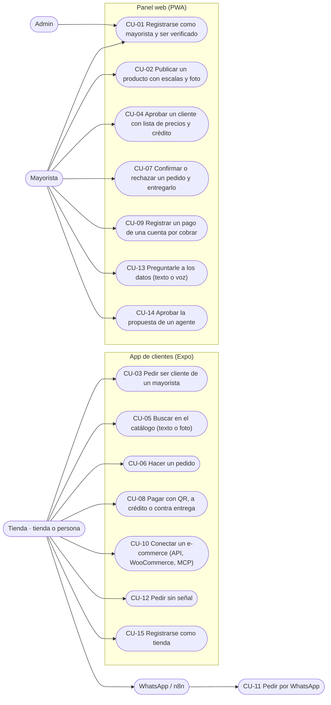

# Casos de uso

Actores y casos del replanteo del 29/10, con la pantalla real de la app de clientes (`apps/app/src/pantallas`), el Panel (`apps/panel-gestion/src/app`), el Superadmin (`apps/superadmin/src/pantallas`), Conecta (`services/conecta/src`) y el Asistente (`services/asistente/src`). La numeración y los dueños son los de la tabla de `README.md`.

La tabla con actor, interfaz, servicios, dueño y fase está en `README.md`. Abajo va el texto de los casos que ya tienen código, en orden.

## CU-02 · Publicar un producto con escalas y foto

**Actor:** Mayorista.
**Precondición:** sesión de Keycloak con una organización de tipo mayorista y el Panel abierto en Gestión → Productos.
**Servicio:** Catálogo.

**Curso básico**

1. `VistaProductos` consulta `MIS_PRODUCTOS` y muestra los productos del mayorista de la sesión.
2. El mayorista toca «Nuevo producto». **Pendiente:** hoy el botón está deshabilitado con `title="Tarea de F1: formulario con escalas"`; no hay formulario.
3. Con el formulario (Pendiente), envía nombre, rubro, descripción, stock inicial, abastecimiento, horas de entrega, costo, proveedor y una o más escalas.
4. La mutación `crearProducto` llama a `CrearProducto::ejecutar`, que valida el código, el stock y las escalas.
5. `Producto` guarda las escalas y deriva el estado del stock: con stock queda `ACTIVO`; sin stock queda `SIN_STOCK`, salvo que sea `BAJO_PEDIDO`.
6. El resolver devuelve el `Producto` y la vista lo agrega a la lista.

**Cursos alternos**

- Si falta el código, Catálogo responde `CODIGO_INVALIDO`: «El producto necesita un código».
- Si el stock es negativo, `STOCK_INVALIDO`: «El stock no puede quedar negativo».
- Si ya existe un producto del mismo mayorista con ese código, `CODIGO_REPETIDO`: «Ya tienes un producto con el código {codigo}».
- Si una escala no trae unidades, `ESCALA_INVALIDA`: «Una presentación tiene que traer al menos una unidad».
- Si el precio no es mayor a cero, `PRECIO_INVALIDO`: «El precio tiene que ser mayor a cero».
- La foto no existe en el modelo: `Producto` no tiene campo de imagen, no hay carga de archivos y `cargarProducto` solo recibe nombre, rubro, presentación, unidades y precio. **Pendiente:** foto y formulario.

## CU-04 · Aprobar un cliente con lista de precios y crédito

**Actor:** Mayorista.
**Precondición:** existe una `RelacionComercial` en estado `SOLICITADA` entre la tienda y el mayorista de la sesión.
**Servicios:** Catálogo y Cobros.

**Curso básico**

1. El mayorista abre Gestión → Clientes; `vistas/clientes.ts` consulta `MIS_SOLICITUDES`.
2. El resolver `misSolicitudes` consulta `RelacionRepositorio::solicitudesDe` y devuelve las relaciones `SOLICITADA` con la tienda y su estado.
3. El mayorista elige una lista —`NUEVOS` 100 %, `FRECUENTES` 97 % o `VIP` 95 %— y toca «Aprobar».
4. La vista envía la mutación `aprobarCliente(tiendaId, lista)` por el Router.
5. `GestionarClientes::aprobar` busca la relación; si no existe lanza `SOLICITUD_NO_EXISTE`: «Esa tienda no pidió ser tu cliente».
6. `RelacionComercial::aprobar(lista)` pasa la relación a `APROBADA` y `RelacionRepositorio::guardar` la persiste.
7. El resolver devuelve la relación y la vista recarga la lista.

**Cursos alternos**

- Si el mayorista rechaza, la vista envía `rechazarCliente(tiendaId)`; `GestionarClientes::rechazar` llama a `RelacionComercial::rechazar()` y la relación queda `RECHAZADA`.
- Si la tienda vuelve a pedir, `volverASolicitar()` la deja en `SOLICITADA`; si ya estaba `APROBADA`, no la cambia.
- **Crédito Pendiente:** `GestionarClientes::aprobar` no crea una `LineaDeCredito` ni publica `cobro.credito_autorizado`. Cobros sí tiene `autorizarCredito`, `lineaDeCredito` y el evento, pero Gestión no los llama. `vistas/clientes.ts` tiene un TODO de crédito y no muestra límite ni plazo.

## CU-05 · Buscar en el catálogo (texto o foto)

**Actor:** Cliente.
**Precondición:** la app tiene sesión y un catálogo guardado de una consulta anterior, o hay señal para pedirlo.
**Servicios:** Catálogo y ML en el teléfono.

**Curso básico**

1. `estado.tsx` carga `CONSULTA_CATALOGO` y guarda `{productos, mayoristas, actualizado}` en `guardado.ts` (AsyncStorage, prefijo `abasto:`).
2. El cliente abre Buscar y escribe texto; `filtrar` recorre el catálogo guardado y muestra productos.
3. Puede cambiar a vendedores; `filtrarMayoristas` y `ordenarMayoristas` ordenan por nombre, nunca por precio.
4. En BuscarPorFoto, el cliente toma una foto o elige una de la galería con `expo-image-picker`.
5. `leerTexto` (ML Kit) lee el texto de la imagen; `palabrasClave` lo limpia y `buscarPorTextoLeido` busca en el catálogo del teléfono.
6. El resultado se muestra agrupado por vendedor; el precio solo aparece si `PoliticaDePrecios` lo permite.

**Cursos alternos**

- Si el cliente niega el permiso de cámara: «Abasto necesita la cámara para buscar con una foto. Actívala en los ajustes del teléfono.»
- Sin señal, la búsqueda sigue sobre el catálogo guardado; si nunca hubo catálogo, la lista queda vacía.
- **ML Pendiente:** no hay modelo TFLite conectado. `apps/app/src/modelo.ts` solo calcula tamaños de tensor (`elementosDe`, `bytesDe`, `entradaNeutra`, `describirTensor`); ninguna pantalla carga un modelo ni llama a inferencia. La foto hoy se resuelve con OCR, no con un modelo de objetos.

## CU-06 · Hacer un pedido

**Actor:** Cliente.
**Precondición:** hay productos en el carrito, la app tiene sesión y el catálogo se cargó al menos una vez.
**Servicios:** Pedidos, Catálogo y Cobros.

**Curso básico**

1. `Finalizar.tsx` agrupa el carrito con `porMayorista(carrito)` y calcula el total con `totalDe`.
2. El cliente elige `QR`, `CONTRA_ENTREGA` o `CREDITO`. Si elige crédito, la app consulta `lineaDeCredito(tiendaId, mayoristaId)` para mostrar el disponible.
3. Al tocar «Hacer pedido», `Finalizar` no llama al servidor: deja un pedido por vendedor en la bandeja con `Bandeja.agregar('pedido.crear', datos)` y una clave `Crypto.randomUUID()`.
4. `Bandeja.sincronizar()` envía el lote a Conecta (`POST /v1/sincronizacion/lotes`, máximo 100). `SincronizarLote` calcula `huellaDe`, reserva la clave en `RegistroDeIdempotencia` y llama a `DestinoGraphQL`.
5. El Router ejecuta la mutación `crearPedido`. `PedidosServicio.ejecutar` busca por clave; si ya existe devuelve el mismo pedido. Si es nuevo, `Pedido.nuevo` valida y `SagaDeCompra.iniciar` deja `pedido.creado` y `catalogo.reservar_stock` en el outbox.
6. RabbitMQ entrega `catalogo.reservar_stock` a Catálogo. `ReservarStock` descuenta stock solo en las líneas `STOCK`; las `BAJO_PEDIDO` no descuentan. Responde `stock.reservado` con precios o `stock.rechazado` con motivo.
7. `RespuestasListener` entrega la respuesta a `SagaServicio.alRecibir`. Con `stock.reservado`, `SagaDeCompra.alReservarStock` fija los precios:
   - `CONTRA_ENTREGA`: pasa directo a `ESPERANDO_MAYORISTA` y emite `pedido.por_confirmar`.
   - `QR`: emite `cobros.generar_qr`.
   - `CREDITO`: emite `cobros.autorizar_credito`.
8. Cobros atiende el comando. El QR queda `PENDIENTE` sin evento; el crédito emite `cobro.credito_autorizado`. En ambos casos `SagaDeCompra.alCobrar` pasa a `ESPERANDO_MAYORISTA` y emite `pedido.por_confirmar`.
9. La app muestra el pedido en Pedidos y el seguimiento. El mayorista lo confirma en Gestión (CU-07) y el pedido sigue `CONFIRMADO` → `EN_PREPARACION` → `DESPACHADO` → `ENTREGADO`.

**Cursos alternos**

- Si el carrito está vacío, `PEDIDO_VACIO`: «El pedido tiene que tener al menos un producto».
- Si la tienda y el mayorista son la misma organización, `PEDIDO_A_SI_MISMO`: «Una empresa no puede hacerse un pedido a sí misma».
- Si una cantidad es cero o negativa, `CANTIDAD_INVALIDA`: «La cantidad tiene que ser mayor a cero».
- Si Catálogo no tiene stock, responde `stock.rechazado` con el motivo. `SagaDeCompra.alFallarReserva` rechaza el pedido, emite `pedido.rechazado` y no se cobra nada.
- Si Cobros rechaza el crédito, emite `cobro.rechazado` con el motivo. `SagaDeCompra.alFallarCobro` entra en `COMPENSANDO`: emite `cobros.liberar_credito` si había crédito, `catalogo.liberar_stock` si había stock y `pedido.rechazado`. Las respuestas `cobro.credito_liberado` y `stock.liberado` cierran la compensación.
- Si el QR no se paga, `VencerQrs` lo marca `VENCIDO` y emite `cobro.rechazado` con «El QR venció sin que se pagara»; la saga libera el stock con `catalogo.liberar_stock`.
- Si el mayorista no responde en 2 h, `RevisorDePlazos` llama a `SagaDeCompra.alRevisarPlazo`, que compensa con el motivo «El mayorista no respondió a tiempo».
- Si la red falla antes de enviar, la operación queda pendiente y la maneja CU-12.
- Los errores de idempotencia de Conecta son: «La misma clave llegó con otro contenido» y «La operación se está aplicando; reintenta en unos segundos».

## CU-07 · Confirmar o rechazar un pedido y entregarlo

**Actor:** Mayorista.
**Precondición:** el pedido está `POR_CONFIRMAR` y pertenece al mayorista de la sesión.
**Servicio:** Pedidos.

**Curso básico**

1. El mayorista abre Gestión → Pedidos; `vistas/pedidos.ts` consulta `MIS_VENTAS`.
2. `VistaPedidos` muestra los pedidos y, para los confirmados, el siguiente paso: `CONFIRMADO` → «Preparar», `EN_PREPARACION` → «Despachar», `DESPACHADO` → «Marcar entregado».
3. El mayorista toca «Confirmar». La vista envía `confirmarPedido(id)`.
4. `PedidosServicio.confirmar` busca el pedido entre las ventas del mayorista. Si no está, `PEDIDO_NO_EXISTE`: «No existe ese pedido entre tus ventas».
5. `SagaDeCompra.alConfirmarMayorista` exige `ESPERANDO_MAYORISTA`; si no, `PEDIDO_NO_ESPERA_CONFIRMACION`: «El pedido {codigo} no está esperando confirmación».
6. `Pedido.confirmar()` pasa a `CONFIRMADO` y la saga emite `pedido.confirmado` por el outbox.
7. Para avanzar, la vista envía `avanzarEntrega(id)`. `PedidosServicio.avanzar` llama a `Pedido.avanzarEntrega()` y el pedido pasa por `EN_PREPARACION`, `DESPACHADO` y `ENTREGADO`.
8. Cada avance deja en el outbox `pedido.en_preparacion`, `pedido.despachado` o `pedido.entregado`; Asistente los proyecta y Conecta los manda por webhook si la tienda está conectada.
9. Si el mayorista rechaza, escribe el motivo y la vista envía `rechazarPedido(id, motivo)`. La saga compensa: `cobros.liberar_credito` o `cobros.devolver_qr`, `catalogo.liberar_stock` y `pedido.rechazado` con el motivo.

**Cursos alternos**

- Si el pedido no tiene saga, `SAGA_NO_EXISTE`: «El pedido {codigo} no tiene saga».
- Si se intenta avanzar un pedido que no está `CONFIRMADO`, `EN_PREPARACION` o `DESPACHADO`, `NO_SE_PUEDE_AVANZAR`: «El pedido {codigo} está {estado}: solo se avanza un pedido confirmado que todavía no se entregó».
- Si el mayorista intenta confirmar un pedido que ya no espera, `PEDIDO_NO_ESPERA_CONFIRMACION`.
- Si el pedido no pertenece al mayorista, `PEDIDO_NO_EXISTE`; no se puede confirmar ni avanzar un pedido ajeno.
- Si el pago fue por QR y estaba pagado, la compensación usa `cobros.devolver_qr` y espera `cobro.qr_devuelto`; si fue a crédito, usa `cobros.liberar_credito` y espera `cobro.credito_liberado`.
- **Pendiente:** no hay una pantalla para ver el historial de compensaciones ni el detalle del motivo de un rechazo anterior; el estado y el motivo se guardan en el pedido.

## CU-12 · Hacer un pedido sin señal

**Actor:** Cliente.
**Precondición:** la app ya cargó el catálogo y el carrito; el teléfono perdió la señal antes o durante el envío.
**Servicios:** Conecta y Pedidos.

**Curso básico**

1. `guardado.ts` guarda catálogo, carrito y datos de la app en AsyncStorage con el prefijo `abasto:`; si falla, no interrumpe la pantalla.
2. `Finalizar` crea una `OperacionLocal` por vendedor en la `Bandeja` de `packages/outbox-offline`; el almacén es `AlmacenEnTelefono`, que usa AsyncStorage con la clave `bandeja`.
3. La operación queda `pendiente` con su clave UUID, `creadaEn`, `intentos` y sin respuesta.
4. Cuando vuelve la señal, `Bandeja.sincronizar()` toma hasta 100 pendientes y los manda con `enviarAConecta(URLS.conecta, token)`.
5. `SincronizarLote` calcula la huella de cada operación y reserva la clave. Si es nueva, aplica `crearPedido` por el Router y guarda la respuesta.
6. La bandeja marca la operación `aplicada` y la quita de pendientes; el pedido aparece en `MIS_COMPRAS`.

**Cursos alternos**

- Si no hay red, `intentos` sube y la operación sigue `pendiente`; se reintenta con la misma clave.
- Si la clave ya se había aplicado, Conecta responde `repetida` con la respuesta original y la bandeja la marca `aplicada`.
- Si la misma clave llega con otro contenido, Conecta responde `conflicto`: «La misma clave llegó con otro contenido».
- Si otra petición está aplicando la misma clave, responde `rechazada`: «La operación se está aplicando; reintenta en unos segundos».
- Si el destino falla, Conecta libera la clave para que el reintento pueda aplicarla.
- **Pendiente:** no hay una pantalla que muestre el detalle de `intentos` o del último error; la bandeja los guarda, pero la app no los expone.

## CU-13 · Preguntarle a los datos (texto o voz)

**Actor:** Mayorista.
**Precondición:** hay una sesión con `org_id`; el Asistente tiene acceso de solo lectura a la base de reportes.
**Servicio:** Asistente.

**Curso básico**

1. El mayorista abre Inteligencia → Reportes y escribe una pregunta, por ejemplo «¿Qué tiendas me tienen que pagar mañana?».
2. Si usa el micrófono, `usarVoz` graba y `transcriptorWhisper` transcribe en el navegador; el texto llena la pregunta y dispara la consulta.
3. `Reportes.vue` hace `POST /v1/reportes/preguntas` con `{texto}`.
4. `ResponderPregunta.ejecutar` pide al `ModeloDeLenguaje` una `SalidaConsulta` con `sql`, `explicacion` y `grafico`.
5. `ConsultarReportes.ejecutar` valida el SQL con `validarConsulta` (parser de PostgreSQL, solo `SELECT`, una sentencia, tablas y funciones permitidas, sin `SELECT INTO` ni `FOR UPDATE`).
6. `ConsultorPostgres` abre `BEGIN READ ONLY`, fija `SET LOCAL statement_timeout='5s'` y `SET LOCAL abasto.org_id`, y consulta con el rol `mcp_lector`. Lee como máximo 1000 filas y marca `truncado` si hay más.
7. `AuditoriaDynamoDB` registra la pregunta, el SQL, el resultado (`ok`, `rechazada` o `error`) y las filas devueltas.
8. El Asistente responde `{pregunta, sql, explicacion, grafico, columnas, filas, truncado, modelo}`; la vista muestra tabla, gráfico y el botón de Excel.

**Cursos alternos**

- Si `validarConsulta` rechaza el SQL, `ConsultarReportes` audita `rechazada` y lanza `ConsultaRechazada`; la vista muestra «No pude armar ese reporte: {motivo}».
- Si el `org_id` no cumple `^[a-z0-9_-]{1,40}$`, `ConsultorPostgres` falla con «La sesión no tiene una empresa válida».
- Si PostgreSQL falla, se audita `error` y la vista recibe el error; no se devuelven filas.
- Si el resultado supera 1000 filas, se devuelve `truncado: true` y la vista avisa que hay más.
- «Exportar a Excel» llama a `POST /v1/reportes/excel` con la misma consulta y descarga el archivo.
- El MCP `consultar_reportes` usa la misma guardia y el mismo consultor; no tiene una ruta alterna a la base.
- **Pendiente:** la voz depende del navegador y de Whisper; en la app móvil no hay pantalla de reportes.

## CU-14 · Aprobar la propuesta de un agente

**Actor:** Mayorista.
**Precondición:** existe al menos una propuesta pendiente en el Asistente.
**Servicios:** Asistente y n8n.

**Curso básico**

1. El mayorista abre Inteligencia → Agentes; `Agentes.vue` consulta `GET /v1/agentes` y `GET /v1/agentes/propuestas`.
2. La vista muestra la propuesta (por ejemplo, un recordatorio de cobranza para las cuentas que vencen mañana).
3. El mayorista aprueba o rechaza; la vista hace `POST /v1/agentes/propuestas/:id/decision`.
4. `DecidirPropuesta` guarda la decisión. Si se aprueba, `EjecutorN8n` hace `POST N8N_WEBHOOK_ACCIONES` con `idempotency-key: propuesta.id`.
5. n8n ejecuta la acción aprobada (el flujo de WhatsApp) y la propuesta queda resuelta en la vista.

**Cursos alternos**

- Si `N8N_WEBHOOK_ACCIONES` no está configurado, `EjecutorN8n` no falla: devuelve `{enviado:false, detalle:'n8n no está configurado (N8N_WEBHOOK_ACCIONES)'}` y deja un warning.
- Si la propuesta se rechaza, no se llama a n8n.
- El agente de cobranza consulta `cuentas_por_cobrar` con `vence = current_date + 1 AND estado = 'pendiente'` y propone `enviar_recordatorio_whatsapp`.
- **Pendiente:** solo `EjecutarCobranza` tiene caso de uso de ejecución. `reposicion`, `catalogo` y `analista` están definidos en `AGENTES` con sus cron, pero no tienen ejecución implementada. El envío real por WhatsApp depende de que n8n esté configurado.
