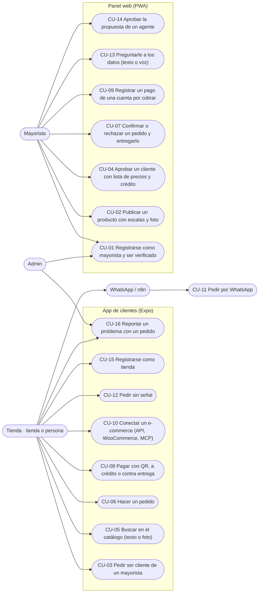

# Casos de uso

Actores y casos del replanteo del 29/10, con la pantalla real de la app de clientes (`apps/app/src/pantallas`), el Panel (`apps/panel-gestion/src/app`), el Superadmin (`apps/superadmin/src/pantallas`), Conecta (`services/conecta/src`) y el Asistente (`services/asistente/src`). La numeración y los dueños son los de la tabla de `README.md`.

La tabla con actor, interfaz, servicios, dueño y fase está en `README.md`. Abajo va el texto de los casos que ya tienen código, en orden.

## CU-01 · Registrarse como mayorista y ser verificado

**Actores:** Mayorista y Admin.
**Precondición:** ninguna; el registro es público.
**Servicios:** Catálogo y Keycloak.

**Curso básico**

1. El mayorista abre `/registro` en el Panel y escribe empresa, NIT, ciudad, representante, teléfono, correo y contraseña.
2. `RegistrarOrganizacion::mayorista` valida los datos y que el NIT no esté en uso.
3. `KeycloakCuentas::crear` crea la cuenta con su `org_id` y el grupo `mayoristas`; la `Organizacion` queda `PENDIENTE`.
4. Al entrar, el Panel le muestra que está en revisión.
5. El admin abre Superadmin › Mayoristas, revisa el NIT, habla con el representante y toca «Verificar».
6. `VerificarMayorista::aprobar` lo deja `VERIFICADO`: sus productos salen en la app.

**Cursos alternos**

- Datos incompletos: `DATOS_INVALIDOS`. NIT repetido: `NIT_EN_USO`. Correo repetido: `CORREO_EN_USO`.
- Si el admin rechaza, tiene que escribir el motivo (`MOTIVO_REQUERIDO`) y el mayorista lo ve en su Panel.

**Prueba:** `services/catalogo/tests/Unit/{RegistroDeOrganizacionesTest,VerificacionTest}.php` y `e2e/pruebas/registro-mayorista.spec.ts`.

## CU-02 · Publicar un producto con escalas y foto

**Actor:** Mayorista.
**Precondición:** sesión de Keycloak con una organización de tipo mayorista y el Panel abierto en Gestión → Productos.
**Servicio:** Catálogo.

**Curso básico**

1. `VistaProductos` consulta `MIS_PRODUCTOS` y muestra los productos del mayorista de la sesión.
2. El mayorista toca «Nuevo producto». **Pendiente:** hoy el botón está deshabilitado con `title="Tarea de F1: formulario con escalas"`; no hay formulario.
3. Con el formulario (Pendiente), envía nombre, rubro, descripción, stock inicial, abastecimiento, horas de entrega, costo, proveedor y una o más escalas.
4. La mutación `crearProducto` llama a `CrearProducto::ejecutar`, que valida el código, el stock y las escalas.
5. `Producto` guarda las escalas y deriva el estado del stock: con stock queda `ACTIVO`; sin stock queda `SIN_STOCK`, salvo que sea `BAJO_PEDIDO`.
6. El resolver devuelve el `Producto` y la vista lo agrega a la lista.

**Cursos alternos**

- Si falta el código, Catálogo responde `CODIGO_INVALIDO`: «El producto necesita un código».
- Si el stock es negativo, `STOCK_INVALIDO`: «El stock no puede quedar negativo».
- Si ya existe un producto del mismo mayorista con ese código, `CODIGO_REPETIDO`: «Ya tienes un producto con el código {codigo}».
- Si una escala no trae unidades, `ESCALA_INVALIDA`: «Una presentación tiene que traer al menos una unidad».
- Si el precio no es mayor a cero, `PRECIO_INVALIDO`: «El precio tiene que ser mayor a cero».
- La foto se carga aparte (`CambiarFotoDeProducto`); un producto sin foto muestra la ilustración de su rubro en la app.

## CU-03 · Pedir ser cliente de un mayorista

**Actor:** Tienda.
**Precondición:** la tienda entró a la app y el mayorista está verificado.
**Servicio:** Catálogo.

**Curso básico**

1. La tienda abre la ficha del vendedor. Sin relación aprobada, ve los productos sin precio (red privada).
2. Toca «Pedir ser cliente»; la app envía `pedirSerCliente(mayoristaId)`.
3. `GestionarClientes::pedirSerCliente` crea la `RelacionComercial` en `SOLICITADA`.
4. La solicitud aparece en Panel › Clientes del mayorista (CU-04).

**Cursos alternos**

- Mayorista que no existe: `MAYORISTA_NO_EXISTE`. Una empresa no puede ser cliente de sí misma: `RELACION_CONSIGO_MISMO`.
- Si ya estaba aprobada, no cambia; si la rechazaron, vuelve a `SOLICITADA`.
- Abasto, el vendedor de la casa, no pide este paso: cualquier tienda registrada ve sus precios.

**Prueba:** `services/catalogo/tests/Unit/RedPrivadaTest.php` y `e2e/pruebas/red-privada.spec.ts`.

## CU-04 · Aprobar un cliente con lista de precios y crédito

**Actor:** Mayorista.
**Precondición:** existe una `RelacionComercial` en estado `SOLICITADA` entre la tienda y el mayorista de la sesión.
**Servicios:** Catálogo y Cobros.

**Curso básico**

1. El mayorista abre Gestión → Clientes; `vistas/clientes.ts` consulta `MIS_SOLICITUDES`.
2. El resolver `misSolicitudes` consulta `RelacionRepositorio::solicitudesDe` y devuelve las relaciones `SOLICITADA` con la tienda y su estado.
3. El mayorista elige una lista —`NUEVOS` 100 %, `FRECUENTES` 97 % o `VIP` 95 %—, escribe si quiere el crédito y el plazo (15 o 30 días) y toca «Aprobar».
4. La vista envía la mutación `aprobarCliente(tiendaId, lista)` por el Router.
5. `GestionarClientes::aprobar` busca la relación; si no existe lanza `SOLICITUD_NO_EXISTE`: «Esa tienda no pidió ser tu cliente».
6. `RelacionComercial::aprobar(lista)` pasa la relación a `APROBADA` y `RelacionRepositorio::guardar` la persiste.
7. El resolver devuelve la relación. Si hubo crédito, la vista envía `asignarCredito(entrada)` a Cobros: `AsignarCredito` abre la `LineaDeCredito` del mayorista del token.
8. La vista recarga: la tienda pasa a «Te compran» con lo que tiene disponible.

**Cursos alternos**

- Si el mayorista rechaza, la vista envía `rechazarCliente(tiendaId)`; `GestionarClientes::rechazar` llama a `RelacionComercial::rechazar()` y la relación queda `RECHAZADA`.
- Si la tienda vuelve a pedir, `volverASolicitar()` la deja en `SOLICITADA`; si ya estaba `APROBADA`, no la cambia.
- Si Cobros falla después de aprobar, la tienda queda aprobada y la vista avisa que el crédito no se guardó; se le da desde su tarjeta.
- Desde «Te compran», «Dar crédito» o «Cambiar crédito» usa la misma mutación. Con límite 0 la tienda deja de comprar a crédito. Si el límite queda por debajo de lo usado, Cobros responde `LIMITE_MENOR_QUE_LO_USADO`.

**Prueba:** `services/cobros/src/aplicacion/asignar-credito.spec.ts`, `apps/panel-gestion/src/app/vistas/clientes.spec.ts` y `e2e/pruebas/credito.spec.ts`.

## CU-05 · Buscar en el catálogo (texto o foto)

**Actor:** Cliente.
**Precondición:** la app tiene sesión y un catálogo guardado de una consulta anterior, o hay señal para pedirlo.
**Servicios:** Catálogo y ML en el teléfono.

**Curso básico**

1. `estado.tsx` carga `CONSULTA_CATALOGO` y guarda `{productos, mayoristas, actualizado}` en `guardado.ts` (AsyncStorage, prefijo `abasto:`).
2. El cliente abre Buscar y escribe texto; `filtrar` recorre el catálogo guardado y muestra productos.
3. Puede cambiar a vendedores; `filtrarMayoristas` y `ordenarMayoristas` ordenan por nombre, nunca por precio.
4. En BuscarPorFoto, la tienda toma una foto o elige una de la galería con `expo-image-picker`.
5. En el teléfono y sin internet, en paralelo: `leerTexto` (ML Kit) lee el texto de la etiqueta y `reconocerProducto` recorta la foto con `recorteCentrado`, la reduce a 224×224 con `expo-image-manipulator`, la pasa por `aEntradaDelModelo` y corre `productos.tflite`; `masParecidos` compara el vector con los de `vectores.json` por similitud coseno.
6. `palabrasClave` limpia lo leído y `buscarPorTextoLeido` busca en el catálogo del teléfono; `combinarConTexto` suma los códigos que leyó el texto a los que reconoció la imagen y la pantalla muestra los productos ordenados por confianza.
7. El resultado se muestra agrupado por vendedor; el precio solo aparece si `PoliticaDePrecios` lo permite.

**Cursos alternos**

- Si el cliente niega el permiso de cámara: «Abasto necesita la cámara para buscar con una foto. Actívala en los ajustes del teléfono.»
- Sin señal, la búsqueda sigue sobre el catálogo guardado; si nunca hubo catálogo, la lista queda vacía.
- Si el modelo está sin entrenar, `vectores.json` trae `productos: []`; `reconocerProducto` devuelve `[]` y la búsqueda queda solo con el texto leído.
- **Pendiente en la pantalla:** `BuscarPorFoto.tsx` ya llama a `leerTexto` y `buscarPorTextoLeido`; la llamada a `reconocerProducto` y `combinarConTexto` está pedida a Andrés en `docs/equipo/jhoel.md`.

## CU-06 · Hacer un pedido

**Actor:** Cliente.
**Precondición:** hay productos en el carrito, la app tiene sesión y el catálogo se cargó al menos una vez.
**Servicios:** Pedidos, Catálogo y Cobros.

**Curso básico**

1. `Finalizar.tsx` agrupa el carrito con `porMayorista(carrito)` y calcula el total con `totalDe`.
2. El cliente elige `QR`, `CONTRA_ENTREGA` o `CREDITO`. Si elige crédito, la app consulta `lineaDeCredito(tiendaId, mayoristaId)` para mostrar el disponible.
3. Al tocar «Hacer pedido», `Finalizar` no llama al servidor: deja un pedido por vendedor en la bandeja con `Bandeja.agregar('pedido.crear', datos)` y una clave `Crypto.randomUUID()`.
4. `Bandeja.sincronizar()` envía el lote a Conecta (`POST /v1/sincronizacion/lotes`, máximo 100). `SincronizarLote` calcula `huellaDe`, reserva la clave en `RegistroDeIdempotencia` y llama a `DestinoGraphQL`.
5. El Router ejecuta la mutación `crearPedido`. `PedidosServicio.ejecutar` busca por clave; si ya existe devuelve el mismo pedido. Si es nuevo, `Pedido.nuevo` valida y `SagaDeCompra.iniciar` deja `pedido.creado` y `catalogo.reservar_stock` en el outbox.
6. RabbitMQ entrega `catalogo.reservar_stock` a Catálogo. `ReservarStock` descuenta stock solo en las líneas `STOCK`; las `BAJO_PEDIDO` no descuentan. Responde `stock.reservado` con precios o `stock.rechazado` con motivo.
7. `RespuestasListener` entrega la respuesta a `SagaServicio.alRecibir`. Con `stock.reservado`, `SagaDeCompra.alReservarStock` fija los precios:
   - `CONTRA_ENTREGA`: pasa directo a `ESPERANDO_MAYORISTA` y emite `pedido.por_confirmar`.
   - `QR`: emite `cobros.generar_qr`.
   - `CREDITO`: emite `cobros.autorizar_credito`.
8. Cobros atiende el comando. El QR queda `PENDIENTE` sin evento; el crédito emite `cobro.credito_autorizado`. En ambos casos `SagaDeCompra.alCobrar` pasa a `ESPERANDO_MAYORISTA` y emite `pedido.por_confirmar`.
9. La app muestra el pedido en Pedidos y el seguimiento. El mayorista lo confirma en Gestión (CU-07) y el pedido sigue `CONFIRMADO` → `EN_PREPARACION` → `DESPACHADO` → `ENTREGADO`.

**Cursos alternos**

- Si el carrito está vacío, `PEDIDO_VACIO`: «El pedido tiene que tener al menos un producto».
- Si la tienda y el mayorista son la misma organización, `PEDIDO_A_SI_MISMO`: «Una empresa no puede hacerse un pedido a sí misma».
- Si una cantidad es cero o negativa, `CANTIDAD_INVALIDA`: «La cantidad tiene que ser mayor a cero».
- Si Catálogo no tiene stock, responde `stock.rechazado` con el motivo. `SagaDeCompra.alFallarReserva` rechaza el pedido, emite `pedido.rechazado` y no se cobra nada.
- Si Cobros rechaza el crédito, emite `cobro.rechazado` con el motivo. `SagaDeCompra.alFallarCobro` entra en `COMPENSANDO`: emite `cobros.liberar_credito` si había crédito, `catalogo.liberar_stock` si había stock y `pedido.rechazado`. Las respuestas `cobro.credito_liberado` y `stock.liberado` cierran la compensación.
- Si el QR no se paga, `VencerQrs` lo marca `VENCIDO` y emite `cobro.rechazado` con «El QR venció sin que se pagara»; la saga libera el stock con `catalogo.liberar_stock`.
- Si el mayorista no responde en 2 h, `RevisorDePlazos` llama a `SagaDeCompra.alRevisarPlazo`, que compensa con el motivo «El mayorista no respondió a tiempo».
- Si la red falla antes de enviar, la operación queda pendiente y la maneja CU-12.
- Los errores de idempotencia de Conecta son: «La misma clave llegó con otro contenido» y «La operación se está aplicando; reintenta en unos segundos».

## CU-07 · Confirmar o rechazar un pedido y entregarlo

**Actor:** Mayorista.
**Precondición:** el pedido está `POR_CONFIRMAR` y pertenece al mayorista de la sesión.
**Servicio:** Pedidos.

**Curso básico**

1. El mayorista abre Gestión → Pedidos; `vistas/pedidos.ts` consulta `MIS_VENTAS`.
2. `VistaPedidos` muestra los pedidos y, para los confirmados, el siguiente paso: `CONFIRMADO` → «Preparar», `EN_PREPARACION` → «Despachar», `DESPACHADO` → «Marcar entregado».
3. El mayorista toca «Confirmar». La vista envía `confirmarPedido(id)`.
4. `PedidosServicio.confirmar` busca el pedido entre las ventas del mayorista. Si no está, `PEDIDO_NO_EXISTE`: «No existe ese pedido entre tus ventas».
5. `SagaDeCompra.alConfirmarMayorista` exige `ESPERANDO_MAYORISTA`; si no, `PEDIDO_NO_ESPERA_CONFIRMACION`: «El pedido {codigo} no está esperando confirmación».
6. `Pedido.confirmar()` pasa a `CONFIRMADO` y la saga emite `pedido.confirmado` por el outbox.
7. Para avanzar, la vista envía `avanzarEntrega(id)`. `PedidosServicio.avanzar` llama a `Pedido.avanzarEntrega()` y el pedido pasa por `EN_PREPARACION`, `DESPACHADO` y `ENTREGADO`.
8. Cada avance deja en el outbox `pedido.en_preparacion`, `pedido.despachado` o `pedido.entregado`; Asistente los proyecta y Conecta los manda por webhook si la tienda está conectada.
9. Si el mayorista rechaza, escribe el motivo y la vista envía `rechazarPedido(id, motivo)`. La saga compensa: `cobros.liberar_credito` o `cobros.devolver_qr`, `catalogo.liberar_stock` y `pedido.rechazado` con el motivo.

**Cursos alternos**

- Si el pedido no tiene saga, `SAGA_NO_EXISTE`: «El pedido {codigo} no tiene saga».
- Si se intenta avanzar un pedido que no está `CONFIRMADO`, `EN_PREPARACION` o `DESPACHADO`, `NO_SE_PUEDE_AVANZAR`: «El pedido {codigo} está {estado}: solo se avanza un pedido confirmado que todavía no se entregó».
- Si el mayorista intenta confirmar un pedido que ya no espera, `PEDIDO_NO_ESPERA_CONFIRMACION`.
- Si el pedido no pertenece al mayorista, `PEDIDO_NO_EXISTE`; no se puede confirmar ni avanzar un pedido ajeno.
- Si el pago fue por QR y estaba pagado, la compensación usa `cobros.devolver_qr` y espera `cobro.qr_devuelto`; si fue a crédito, usa `cobros.liberar_credito` y espera `cobro.credito_liberado`.
- **Pendiente:** no hay una pantalla para ver el historial de compensaciones ni el detalle del motivo de un rechazo anterior; el estado y el motivo se guardan en el pedido.

## CU-08 · Pagar con QR, a crédito o contra entrega

**Actor:** Tienda.
**Precondición:** la tienda está haciendo un pedido (CU-06).
**Servicios:** Cobros y Pedidos.

**Curso básico**

1. En Finalizar elige cómo paga. Crédito solo se puede si `lineaDeCredito` tiene cupo para el total.
2. **Crédito:** `AutorizarCredito` reserva el monto y sale `cobro.credito_autorizado`.
3. **QR:** `GenerarQr` crea el cobro, que vence a los 30 minutos, y sale `cobro.qr_generado`. Seguimiento muestra el QR; al pagar, `PagarQr` lo marca `PAGADO` y sale `cobro.qr_pagado`.
4. **Contra entrega:** no pasa por Cobros en este paso; se cobra al entregar (CU-09).
5. El pedido queda `POR_CONFIRMAR` esperando al mayorista (CU-07).

**Cursos alternos**

- Sin cupo: `LIMITE_DE_CREDITO_EXCEDIDO`, sale `cobro.rechazado` con el motivo y la saga libera el stock.
- QR vencido: `VencerQrs` lo marca y sale `cobro.rechazado`. Intentar pagarlo: `QR_NO_SE_PUEDE_PAGAR`.
- Otra tienda intenta pagarlo: `SIN_PERMISO`.
- **Pendiente:** el pago por QR se simula (`pagarQrDePrueba`). Falta conectar un banco real.

**Prueba:** `services/cobros/src/dominio/cobro-qr.spec.ts`, `services/cobros/src/aplicacion/atender-comando.spec.ts` y `e2e/pruebas/compra.spec.ts`.

## CU-09 · Registrar un pago de una cuenta por cobrar

**Actor:** Mayorista.
**Precondición:** el mayorista confirmó un pedido a crédito o contra entrega (CU-07), así que Cobros ya abrió su cuenta por cobrar.
**Servicio:** Cobros (con Catálogo para el nombre de la tienda, por el Router).

**Curso básico**

1. Al confirmarse el pedido, Pedidos publica `pedido.confirmado`. `ConsumidorDeCuentas` (cola `cobros.cuentas`) llama a `AbrirCuentaDePedido`: si el pedido es a crédito o contra entrega crea `CuentaPorCobrar` con el total. El crédito vence a los `plazoDias` de la `LineaDeCredito` de la tienda; contra entrega se cobra al entregar.
2. El mayorista abre Gestión → Cuentas por cobrar; `vistas/cuentas.ts` consulta `cuentasPorCobrar`. Arriba ve lo que le deben, lo vencido y lo que vence en 7 días; abajo, una tarjeta por cuenta, lo más atrasado primero, con el vencimiento en palabras («Venció hace 5 días»).
3. Toca la cuenta. Al costado ve el pedido, lo pagado, lo que debe y los pagos anteriores.
4. Escribe cuánto le pagó (o toca «Todo» o «La mitad»), elige Efectivo, Transferencia o QR y, si quiere, una nota.
5. La vista envía `registrarPago(entrada)` con un `pagoId` nuevo. `RegistrarPago` busca la cuenta del pedido, comprueba que sea del mayorista del token y llama a `CuentaPorCobrar.registrarPago`.
6. La cuenta suma el pago, queda `PARCIAL` o `PAGADA` y deja `cobro.pago_registrado` (con el saldo) en el outbox, en la misma transacción. Asistente lo proyecta en `cuentas_por_cobrar`.
7. Si una cuenta a crédito queda `PAGADA`, `LineaDeCredito.saldar` quita la reserva del pedido: la tienda recupera ese cupo.
8. La vista muestra «Registraste Bs 100,00 de Almacén Mery: todavía debe Bs 130,00» o «Almacén Mery terminó de pagar A-1051».

**Cursos alternos**

- Si el monto pasa lo que debe, la pantalla lo dice antes de enviar; Cobros lo rechaza igual con `PAGO_MAYOR_QUE_EL_SALDO`: «El pedido {codigo} debe {saldo}: no se puede registrar un pago de {monto}».
- Si el mismo pago llega dos veces (doble toque o reenvío desde la bandeja sin señal), tiene el mismo `pagoId` y se cuenta una sola vez.
- Si dos personas cobran la misma cuenta a la vez y juntas pasan lo que se debe, la base lo frena (`pagado_centavos ≤ centavos`): «Otro pago de esta cuenta se registró recién».
- Si la cuenta es de otro mayorista, `SIN_PERMISO`; si el pedido no tiene cuenta (por QR ya está pagado), `CUENTA_NO_EXISTE`.
- Saldar no publica `cobro.credito_liberado`: ese evento es una compensación de la saga y Pedidos la tomaría como tal.

**Prueba:** `services/cobros/src/aplicacion/cuentas-por-cobrar.spec.ts` (reglas), `apps/panel-gestion/src/app/vistas/cuentas.spec.ts` (pantalla) y `e2e/pruebas/cuentas.spec.ts` (de punta a punta: confirmar A-1051 → la cuenta aparece → dos pagos → pagada).

## CU-10 · Conectar un e-commerce (API, WooCommerce, MCP)

**Actor:** Tienda, su e-commerce o un agente de IA.
**Precondición:** la tienda tiene cuenta (CU-15).
**Servicios:** Conecta y Keycloak; Pedidos y Catálogo por el Router.

**Curso básico**

1. En Cuenta › Conectar mi tienda en línea, la tienda saca una llave. Se muestra una sola vez; Conecta guarda solo su huella y crea una cuenta de Keycloak con el `org_id` de la tienda y el rol `tienda`.
2. La pega en el plugin de WooCommerce, en su e-commerce o en un agente con MCP.
3. Lee el catálogo con sus precios (`GET /v1/productos`, `buscar_productos`). El plugin lo importa como borrador, con la ganancia sumada.
4. Cuando entra una venta, pide con una clave fija (`POST /v1/pedidos`, `crear_pedido`). El plugin saca la clave del sitio, el pedido y el mayorista: reintentar nunca duplica.
5. Registra una dirección de avisos. Cada `pedido.*` y `cobro.*` de esa tienda le llega firmado; el plugin lo deja como nota en el pedido.

**Cursos alternos**

- Llave inventada o revocada: 401. Revocarla corta al momento.
- Una llave no puede sacar otras llaves: 403.
- Misma clave: `repetida`, misma respuesta. Misma clave con otro contenido: `conflicto`. Clave que ya usó otra tienda: `CLAVE_EN_USO`, nunca el pedido ajeno.
- Dirección interna o sin https: `URL_INVALIDA`.
- Aviso que no llega: se reintenta a los 1, 5, 30, 120 y 720 minutos; después queda `fallida` y se reenvía desde la app o el Superadmin.

**Prueba:** `services/conecta/src/aplicacion/integraciones.spec.ts`, `services/conecta/src/interfaz/mcp/servidor-mcp.spec.ts`, `apps/app/src/pantallas/conectar-tienda.test.tsx`, `e2e/pruebas/tienda-en-linea.spec.ts` y, contra un WooCommerce de verdad, `e2e/pruebas/woocommerce.spec.ts`.

## CU-11 · Pedir por WhatsApp

**Actor:** Tienda, por WhatsApp.
**Precondición:** n8n está corriendo con el flujo `pedido-por-whatsapp` activo (`pnpm n8n`).
**Servicios:** Conecta y Pedidos.

**Curso básico**

1. Llega el mensaje con su id, el teléfono y el texto: «2 unidades AB-101, 1 unidad AB-102». Sin decir a quién, le compra a Abasto, contra entrega; a un afiliado se le indica `mayoristaId` y `metodoPago`.
2. n8n convierte cada línea en producto, presentación y cantidad, y deriva la clave del id del mensaje.
3. Manda `POST /v1/pedidos` con `Idempotency-Key` y `X-Abasto-Origen: whatsapp`.
4. `SincronizarLote` reserva la clave, crea el pedido por el Router y anota la bitácora.
5. El mayorista lo ve en Panel › Conecta y en Pedidos.

**Cursos alternos**

- WhatsApp reintenta el mensaje: `repetida` y en el Panel sale «Repetido: no se duplicó».
- Presentación que no existe: `rechazada`, con el motivo a la vista en el Panel.
- Un mensaje que no es un pedido no crea nada: `rechazada`.
- **Pendiente:** el flujo usa la tienda de prueba y un mensaje que se le manda al webhook. Falta conectar un número real y buscar la tienda por su teléfono.

**Prueba:** `services/conecta/src/aplicacion/sincronizar-lote.spec.ts`, `e2e/pruebas/conecta.spec.ts` y, contra el n8n de verdad, `e2e/pruebas/n8n-whatsapp.spec.ts`.

## CU-12 · Hacer un pedido sin señal

**Actor:** Cliente.
**Precondición:** la app ya cargó el catálogo y el carrito; el teléfono perdió la señal antes o durante el envío.
**Servicios:** Conecta y Pedidos.

**Curso básico**

1. `guardado.ts` guarda catálogo, carrito y datos de la app en AsyncStorage con el prefijo `abasto:`; si falla, no interrumpe la pantalla.
2. `Finalizar` crea una `OperacionLocal` por vendedor en la `Bandeja` de `packages/outbox-offline`; el almacén es `AlmacenEnTelefono`, que usa AsyncStorage con la clave `bandeja`.
3. La operación queda `pendiente` con su clave UUID, `creadaEn`, `intentos` y sin respuesta.
4. Cuando vuelve la señal, `Bandeja.sincronizar()` toma hasta 100 pendientes y los manda con `enviarAConecta(URLS.conecta, token)`.
5. `SincronizarLote` calcula la huella de cada operación y reserva la clave. Si es nueva, aplica `crearPedido` por el Router y guarda la respuesta.
6. La bandeja marca la operación `aplicada` y la quita de pendientes; el pedido aparece en `MIS_COMPRAS`.

**Cursos alternos**

- Si no hay red, `intentos` sube y la operación sigue `pendiente`; se reintenta con la misma clave.
- Si la clave ya se había aplicado, Conecta responde `repetida` con la respuesta original y la bandeja la marca `aplicada`.
- Si la misma clave llega con otro contenido, Conecta responde `conflicto`: «La misma clave llegó con otro contenido».
- Si otra petición está aplicando la misma clave, responde `rechazada`: «La operación se está aplicando; reintenta en unos segundos».
- Si el destino falla, Conecta libera la clave para que el reintento pueda aplicarla.
- **Pendiente:** no hay una pantalla que muestre el detalle de `intentos` o del último error; la bandeja los guarda, pero la app no los expone.

## CU-13 · Preguntarle a los datos (texto o voz)

**Actor:** Mayorista.
**Precondición:** hay una sesión con `org_id`; el Asistente tiene acceso de solo lectura a la base de reportes.
**Servicio:** Asistente.

**Curso básico**

1. El mayorista abre Inteligencia → Reportes, que es un chat con el Analista: a la izquierda la conversación y a la derecha la mesa de trabajo. Escribe una pregunta, por ejemplo «¿Qué tiendas me tienen que pagar mañana?», o toca una de las plantillas de la mesa.
2. Si usa el micrófono, `escucharDelMicrofono` junta el audio y detecta cuándo calla, y `transcriptorWhisper` transcribe en el navegador mientras habla: lo entendido aparece en su burbuja. Al callarse, la pregunta sale sola.
3. `Reportes.vue` hace `POST /v1/reportes/preguntas` con `{texto}`.
4. `ResponderPregunta.ejecutar` pide al `ModeloDeLenguaje` una `SalidaConsulta` con `sql`, `explicacion` y `grafico`.
5. `ConsultarReportes.ejecutar` valida el SQL con `validarConsulta` (parser de PostgreSQL, solo `SELECT`, una sentencia, tablas y funciones permitidas, sin `SELECT INTO` ni `FOR UPDATE`).
6. `ConsultorPostgres` abre `BEGIN READ ONLY`, fija `SET LOCAL statement_timeout='5s'` y `SET LOCAL abasto.org_id`, y consulta con el rol `mcp_lector`. Lee como máximo 1000 filas y marca `truncado` si hay más.
7. `AuditoriaDynamoDB` registra la pregunta, el SQL, el resultado (`ok`, `rechazada` o `error`) y las filas devueltas.
8. El Asistente responde `{pregunta, sql, explicacion, grafico, columnas, filas, truncado, modelo}`. El chat muestra la explicación y la mesa arma el reporte en su pestaña con la plantilla que corresponde (`plantillaDe`): números en grande si es una sola fila, gráfico con su resumen o tabla, y el botón de Excel.

**Cursos alternos**

- Si `validarConsulta` rechaza el SQL, `ConsultarReportes` audita `rechazada` y lanza `ConsultaRechazada`; la vista muestra «No pude armar ese reporte: {motivo}».
- Si el `org_id` no cumple `^[a-z0-9_-]{1,40}$`, `ConsultorPostgres` falla con «La sesión no tiene una empresa válida».
- Si PostgreSQL falla, se audita `error` y la vista recibe el error; no se devuelven filas.
- Si el resultado supera 1000 filas, se devuelve `truncado: true` y la vista avisa que hay más.
- «Exportar a Excel» llama a `POST /v1/reportes/excel` con la misma consulta y descarga el archivo.
- El MCP `consultar_reportes` usa la misma guardia y el mismo consultor; no tiene una ruta alterna a la base.
- Si la pregunta es ambigua, el Analista pregunta de vuelta en el chat con 2 a 4 opciones que se eligen con un toque.
- **Pendiente:** la voz depende del navegador y de Whisper, y su velocidad del equipo (de 1 a 11 s por frase); en la app móvil no hay pantalla de reportes.

## CU-14 · Aprobar la propuesta de un agente

**Actor:** Mayorista.
**Precondición:** hay una sesión con `org_id`; el Asistente tiene acceso de solo lectura a la base de reportes.
**Servicios:** Asistente y n8n.

**Curso básico**

1. El mayorista abre Inteligencia → Agentes; `Agentes.vue` consulta `GET /v1/agentes` y `GET /v1/agentes/propuestas`.
2. Toca «Revisar ahora»: `POST /v1/agentes/monitorear` llama a `MonitorearNegocio.monitorear`.
3. `MonitorearNegocio` corre las tres misiones (`MisionCobranza`, `MisionReposicion` y `MisionCatalogo`) con `EjecutarMision.ejecutar`.
4. Cada misión consulta los reportes con `ConsultarReportes.ejecutar` y devuelve `Hallazgo[]`; `EjecutarMision` descarta los que ya esperan una decisión con la misma `clave` y guarda las nuevas con `PropuestasDynamoDB.guardar`.
5. `MonitorearNegocio` responde `{ total, agentes }`; la vista muestra cuántas propuestas nuevas dejó cada agente y recarga la lista.
6. El mayorista toca «Aprobar» o «Rechazar»; la vista hace `POST /v1/agentes/propuestas/:id/decision` con `{ aprobar }`.
7. `DecidirPropuesta.ejecutar` busca la propuesta, `decidir` la pasa a `aprobada` o `rechazada` y guarda la decisión.
8. Si se aprobó, `EjecutorN8n.ejecutar` hace `POST N8N_WEBHOOK_ACCIONES` con `idempotency-key` igual al id de la propuesta; n8n ejecuta la acción (por ejemplo, el WhatsApp de cobranza) y la propuesta sale de la lista.

**Cursos alternos**

- Si la propuesta ya no está `pendiente`, `decidir` lanza `PropuestaYaDecidida`: «La propuesta {id} ya está {estado}».
- Si se rechaza, `decidir` la deja `rechazada`, se guarda y no se llama a `EjecutorN8n`.
- Si `N8N_WEBHOOK_ACCIONES` no está configurado, `EjecutorN8n` no falla: devuelve `{enviado:false, detalle:'n8n no está configurado (N8N_WEBHOOK_ACCIONES)'}` y deja un warning.
- Si una misión falla, `MonitorearNegocio` sigue con las demás y el resumen trae `{ agenteId, nuevas: 0, error }`; la vista muestra «no pudo revisar ({error})».
- Si nada es nuevo, el resumen trae `total: 0` y la vista dice «Todo en orden: ningún agente encontró algo nuevo.».
- `POST /v1/agentes/:id/ejecutar` corre una sola misión; para `analista` responde «El Analista no corre solo: hazle una pregunta en Reportes» y si el id no existe, «No existe el agente {id}».

**Qué propone cada agente**

- **Cobranza** (`MisionCobranza`): las cuentas por cobrar que vencen mañana y están `pendiente` → un `enviar_recordatorio_whatsapp` por cuenta, con el saldo y el mensaje.
- **Reposición** (`MisionReposicion`): con `demandaDeLaSemana`, `enRiesgo` (menos de 7 días de stock) y `cantidadAPedir` (dos semanas), lo que no alcanza → `crear_pedido_a_proveedor`.
- **Catálogo** (`MisionCatalogo`): los productos con `stock = 0` que siguen publicados → `pausar_producto`, primero los que más se venden.

## CU-15 · Registrarse como tienda

**Actor:** Tienda o persona.
**Precondición:** ninguna.
**Servicios:** Catálogo y Keycloak.

**Curso básico**

1. Escribe su celular. `pedirCodigo` guarda la huella de un código de 6 dígitos, que dura 5 minutos, y lo manda.
2. Escribe el código. La primera vez, también su nombre.
3. `EntrarConTelefono` crea la `Organizacion` y su cuenta de Keycloak en el grupo `clientes`. Nunca hay correo ni contraseña.
4. La app recibe una sesión larga y no vuelve a pedir el celular.
5. Elige para qué compra (hogar, tienda o productor) y su dirección. Queda en la base: en otro celular se carga solo.

**Cursos alternos**

- Celular que no es de Bolivia: `TELEFONO_INVALIDO`. Pedir otro código muy pronto: `ESPERA`.
- Código incorrecto: `CODIGO_INCORRECTO`. Muchos intentos: `CODIGO_BLOQUEADO`. Venció: `CODIGO_VENCIDO`.
- Cuenta suspendida por Abasto: `CUENTA_SUSPENDIDA`.
- **Pendiente:** el código se muestra en la app («Modo prueba»). Falta conectar WhatsApp para mandarlo de verdad.

**Prueba:** `services/catalogo/tests/Unit/EntrarConTelefonoTest.php`, `apps/app/src/acceso.test.ts` y `e2e/pruebas/registro-tienda.spec.ts`.

## CU-16 · Reportar un problema con un pedido

**Actores:** Tienda y Admin.
**Precondición:** la tienda tiene un pedido que ya salió de `PENDIENTE`.
**Servicio:** Pedidos.

**Curso básico**

1. En Seguimiento, la tienda toca «Tengo un problema con este pedido», elige qué pasó (llegó incompleto, dañado, no llegó, le cobraron mal u otro) y, si quiere, lo cuenta.
2. `ReclamosServicio.abrir` comprueba que el pedido sea suyo y crea el `Reclamo` en `ABIERTO`.
3. El mayorista ve la marca «Reclamo» en su pedido del Panel; no lo resuelve él.
4. El admin abre Superadmin › Reclamos, habla con la tienda y, si corresponde, le devuelve el dinero a mano.
5. Anota cuánto devolvió, cómo y qué le responde. El `Reclamo` queda `APROBADO`.
6. La tienda lee en Seguimiento la respuesta y lo devuelto.

**Cursos alternos**

- Pedido que la saga todavía procesa: `PEDIDO_EN_PROCESO`. Pedido de otra tienda: `PEDIDO_NO_EXISTE`.
- Repetir el reclamo devuelve el mismo: hay uno por pedido.
- El motivo «Otro» pide contar qué pasó: `DETALLE_REQUERIDO`.
- Si Abasto no le da la razón, lo rechaza con su respuesta. Aprobar sin devolver dinero también se puede, por ejemplo si repuso el producto.
- Lo devuelto pasa el total del pedido: `DEVUELTO_MAYOR_QUE_EL_TOTAL`. Dinero sin decir cómo: `FORMA_REQUERIDA`. Sin respuesta: `RESPUESTA_REQUERIDA`. Ya resuelto: `RECLAMO_YA_RESUELTO`.

**Decisión de Andrés (06/11):** el sistema solo anota la devolución. No hay saga ni compensación: no cambia el cobro, el crédito ni la cuenta por cobrar del pedido.

**Prueba:** `services/pedidos/src/test/java/bo/abasto/pedidos/aplicacion/servicios/ReclamosServicioTest.java`, `apps/app/src/reclamo-del-pedido.test.tsx`, `apps/superadmin/src/reclamos.spec.ts` y `e2e/pruebas/reclamos.spec.ts`.
