# Clases por servicio

Los diagramas salen del código de cada servicio y están separados por capas. Se muestran los métodos públicos que expresan reglas o casos de uso; se omiten getters triviales. Las interfaces de los puertos aparecen con sus adaptadores.

## Catálogo · Laravel (clean architecture)

Fuente: `services/catalogo/src/Catalogo/{Dominio,Aplicacion,Infraestructura}`, `services/catalogo/graphql/schema.graphql` y `services/catalogo/src/Catalogo/Infraestructura/GraphQL/Resolutores.php`.

```mermaid
classDiagram
  namespace Dominio {
    class Organizacion {
      +String id
      +String nombre
      +String tipo
      +String ciudad
      +EstadoVerificacion verificacion
      +String nit
      +bool deLaCasa
      +esMayorista() bool
      +estaVerificada() bool
      +verificar() Organizacion
      +rechazar() Organizacion
    }
    class Producto {
      +String id
      +String mayoristaId
      +String codigo
      +String nombre
      +String rubro
      +String descripcion
      +int stock
      +EstadoProducto estado
      +List~EscalaDePrecio~ escalas
      +Abastecimiento abastecimiento
      +int entregaHoras
      +int costoUnitarioCentavos
      +String proveedor
      +bajoPedido() bool
      +cambiarAbastecimiento(Abastecimiento, int, int, String) void
      +escalas() array
      +cambiarEscalas(array) void
      +escalaDe(Presentacion) EscalaDePrecio
      +ajustarStock(int) void
    }
    class RelacionComercial {
      +String tiendaId
      +String mayoristaId
      +EstadoRelacion estado
      +ListaDePrecios lista
      +solicitar(tiendaId, mayoristaId) RelacionComercial
      +aprobar(ListaDePrecios) void
      +rechazar() void
      +volverASolicitar() void
      +estado() EstadoRelacion
      +lista() ListaDePrecios
      +permiteVerPrecios() bool
    }
    class ReservaDeStock {
      +String pedidoId
      +EstadoReserva estado
      +List~LineaReservada~ lineas
      +String motivo
      +reservada(pedidoId, lineas) ReservaDeStock
      +rechazada(pedidoId, motivo) ReservaDeStock
      +rehidratar(pedidoId, estado, lineas, motivo) ReservaDeStock
      +estado() EstadoReserva
      +lineas() array
      +tieneStockPorDevolver() bool
      +liberar() void
    }
    class LineaReservada {
      +String productoId
      +int unidades
      +int precioUnitarioCentavos
      +bool descontado
    }
    class EscalaDePrecio {
      +Presentacion presentacion
      +int unidades
      +int precioUnitarioCentavos
      +conPorcentaje(int) EscalaDePrecio
    }
    class PoliticaDePrecios {
      +escalasPara(Producto, String, RelacionComercial, bool) array
    }
    class ListaDePrecios {
      <<enumeration>>
      NUEVOS
      FRECUENTES
      VIP
    }
    class Presentacion {
      <<enumeration>>
      UNIDAD
      CUARTA
      DOCENA
      CAJA
      FARDO
    }
    class Abastecimiento {
      <<enumeration>>
      STOCK
      BAJO_PEDIDO
    }
    class EstadoProducto {
      <<enumeration>>
      ACTIVO
      PAUSADO
      SIN_STOCK
      PENDIENTE_DE_REVISION
    }
    class EstadoRelacion {
      <<enumeration>>
      NINGUNA
      SOLICITADA
      APROBADA
      RECHAZADA
    }
    class EstadoReserva {
      <<enumeration>>
      RESERVADA
      RECHAZADA
      LIBERADA
    }
    class EstadoVerificacion {
      <<enumeration>>
      PENDIENTE
      VERIFICADO
      RECHAZADO
    }
    class ErrorDeDominio {
      +String codigo
    }
    class ProductoRepositorio {
      <<interface>>
      +porId(String) Producto
      +porCodigo(String, String) Producto
      +deMayorista(String, String) array
      +publicados(String, String) array
      +guardar(Producto) void
      +fijarStock(Producto) void
      +siguienteId() String
      +descontarStock(String, int) bool
      +devolverStock(String, int) void
    }
    class OrganizacionRepositorio {
      <<interface>>
      +porId(String) Organizacion
      +mayoristas(String) array
    }
    class RelacionRepositorio {
      <<interface>>
      +de(String, String) RelacionComercial
      +deTienda(String) array
      +solicitudesDe(String) array
      +guardar(RelacionComercial) void
    }
    class ReservaRepositorio {
      <<interface>>
      +de(String) ReservaDeStock
      +guardar(ReservaDeStock) void
    }
    class PublicadorDeEventos {
      <<interface>>
      +publicar(String, String, String, array, String) void
    }
  }

  namespace Aplicacion {
    class GestionarClientes {
      +pedirSerCliente(String, String) RelacionComercial
      +aprobar(String, String, ListaDePrecios) RelacionComercial
      +rechazar(String, String) RelacionComercial
    }
    class ReservarStock {
      +ejecutar(String, String, String, array) ReservaDeStock
    }
    class LiberarStock {
      +ejecutar(String, String) void
    }
    class AvisoDeStock {
      +avisar(String, ReservaDeStock, String) void
    }
    class ConsultarCatalogo {
      +paraTienda(String, String, String) array
      +delMayorista(String, String) array
      +uno(String, String) VistaDeProducto
    }
    class CrearProducto {
      +ejecutar(String, String, String, String, String, int, array, Abastecimiento, int, int, String) Producto
    }
    class EditarProducto {
      +ejecutar(String, String, String, String, String, array, EstadoProducto, Abastecimiento, int, int, String) Producto
    }
    class CargarProducto {
      +ejecutar(String, String, String, Presentacion, int, int) Producto
    }
    class AjustarStock {
      +ejecutar(String, String, int) Producto
    }
    class VistaDeProducto {
    }
  }

  namespace Infraestructura {
    class Resolutores {
      +productos(String, String) array
      +producto(String) Producto
      +misProductos(String) array
      +mayoristas(String) array
      +misSolicitudes() array
      +pedirSerCliente(String) RelacionComercial
      +aprobarCliente(String, ListaDePrecios) RelacionComercial
      +rechazarCliente(String) RelacionComercial
      +cargarProducto(array) Producto
      +crearProducto(array) Producto
      +editarProducto(String, array) Producto
      +ajustarStock(String, int) Producto
    }
    class Vistas {
      +producto(Producto, array, bool) array
      +relacion(RelacionComercial, Organizacion, Organizacion) array
      +dinero(int) array
    }
    class MongoProductoRepositorio {
    }
    class MongoOrganizacionRepositorio {
    }
    class MongoRelacionRepositorio {
    }
    class MongoReservaRepositorio {
    }
    class RabbitPublicador {
    }
    class DespachadorDeComandos {
    }
    class SobreDeEvento {
    }
  }

  Organizacion "1" --> "0..*" Producto : vende
  Organizacion "1" --> "0..*" RelacionComercial : participa
  RelacionComercial "0..*" --> "0..1" ListaDePrecios : usa
  Producto "1" *-- "1..*" EscalaDePrecio : publica
  Producto "1" --> "1" Abastecimiento : se abastece
  EscalaDePrecio "0..*" --> "1" Presentacion : se vende por
  ReservaDeStock "1" *-- "1..*" LineaReservada : detalla
  RelacionComercial ..> EstadoRelacion
  Producto ..> EstadoProducto
  Organizacion ..> EstadoVerificacion
  ReservaDeStock ..> EstadoReserva
  ProductoRepositorio <|.. MongoProductoRepositorio
  OrganizacionRepositorio <|.. MongoOrganizacionRepositorio
  RelacionRepositorio <|.. MongoRelacionRepositorio
  ReservaRepositorio <|.. MongoReservaRepositorio
  PublicadorDeEventos <|.. RabbitPublicador
  GestionarClientes ..> RelacionRepositorio
  GestionarClientes ..> OrganizacionRepositorio
  GestionarClientes ..> RelacionComercial
  ReservarStock ..> ProductoRepositorio
  ReservarStock ..> ReservaRepositorio
  ReservarStock ..> AvisoDeStock
  LiberarStock ..> ReservaRepositorio
  LiberarStock ..> ProductoRepositorio
  ConsultarCatalogo ..> ProductoRepositorio
  ConsultarCatalogo ..> OrganizacionRepositorio
  ConsultarCatalogo ..> RelacionRepositorio
  ConsultarCatalogo ..> PoliticaDePrecios
  CrearProducto ..> ProductoRepositorio
  CrearProducto ..> Producto
  EditarProducto ..> ProductoRepositorio
  CargarProducto ..> ProductoRepositorio
  AjustarStock ..> ProductoRepositorio
  Resolutores ..> GestionarClientes
  Resolutores ..> ReservarStock
  Resolutores ..> ConsultarCatalogo
  Resolutores ..> CrearProducto
  Resolutores ..> EditarProducto
  Resolutores ..> CargarProducto
  Resolutores ..> AjustarStock
  Resolutores ..> Vistas
  DespachadorDeComandos ..> ReservarStock
  DespachadorDeComandos ..> LiberarStock
```

`Producto` no tiene foto; `CargarProducto` crea un producto `PENDIENTE_DE_REVISION` con stock 0 y una sola escala. `CrearProducto` y `EditarProducto` son los casos del Panel; `ReservarStock` y `LiberarStock` los llama la saga por RabbitMQ. `PublicadorDeEventos` es el puerto que implementa `RabbitPublicador`; `DespachadorDeComandos` consume `abasto.comandos`.

## Pedidos · Spring Boot (hexagonal)

Fuente: `services/pedidos/src/main/java/bo/abasto/pedidos/{dominio,aplicacion,adaptadores}`.

```mermaid
classDiagram
  namespace Dominio {
    class Reclamo {
        -UUID id
        -UUID pedidoId
        -Motivo motivo
        -String detalle
        -Estado estado
        -String respuesta
        -Dinero devuelto
        -FormaDeDevolucion forma
        +abrir(id, pedido, motivo, detalle, ahora)$ Reclamo
        +aprobar(devuelto, forma, respuesta, total, quien, ahora)
        +rechazar(respuesta, quien, ahora)
    }
    class Pedido {
      +UUID id
      +String codigo
      +UUID clave
      +String tiendaId
      +String mayoristaId
      +EstadoPedido estado
      +MetodoPago metodoPago
      +List~LineaDePedido~ lineas
      +Dinero total
      +Instant creadoEn
      +String motivoRechazo
      +nuevo(String, UUID, String, String, MetodoPago, List~LineaDePedido~, Instant) Pedido
      +fijarPrecios(List~LineaDePedido~) void
      +quedarPorConfirmar() void
      +confirmar() void
      +rechazar(String) void
      +pasarA(EstadoPedido) void
      +avanzarEntrega() EstadoPedido
      +datosDelEvento() Map
      +esDe(String) bool
    }
    class LineaDePedido {
      +String productoId
      +Presentacion presentacion
      +int cantidad
      +int unidades
      +Dinero precioUnitario
      +sinPrecio(String, Presentacion, int) LineaDePedido
      +conPrecio(int, Dinero) LineaDePedido
      +subtotal() Dinero
    }
    class Dinero {
      +long centavos
      +Dinero CERO
      +sumar(Dinero) Dinero
      +por(int) Dinero
      +texto() String
    }
    class SagaDeCompra {
      +Paso paso
      +bool stockReservado
      +bool cobrado
      +Instant venceConfirmacionEn
      +iniciar(Pedido) SagaDeCompra
      +alReservarStock(Pedido, List~LineaDePedido~, Instant) void
      +alFallarReserva(Pedido, String) void
      +alCobrar(Pedido, Instant) void
      +alFallarCobro(Pedido, String) void
      +alConfirmarMayorista(Pedido) void
      +alRechazarMayorista(Pedido, String) void
      +alRevisarPlazo(Pedido, Instant) void
      +alCompensar(String) void
      +sacarMensajes() List~Mensaje~
    }
    class Mensaje {
      +Clase clase
      +String tipo
      +Map datos
      +evento(String, Map) Mensaje
      +comando(String, Map) Mensaje
    }
    class Traccion {
      +int pedidos
      +Dinero ventas
      +Dinero ticketPromedio
      +int tiendasActivas
      +int tiendasQueRepiten
      +List~Semana~ semanas
      +List~TiendaCompradora~ tiendas
      +de(List~Pedido~, LocalDate, int, ZoneId) Traccion
    }
    class ListaDeCompras {
      +de(List~Pedido~) List~LineaDeCompra~
    }
    class LineaDeCompra {
      +String productoId
      +int unidades
      +Dinero venta
      +List~String~ pedidos
    }
    class Semana {
      +LocalDate desde
      +int pedidos
      +Dinero ventas
    }
    class TiendaCompradora {
      +String tiendaId
      +int pedidos
      +Dinero ventas
    }
    class EstadoPedido {
      <<enumeration>>
      PENDIENTE
      POR_CONFIRMAR
      CONFIRMADO
      EN_PREPARACION
      DESPACHADO
      ENTREGADO
      RECHAZADO
      CANCELADO
    }
    class MetodoPago {
      <<enumeration>>
      QR
      CONTRA_ENTREGA
      CREDITO
    }
    class Presentacion {
      <<enumeration>>
      UNIDAD
      CUARTA
      DOCENA
      CAJA
      FARDO
    }
    class Paso {
      <<enumeration>>
      RESERVANDO_STOCK
      COBRANDO
      ESPERANDO_MAYORISTA
      COMPLETADA
      COMPENSANDO
      COMPENSADA
    }
    class Clase {
      <<enumeration>>
      COMANDO
      EVENTO
    }
    class ErrorDeDominio {
      +String codigo
    }
  }

  namespace Aplicacion {
    class CrearPedido {
      <<interface>>
      +ejecutar(Comando) Pedido
    }
    class ConsultarPedidos {
      <<interface>>
      +compras(String, EstadoPedido) List~Pedido~
      +ventas(String, EstadoPedido) List~Pedido~
      +uno(UUID, String) Optional
      +porId(UUID) Optional
    }
    class DecidirPedido {
      <<interface>>
      +confirmar(UUID, String) Pedido
      +rechazar(UUID, String, String) Pedido
    }
    class EntregarPedido {
      <<interface>>
      +avanzar(UUID, String) Pedido
      +listaDeCompras(String) List~LineaDeCompra~
      +traccion(String, int) Traccion
    }
    class AvanzarSaga {
      <<interface>>
      +alRecibir(Respuesta) void
      +vencerPlazos() int
    }
    class PedidoRepositorio {
      <<interface>>
      +porId(UUID) Optional
      +porClave(UUID) Optional
      +deTienda(String, EstadoPedido) List~Pedido~
      +deMayorista(String, EstadoPedido) List~Pedido~
      +desde(Instant, String) List~Pedido~
      +guardar(Pedido) void
      +siguienteCodigo() String
    }
    class SagaRepositorio {
      <<interface>>
      +porPedido(UUID) Optional
      +esperandoConVencimientoAntesDe(Instant) List~SagaDeCompra~
      +guardar(SagaDeCompra) void
    }
    class Outbox {
      <<interface>>
      +agregar(List~Mensaje~, UUID, String) void
    }
    class MensajesProcesados {
      <<interface>>
      +registrarSiEsNuevo(String) bool
    }
    class PedidosServicio {
      +ejecutar(CrearPedido.Comando) Pedido
      +confirmar(UUID, String) Pedido
      +rechazar(UUID, String, String) Pedido
      +avanzar(UUID, String) Pedido
      +listaDeCompras(String) List~LineaDeCompra~
      +traccion(String, int) Traccion
      +compras(String, EstadoPedido) List~Pedido~
      +ventas(String, EstadoPedido) List~Pedido~
      +uno(UUID, String) Optional
      +porId(UUID) Optional
    }
    class SagaServicio {
      +alRecibir(AvanzarSaga.Respuesta) void
      +vencerPlazos() int
    }
  }

  namespace Adaptadores {
    class PedidoController {
      +misCompras(EstadoPedido, Jwt) List
      +misVentas(EstadoPedido, Jwt) List
      +pedido(UUID, Jwt) PedidoVista
      +crearPedido(CrearPedidoEntrada, Jwt) PedidoVista
      +confirmarPedido(UUID, Jwt) PedidoVista
      +rechazarPedido(UUID, String, Jwt) PedidoVista
      +avanzarEntrega(UUID, Jwt) PedidoVista
      +listaDeCompras(Jwt) List
      +traccion(String, Integer, Jwt) TraccionVista
    }
    class PersistenciaAdaptador {
    }
    class RespuestasListener {
      +recibir(Message) void
    }
    class PublicadorOutbox {
      +publicar() void
    }
    class OutboxLector {
      +pendientes() List
      +marcarPublicado(UUID) void
    }
    class RevisorDePlazos {
      +revisar() void
    }
  }

  Pedido "1" *-- "1..*" LineaDePedido : contiene
  Pedido "1" --> "1" Dinero : total
  Pedido "1" --> "1" SagaDeCompra : sigue
  SagaDeCompra "1" --> "1" Paso : está en
  Pedido "1" --> "1" EstadoPedido : está en
  Pedido "1" --> "1" MetodoPago : paga con
  LineaDePedido "0..*" --> "1" Presentacion : en
  Mensaje "1" --> "1" Clase : es
  Traccion "1" *-- "0..*" Semana : agrupa
  Traccion "1" *-- "0..*" TiendaCompradora : ranking
  ListaDeCompras ..> LineaDeCompra : calcula
  CrearPedido <|.. PedidosServicio
  ConsultarPedidos <|.. PedidosServicio
  DecidirPedido <|.. PedidosServicio
  EntregarPedido <|.. PedidosServicio
  AvanzarSaga <|.. SagaServicio
  PedidoRepositorio <|.. PersistenciaAdaptador
  SagaRepositorio <|.. PersistenciaAdaptador
  Outbox <|.. PersistenciaAdaptador
  MensajesProcesados <|.. PersistenciaAdaptador
  PedidosServicio ..> PedidoRepositorio
  PedidosServicio ..> SagaRepositorio
  PedidosServicio ..> Outbox
  PedidosServicio ..> SagaDeCompra
  SagaServicio ..> PedidoRepositorio
  SagaServicio ..> SagaRepositorio
  SagaServicio ..> Outbox
  SagaServicio ..> MensajesProcesados
  PedidoController ..> CrearPedido
  PedidoController ..> DecidirPedido
  PedidoController ..> ConsultarPedidos
  PedidoController ..> EntregarPedido
  PublicadorOutbox ..> OutboxLector
  RespuestasListener ..> AvanzarSaga
```

`PedidosServicio` implementa los cuatro puertos de entrada y `SagaServicio` implementa `AvanzarSaga`. `PersistenciaAdaptador` implementa los cuatro puertos de salida. La transacción la abre `PedidoController`; los casos de uso no conocen Spring.

## Cobros · NestJS (DDD)

Fuente: `services/cobros/src/{dominio,aplicacion,interfaz,infraestructura}`.

```mermaid
classDiagram
  namespace Dominio {
    class Dinero {
      +int centavos
      +String moneda
      +deCentavos(int) Dinero
      +deBolivianos(number) Dinero
      +cero() Dinero
      +sumar(Dinero) Dinero
      +restar(Dinero) Dinero
      +esMayorQue(Dinero) bool
      +esPositivo() bool
      +igualA(Dinero) bool
      +texto() String
    }
    class LineaDeCredito {
      +String id
      +String tiendaId
      +String mayoristaId
      +Dinero limite
      +int plazoDias
      +Map reservas
      +Dinero usado
      +Dinero disponible
      +reservaDe(String) Dinero
      +listaDeReservas() array
      +autorizar(String, Dinero) void
      +liberar(String) void
      +sacarEventos() array
    }
    class CobroQr {
      +String id
      +String pedidoId
      +String tiendaId
      +String mayoristaId
      +Dinero monto
      +EstadoCobroQr estado
      +String codigo
      +Date creadoEn
      +Date venceEn
      +Date pagadoEn
      +generar(GenerarCobroQr) CobroQr
      +pagar(Date) void
      +vencerSiCorresponde(Date) bool
      +devolver() void
      +sacarEventos() array
    }
    class EstadoCobroQr {
      <<enumeration>>
      PENDIENTE
      PAGADO
      VENCIDO
      DEVUELTO
      ANULADO
    }
    class ErrorDeDominio {
      +String codigo
    }
    class MontoInvalido
    class LimiteDeCreditoExcedido
    class LineaDeCreditoNoExiste
    class QrNoSePuedePagar
    class CobroNoExiste
    class SinPermiso
    class LineaDeCreditoRepositorio {
      <<interface>>
      +buscar(String, String) Promise
      +buscarPorId(String) Promise
      +guardar(LineaDeCredito) Promise
    }
    class CobroQrRepositorio {
      <<interface>>
      +porPedido(String) Promise
      +pendientesVencidos(Date) Promise
      +guardar(CobroQr) Promise
    }
    class Outbox {
      <<interface>>
      +agregar(EventoDeCobros) Promise
    }
    class MensajesProcesados {
      <<interface>>
      +yaProcesado(String) Promise
      +marcar(String) Promise
    }
  }

  namespace Aplicacion {
    class AutorizarCredito {
      +ejecutar(AutorizarCreditoEntrada) ResultadoCredito
    }
    class LiberarCredito {
      +ejecutar(entrada) void
    }
    class GenerarQr {
      +ejecutar(GenerarQrEntrada) CobroQr
    }
    class PagarQr {
      +ejecutar(String, String) CobroQr
    }
    class DevolverQr {
      +ejecutar(String) void
    }
    class VencerQrs {
      +ejecutar() int
    }
    class ConsultarCobro {
      +dePedido(String, String) CobroQr
    }
    class ConsultarCredito {
      +porTiendaYMayorista(String, String) LineaDeCredito
      +porId(String) LineaDeCredito
    }
    class AtenderComando {
      +ejecutar(Comando) Resultado
    }
  }

  namespace Interfaz {
    class CreditoResolver {
      +lineaDeCredito(String, String) LineaDeCredito
      +autorizarCredito(AutorizarCreditoEntrada) LineaDeCredito
      +resolverReferencia(referencia) LineaDeCredito
    }
    class CobroResolver {
      +cobroDePedido(String, Contexto) CobroQr
      +pagarQrDePrueba(String, Contexto) CobroQr
    }
    class PedidoConCobroResolver {
      +cobro(pedido, Contexto) CobroQr
    }
  }

  namespace Infraestructura {
    class LineaDeCreditoPrisma {
    }
    class CobroQrPrisma {
    }
    class OutboxPrisma {
    }
    class MensajesProcesadosPrisma {
    }
    class PrismaServicio {
    }
  }

  LineaDeCredito "0..*" --> "1" Dinero : límite
  CobroQr "1" --> "1" Dinero : monto
  CobroQr "1" --> "1" EstadoCobroQr : está en
  ErrorDeDominio <|-- MontoInvalido
  ErrorDeDominio <|-- LimiteDeCreditoExcedido
  ErrorDeDominio <|-- LineaDeCreditoNoExiste
  ErrorDeDominio <|-- QrNoSePuedePagar
  ErrorDeDominio <|-- CobroNoExiste
  ErrorDeDominio <|-- SinPermiso
  LineaDeCreditoRepositorio <|.. LineaDeCreditoPrisma
  CobroQrRepositorio <|.. CobroQrPrisma
  Outbox <|.. OutboxPrisma
  MensajesProcesados <|.. MensajesProcesadosPrisma
  AutorizarCredito ..> LineaDeCreditoRepositorio
  LiberarCredito ..> LineaDeCreditoRepositorio
  GenerarQr ..> CobroQrRepositorio
  PagarQr ..> CobroQrRepositorio
  DevolverQr ..> CobroQrRepositorio
  VencerQrs ..> CobroQrRepositorio
  ConsultarCobro ..> CobroQrRepositorio
  ConsultarCredito ..> LineaDeCreditoRepositorio
  AtenderComando ..> AutorizarCredito
  AtenderComando ..> LiberarCredito
  AtenderComando ..> GenerarQr
  AtenderComando ..> DevolverQr
  AtenderComando ..> Outbox
  AtenderComando ..> MensajesProcesados
  CreditoResolver ..> AutorizarCredito
  CreditoResolver ..> ConsultarCredito
  CobroResolver ..> PagarQr
  CobroResolver ..> ConsultarCobro
  PedidoConCobroResolver ..> ConsultarCobro
```

`LineaDeCredito` y `CobroQr` son los agregados; `Dinero` es el objeto de valor. `AtenderComando` reparte los comandos de la saga y traduce un error de dominio a `cobro.rechazado`. `PagarQr` exige que la organización sea la tienda que hizo el pedido; `pagarQrDePrueba` solo se habilita con `QR_DE_PRUEBA=si`.

## Asistente · NestJS (reportes, agentes y proyector)

Fuente: `services/asistente/src/{reportes,agentes,proyector,interfaz,infraestructura,mcp}`.

```mermaid
classDiagram
  namespace Reportes {
    class ModeloDeLenguaje {
      <<interface>>
      +String nombre
      +generarConsulta(String, String) ConsultaGenerada
    }
    class ConsultorDeReportes {
      <<interface>>
      +consultar(String, Solicitante) ResultadoDeConsulta
    }
    class AuditoriaDeConsultas {
      <<interface>>
      +registrar(RegistroDeAuditoria) void
    }
    class Solicitante {
      +String usuarioId
      +String orgId
    }
    class RegistroDeAuditoria {
      +String orgId
      +String usuarioId
      +String origen
      +String sql
      +String resultado
    }
    class ResponderPregunta {
      +ejecutar(String, Solicitante) Respuesta
    }
    class ConsultarReportes {
      +ejecutar(String, Solicitante, String) ResultadoDeConsulta
    }
    class ConsultaRechazada {
      +String motivo
    }
  }

  namespace Agentes {
    class DefinicionDeAgente {
      <<interface>>
      +IdDeAgente id
      +String nombre
      +String mision
      +List~String~ habilidades
      +String horario
      +List~String~ requiereAprobacion
    }
    class Propuesta {
      <<interface>>
      +String id
      +String orgId
      +IdDeAgente agenteId
      +String titulo
      +String detalle
      +Map accion
      +EstadoDePropuesta estado
      +String creadaEn
      +String decididaPor
      +String decididaEn
    }
    class PropuestaYaDecidida {
    }
    class IdDeAgente {
      <<enumeration>>
      cobranza
      reposicion
      catalogo
      analista
    }
    class RepositorioDePropuestas {
      <<interface>>
      +guardar(Propuesta) void
      +buscar(String, String) Propuesta
      +pendientes(String) array
    }
    class EjecutorDeAcciones {
      <<interface>>
      +ejecutar(Propuesta) Resultado
    }
    class EjecutarCobranza {
      +ejecutar(Solicitante) array
    }
    class DecidirPropuesta {
      +ejecutar(String, String, bool, String) Resultado
    }
    class EstadoDePropuesta {
      <<enumeration>>
      pendiente
      aprobada
      rechazada
    }
  }

  namespace Proyector {
    class ProyectorServicio {
      +aplicar(Evento) bool
    }
  }

  namespace Interfaz {
    class ReportesController {
      +preguntar(cuerpo, req) Respuesta
      +excel(cuerpo, res) void
    }
    class AgentesController {
      +lista() array
      +pendientes(req) array
      +ejecutar(String, req) array
      +decision(String, cuerpo, req) Propuesta
    }
    class McpController {
      +mcp(req, res) void
    }
    class AuditoriaController {
      +ultimas(String, req) array
    }
  }

  namespace Infraestructura {
    class ModeloAnthropic {
      +String nombre
      +generarConsulta(String, String) ConsultaGenerada
    }
    class ModeloSimulado {
      +String nombre
      +generarConsulta(String) ConsultaGenerada
    }
    class ConsultorPostgres {
      +consultar(String, Solicitante) ResultadoDeConsulta
    }
    class AuditoriaDynamoDB {
      +registrar(RegistroDeAuditoria) void
      +ultimas(String, int) array
    }
    class PropuestasDynamoDB {
      +guardar(Propuesta) void
      +buscar(String, String) Propuesta
      +pendientes(String) array
    }
    class EjecutorN8n {
      +ejecutar(Propuesta) Resultado
    }
  }

  ModeloDeLenguaje <|.. ModeloAnthropic
  ModeloDeLenguaje <|.. ModeloSimulado
  ConsultorDeReportes <|.. ConsultorPostgres
  AuditoriaDeConsultas <|.. AuditoriaDynamoDB
  RepositorioDePropuestas <|.. PropuestasDynamoDB
  EjecutorDeAcciones <|.. EjecutorN8n
  ResponderPregunta ..> ModeloDeLenguaje
  ResponderPregunta ..> ConsultarReportes
  ConsultarReportes ..> ConsultorDeReportes
  ConsultarReportes ..> AuditoriaDeConsultas
  ConsultarReportes ..> ConsultaRechazada
  Propuesta "0..*" --> "1" DefinicionDeAgente : agenteId
  EjecutarCobranza ..> ConsultarReportes
  EjecutarCobranza ..> RepositorioDePropuestas
  DecidirPropuesta ..> RepositorioDePropuestas
  DecidirPropuesta ..> EjecutorDeAcciones
  ReportesController ..> ResponderPregunta
  AgentesController ..> EjecutarCobranza
  AgentesController ..> DecidirPropuesta
  AgentesController ..> RepositorioDePropuestas
  McpController ..> ConsultarReportes
  AuditoriaController ..> AuditoriaDynamoDB
```

`ConsultarReportes` es la única puerta a la base: valida con `guardia-sql`, ejecuta con `ConsultorPostgres` y audita siempre. `ModeloAnthropic` usa `ASISTENTE_MODELO` (por defecto `claude-opus-5-5`); sin `ANTHROPIC_API_KEY` se usa `ModeloSimulado`. `EjecutarCobranza` es el único agente con ejecución; los demás existen en `AGENTES` pero no tienen caso de uso. `PropuestasDynamoDB` implementa `RepositorioDePropuestas` y es el adaptador real de infraestructura. `PropuestaYaDecidida` es la excepción que lanza `decidir` cuando el estado ya no es `pendiente`.

Pendiente: `Cuota` y `Pago` no existen como clases en Cobros; el servicio cobra por QR y por línea de crédito, pero no tiene un agregado de cuota ni de pago suelto.
