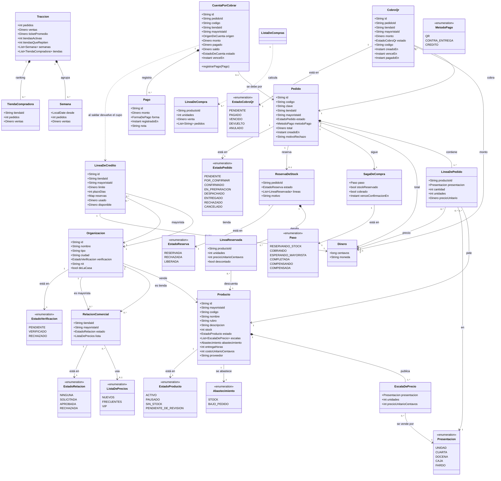

# Modelo de dominio

Muestra los conceptos que existen hoy en el código de Catálogo (`services/catalogo/src/Catalogo/Dominio`), Pedidos (`services/pedidos/src/main/java/bo/abasto/pedidos/dominio`) y Cobros (`services/cobros/src/dominio`). No hay métodos: solo atributos clave y multiplicidades.

**Organizacion** — Catálogo. Es la misma clase para tienda, mayorista y la organización de la casa (`deLaCasa`); `tipo` distingue el papel y `verificacion` guarda el estado. En GraphQL se expone como `Mayorista` o `Tienda`, pero no hay clases PHP separadas.

**RelacionComercial** — Catálogo. Une una tienda con un mayorista y guarda la lista de precios aprobada; nace en `SOLICITADA` y solo una relación `APROBADA` permite ver precios.

**ListaDePrecios** — Catálogo. Enum `NUEVOS` (100 %), `FRECUENTES` (97 %) y `VIP` (95 %).

**Producto** — Catálogo. Tiene escalas por presentación, stock y forma de abastecimiento. `BAJO_PEDIDO` significa que se compra cuando entra el pedido y no descuenta stock al reservar; también guarda costo y proveedor, que solo ve el mayorista.

**Abastecimiento** — Catálogo. Enum `STOCK` / `BAJO_PEDIDO`; una de las reglas de `Producto` impide que un producto bajo pedido quede en `SIN_STOCK`.

**EscalaDePrecio** — Catálogo. Una presentación con su cantidad de unidades y su precio unitario en centavos.

**Presentacion** — Catálogo. Enum `UNIDAD`, `CUARTA`, `DOCENA`, `CAJA` y `FARDO`.

**ReservaDeStock** — Catálogo. Es la respuesta de Catálogo a `catalogo.reservar_stock`: guarda las líneas reservadas, si se descontó stock y el motivo cuando rechaza.

**LineaReservada** — Catálogo. Producto, unidades y precio unitario que Catálogo devuelve a Pedidos; `descontado` indica si esa línea tocó el stock (las de `BAJO_PEDIDO` no).

**Pedido** — Pedidos. Tiene una clave de idempotencia, comprador, vendedor, líneas, método de pago y estado. El total se llena cuando Catálogo responde con precios.

**LineaDePedido** — Pedidos. Producto, presentación, cantidad pedida, unidades y precio; el precio queda nulo hasta que Catálogo lo fija.

**SagaDeCompra** — Pedidos. Máquina de estados de la compra: `RESERVANDO_STOCK`, `COBRANDO`, `ESPERANDO_MAYORISTA`, `COMPLETADA`, `COMPENSANDO` y `COMPENSADA`; el plazo del mayorista es de 2 h.

**LineaDeCredito** — Cobros. Límite, plazo (15 o 30 días) y reservas por pedido de una tienda con un mayorista; `autorizar` y `liberar` son idempotentes.

**CobroQr** — Cobros. Cobro por QR de un pedido, con monto, código `ABASTO-QR|...`, vencimiento y estado.

**Dinero** — Pedidos y Cobros. Valor en centavos con moneda `BOB`; Pedidos además lo expone como `texto` en el GraphQL.

**Traccion** — Pedidos. Resumen de ventas por semana y por tienda que consume el Superadmin.

**ListaDeCompras** — Pedidos. Agrupa por producto lo que hay que comprar para los pedidos `CONFIRMADO` y `EN_PREPARACION`; la usa Gestión (Compras).

**Estados** — Catálogo, Pedidos y Cobros. Cada agregado tiene su enum de estado; los nombres de arriba son los que existen en el código, no una traducción.

**CuentaPorCobrar** — Cobros (03/11, CU-09). Lo que una tienda le debe a un mayorista por un pedido a crédito o contra entrega; una por pedido. Nace con `pedido.confirmado`. Lo pagado nunca pasa el monto y un `Pago` repetido (mismo id) no se cuenta dos veces. Al saldar un crédito, la `LineaDeCredito` recupera el cupo.

**Pago** — Cobros. Efectivo, transferencia o QR, con fecha, quién lo anotó y una nota. Nunca se edita ni se borra.

Pendiente: no existen las clases `Tienda`, `Mayorista` ni `Cuota`. `Tienda` y `Mayorista` son tipos GraphQL sobre `Organizacion`; las cuotas (pagar un crédito en partes con fechas fijas) no existen: hoy un crédito tiene un solo vencimiento y se paga en los pagos que haga falta. Tampoco hay un concepto `Foto` en `Producto`: el producto no guarda imagen.
