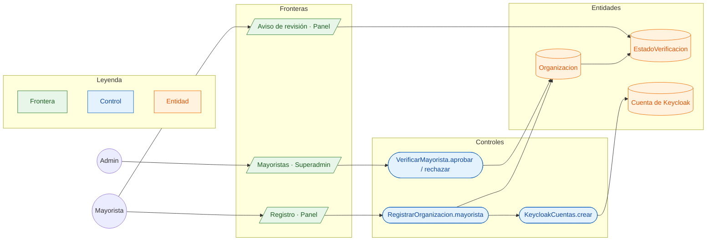

# CU-01 Registrarse como mayorista y ser verificado · robustez

**Actores:** Mayorista, Admin · **Interfaz:** Panel (`/registro`) → Superadmin (Mayoristas) · **Servicio:** Catálogo, Keycloak · **Dueño:** Andrés

Sale de `apps/panel-shell/src/Registro.tsx`, `apps/superadmin/src/pantallas/Mayoristas.tsx`, `services/catalogo/src/Catalogo/Aplicacion/{RegistrarOrganizacion,VerificarMayorista}.php` y `Infraestructura/Keycloak/KeycloakCuentas.php`.

## Curso básico

1. El mayorista abre `/registro` sin sesión y escribe empresa, NIT, ciudad, representante, teléfono, correo y contraseña.
2. `registrarMayorista` llama a `RegistrarOrganizacion.mayorista`, que valida los datos y que el NIT no esté en uso.
3. `KeycloakCuentas.crear` crea la cuenta con su `org_id` y el grupo `mayoristas`; la `Organizacion` queda `PENDIENTE`.
4. Al entrar al Panel ve el aviso «en revisión» mientras no esté verificado.
5. El admin abre Superadmin › Mayoristas (`mayoristasPorVerificar`), revisa el NIT y al representante y toca «Verificar».
6. `VerificarMayorista.aprobar` deja la `Organizacion` en `VERIFICADO`: sus productos salen en la app.

## Cursos alternos

- Datos incompletos: `DATOS_INVALIDOS` con el motivo («Elige la ciudad»). NIT repetido: `NIT_EN_USO`. Correo repetido: `CORREO_EN_USO`.
- El admin rechaza: `rechazarMayorista(id, motivo)` exige el motivo (`MOTIVO_REQUERIDO`) y el mayorista lo ve en su Panel.
- Una organización rechazada no pasa directo a verificada: `VERIFICACION_RECHAZADA`.
