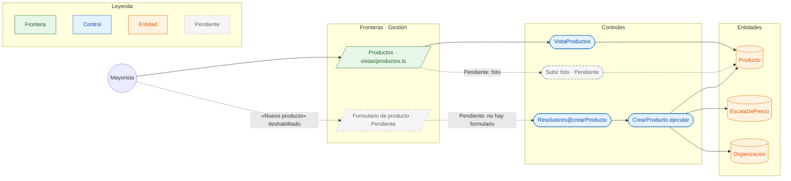

# CU-02 Publicar un producto con escalas y foto · robustez

**Actor:** Mayorista · **Interfaz:** Gestión (Productos) · **Servicio:** Catálogo · **Dueño:** Jhoel

Sale de `apps/panel-gestion/src/app/vistas/productos.ts`, `services/catalogo/graphql/schema.graphql` y `services/catalogo/src/Catalogo/Aplicacion/CrearProducto.php`.

## Curso básico

1. El mayorista entra a Gestión → Productos; `VistaProductos` consulta `MIS_PRODUCTOS`.
2. La lista muestra código, nombre, rubro, stock, estado y escalas del mayorista de la sesión.
3. El botón «Nuevo producto» está deshabilitado con `title="Tarea de F1: formulario con escalas"`; **Pendiente** el formulario.
4. Cuando exista, el formulario envía `crearProducto` con `CrearProductoEntrada`; el resolver llama a `CrearProducto.ejecutar`.
5. `CrearProducto` valida el código, el stock, el abastecimiento y las escalas, y crea el `Producto` con su `Organizacion` como dueña.
6. `Producto` guarda las `EscalaDePrecio` y deriva el estado: con stock `ACTIVO`, sin stock `SIN_STOCK`, salvo `BAJO_PEDIDO`.
7. La vista recibe el producto y lo agrega a la lista.

## Cursos alternos

- Sin código: `CODIGO_INVALIDO` («El producto necesita un código»).
- Código repetido: `CODIGO_REPETIDO` («Ya tienes un producto con el código {codigo}»).
- Stock negativo: `STOCK_INVALIDO` («El stock no puede quedar negativo»).
- Escala sin unidades: `ESCALA_INVALIDA` («Una presentación tiene que traer al menos una unidad»).
- Precio no positivo: `PRECIO_INVALIDO` («El precio tiene que ser mayor a cero»).
- **Foto Pendiente:** `Producto` no tiene campo de imagen y `cargarProducto` no recibe archivo; no hay entidad `Foto` ni pantalla de carga.

## Pruebas que lo cubren

- `services/catalogo/tests/Unit/GestionDeProductosTest.php` y `EscalasTest.php`: creación, códigos y escalas.
- `services/catalogo/tests/Feature/ProductoRepositorioTest.php` y `SubgrafoTest.php`: persistencia y contrato GraphQL.
- `e2e/pruebas/panel.spec.ts`: el Panel carga la vista de Productos. No cubre la creación porque el formulario todavía no existe.
