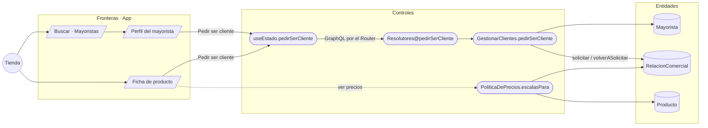

# CU-03 Pedir ser cliente de un mayorista · robustez

**Actor:** Cliente · **Interfaz:** App (Producto.tsx) · **Servicio:** Catálogo · **Dueño:** Andrés (pantalla) y Jhoel (servicio)

## Curso básico

1. La tienda busca mayoristas y abre el perfil de uno con el que no tiene relación.
2. La app muestra el catálogo sin precios y el botón «Pedir ser cliente».
3. La tienda lo toca. La app manda `pedirSerCliente(mayoristaId)` al Router.
4. Catálogo revisa que el mayorista exista, crea la relación en estado SOLICITADA y la guarda.
5. La app muestra «Solicitud enviada · por confirmar» en el perfil y en cada producto de ese mayorista.
6. Cuando el mayorista la aprueba (CU-04), la tienda ve los precios de su lista la próxima vez que se trae el catálogo.

## Cursos alternos

- **Sin señal:** el botón queda desactivado con «Necesitas conexión para pedir ser cliente». El catálogo guardado se sigue viendo.
- **Ya había pedido:** el botón no aparece y se muestra la solicitud pendiente.
- **El mayorista la rechazó antes:** se muestra «El mayorista no aprobó tu solicitud anterior» y el botón dice «Volver a pedir». Catálogo la pasa otra vez a SOLICITADA.
- **Ya es cliente:** se muestra «Eres cliente · ves los precios de tu lista» y no hay botón.
- **El mayorista no existe o no es mayorista:** Catálogo responde `MAYORISTA_NO_EXISTE` y La app muestra el mensaje.
- **Una empresa que es mayorista y tienda a la vez:** no ve sus propios productos en la app y no puede pedirse a sí misma (`RELACION_CONSIGO_MISMO`).

## Pruebas que lo cubren

- `e2e/pruebas/mercado.spec.ts`: pedir ser cliente → el mayorista aprueba → la tienda ve los precios de su lista; una tienda sin relación nunca recibe precios por GraphQL.
- `packages/comercio/src/catalogo.spec.ts`: sin relación aprobada no hay opciones de compra, ni precio «desde», ni escala para agregar.
- `services/catalogo/tests`: red privada y relación (Pest).
