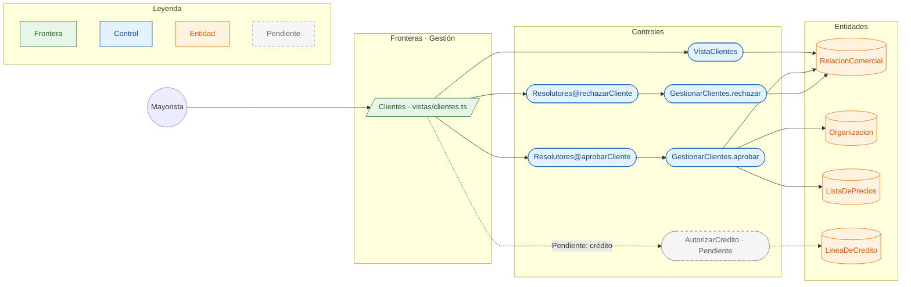

# CU-04 Aprobar un cliente con lista de precios y crédito · robustez

**Actor:** Mayorista · **Interfaz:** Gestión (Clientes) · **Servicios:** Catálogo y Cobros · **Dueño:** Jhoel

Sale de `apps/panel-gestion/src/app/vistas/clientes.ts`, `services/catalogo/src/Catalogo/Aplicacion/GestionarClientes.php`, `services/catalogo/src/Catalogo/Dominio/RelacionComercial.php` y `services/cobros/src/interfaz/graphql/credito.resolver.ts`.

## Curso básico

1. El mayorista abre Clientes; `VistaClientes` ejecuta `MIS_SOLICITUDES`.
2. La frontera muestra la tienda, la fecha y el estado `SOLICITADA`; no muestra el crédito.
3. El mayorista elige `NUEVOS`, `FRECUENTES` o `VIP` y toca «Aprobar».
4. La vista envía `aprobarCliente(tiendaId, lista)` al Router.
5. `GestionarClientes.aprobar` busca la relación; si no existe lanza `SOLICITUD_NO_EXISTE` («Esa tienda no pidió ser tu cliente»).
6. `RelacionComercial.aprobar(lista)` pasa a `APROBADA` y el repositorio la guarda.
7. La vista recarga y muestra la relación aprobada con su lista.

## Cursos alternos

- Si el mayorista rechaza, `rechazarCliente` llama a `GestionarClientes.rechazar` y `RelacionComercial.rechazar()` deja `RECHAZADA`.
- Si la tienda vuelve a pedir, `volverASolicitar()` la deja en `SOLICITADA`; no cambia una relación ya `APROBADA`.
- Si la tienda y el mayorista son la misma organización, Catálogo usa `RELACION_CONSIGO_MISMO` («Una empresa no puede ser cliente de sí misma»).
- **Crédito Pendiente:** Cobros tiene `autorizarCredito`, `lineaDeCredito`, `LineaDeCredito` y el evento `cobro.credito_autorizado`, pero `GestionarClientes.aprobar` no los llama ni publica nada. La frontera no pide límite, plazo ni cupo; `vistas/clientes.ts` tiene un TODO de crédito.

## Pruebas que lo cubren

- `services/catalogo/tests/Unit/RedPrivadaTest.php`: relación, aprobación, rechazo y visibilidad de precios.
- `services/catalogo/tests/Feature/SubgrafoTest.php`: `aprobarCliente` y `rechazarCliente` por GraphQL.
- `services/cobros/src/dominio/linea-de-credito.spec.ts` y `src/aplicacion/autorizar-credito.spec.ts`: límite, reserva y autorización.
- `e2e/pruebas/red-privada.spec.ts`: la tienda ve precios solo después de la aprobación.
