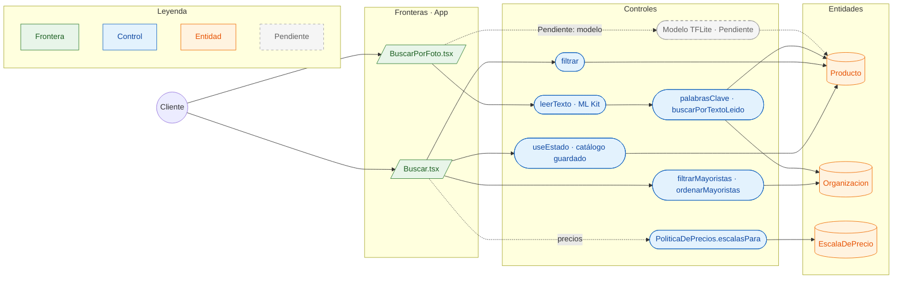

# CU-05 Buscar en el catálogo (texto o foto) · robustez

**Actor:** Cliente · **Interfaz:** App (Buscar, BuscarPorFoto) · **Servicios:** Catálogo y ML en el teléfono · **Dueño:** Andrés (pantalla) · Jhoel (ML)

Sale de `apps/app/src/pantallas/Buscar.tsx`, `BuscarPorFoto.tsx`, `apps/app/src/leer-texto.ts`, `apps/app/src/estado.tsx` y `packages/comercio/src/catalogo.ts`.

## Curso básico

1. `estado.tsx` carga `CONSULTA_CATALOGO` y guarda productos y mayoristas en AsyncStorage con `guardado.ts`.
2. El cliente escribe en Buscar; `filtrar` recorre el catálogo guardado y muestra coincidencias.
3. `filtrarMayoristas` y `ordenarMayoristas` permiten ver vendedores; el orden es por nombre, nunca por precio.
4. En BuscarPorFoto, el cliente toma o elige una foto con `expo-image-picker`.
5. `leerTexto` usa ML Kit para leer el texto de la imagen y `palabrasClave` lo limpia.
6. `buscarPorTextoLeido` busca esas palabras en el catálogo del teléfono y devuelve productos de varios vendedores.
7. La vista muestra los productos y, si la red privada lo permite, sus escalas.

## Cursos alternos

- Si se niega el permiso de cámara: «Abasto necesita la cámara para buscar con una foto. Actívala en los ajustes del teléfono.»
- Sin señal, la búsqueda funciona sobre el catálogo guardado; si nunca se cargó, no hay resultados.
- Si la tienda no tiene relación aprobada con un mayorista y no es `deLaCasa`, `PoliticaDePrecios` devuelve `null` y no se muestran precios.
- **ML Pendiente:** `apps/app/src/modelo.ts` solo tiene `elementosDe`, `bytesDe`, `entradaNeutra` y `describirTensor`; ninguna pantalla carga un modelo TFLite ni ejecuta inferencia. La foto se resuelve con OCR.

## Pruebas que lo cubren

- `packages/comercio/src/catalogo.spec.ts`: filtros y catálogo.
- `apps/app/src/modelo.test.ts`: solo las utilidades de tensor; no hay prueba de inferencia porque no hay modelo conectado.
- `e2e/pruebas/red-privada.spec.ts`: una tienda sin relación no recibe precios.
- `services/catalogo/tests/Unit/RedPrivadaTest.php`: `PoliticaDePrecios` y listas.
