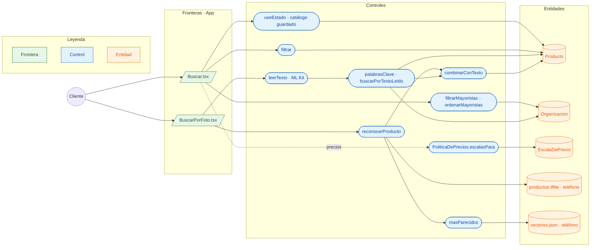

# CU-05 Buscar en el catálogo (texto o foto) · robustez

**Actor:** Tienda · **Interfaz:** App (Buscar, BuscarPorFoto) · **Servicios:** Catálogo y ML en el teléfono · **Dueño:** Andrés (pantalla) · Jhoel (ML)

Sale de `apps/app/src/pantallas/Buscar.tsx`, `BuscarPorFoto.tsx`, `apps/app/src/ia/index.ts`, `ia/leer-texto.ts`, `ia/reconocer.ts`, `ia/parecido.ts`, `ia/imagen.ts`, `packages/comercio/src/catalogo.ts`, `apps/app/assets/modelos/vectores.json` y `ml/src/abasto_ml/vision/entrenar.py`.

Todo lo de IA (`leerTexto`, `reconocerProducto`, `masParecidos` y `combinarConTexto`) ocurre dentro del teléfono, sin internet: ML Kit y TFLite corren en el dispositivo y no hay una llamada a un servicio.

## Curso básico

1. `estado.tsx` carga `CONSULTA_CATALOGO` y guarda productos y mayoristas en AsyncStorage con `guardado.ts`.
2. El cliente escribe en Buscar; `filtrar` recorre el catálogo guardado y muestra coincidencias.
3. `filtrarMayoristas` y `ordenarMayoristas` permiten ver vendedores; el orden es por nombre, nunca por precio.
4. En BuscarPorFoto, el cliente toma o elige una foto con `expo-image-picker`.
5. `leerTexto` usa ML Kit para leer el texto de la imagen y `palabrasClave` lo limpia.
6. En paralelo, `reconocerProducto` recorta la foto con `recorteCentrado`, la reduce a 224×224 con `expo-image-manipulator`, la pasa por `aEntradaDelModelo` y corre `productos.tflite`; `masParecidos` compara el vector con los de `vectores.json` por similitud coseno.
7. `buscarPorTextoLeido` busca las palabras en el catálogo del teléfono y `combinarConTexto` suma los códigos que leyó el texto a los que reconoció la imagen.
8. La vista muestra los productos y, si la red privada lo permite, sus escalas.

## Cursos alternos

- Si se niega el permiso de cámara: «Abasto necesita la cámara para buscar con una foto. Actívala en los ajustes del teléfono.»
- Sin señal, la búsqueda funciona sobre el catálogo guardado; si nunca se cargó, no hay resultados.
- Si la tienda no tiene relación aprobada con un mayorista y no es `deLaCasa`, `PoliticaDePrecios` devuelve `null` y no se muestran precios.
- Si el modelo está sin entrenar, `vectores.json` trae `productos: []`; `reconocerProducto` devuelve `[]` y la búsqueda queda solo con el texto leído.
- **Pendiente en la pantalla:** `BuscarPorFoto.tsx` ya llama a `leerTexto` y `buscarPorTextoLeido`; la llamada a `reconocerProducto` y `combinarConTexto` está pedida a Andrés en `docs/equipo/jhoel.md`.

## Pruebas que lo cubren

- `apps/app/src/ia/parecido.test.ts`: `similitudCoseno`, `masParecidos`, `combinarConTexto` y `leerVectores`.
- `apps/app/src/ia/imagen.test.ts`: `recorteCentrado` y `aEntradaDelModelo`.
- `ml/tests/test_vision.py`: vectores normalizados, promedio por producto y paridad Keras = TFLite.
- `packages/comercio/src/catalogo.spec.ts`: `palabrasClave`, `buscarPorTextoLeido` y filtros del catálogo.
- `e2e/pruebas/red-privada.spec.ts`: una tienda sin relación no recibe precios.
- `services/catalogo/tests/Unit/RedPrivadaTest.php`: `PoliticaDePrecios` y listas.
