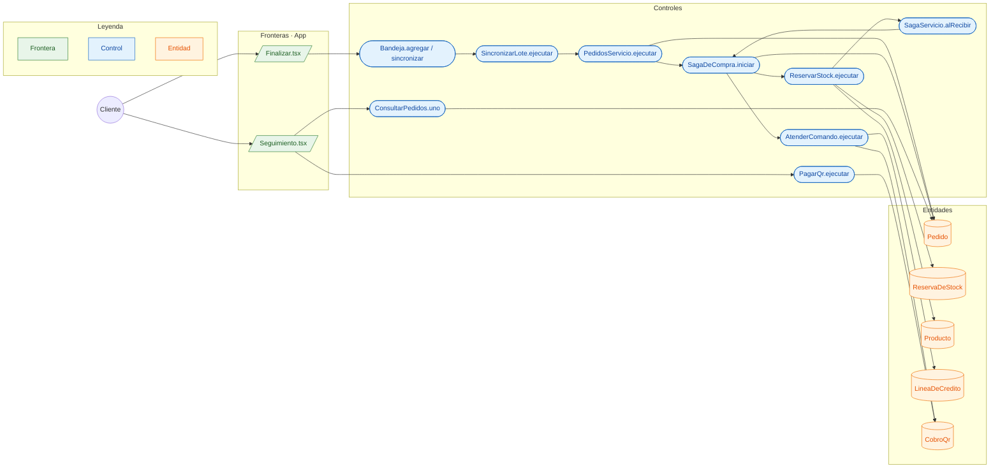

# CU-06 Hacer un pedido · robustez

**Actor:** Cliente · **Interfaz:** App (Carrito, Finalizar, Seguimiento) · **Servicios:** Pedidos, Catálogo y Cobros · **Dueño:** Andrés

Sale de `apps/app/src/pantallas/Finalizar.tsx`, `Seguimiento.tsx`, `packages/outbox-offline/src/bandeja.ts`, `services/conecta/src/aplicacion/sincronizar-lote.ts`, `services/pedidos/src/main/java/bo/abasto/pedidos/aplicacion/servicios/{PedidosServicio,SagaServicio}.java` y `services/catalogo/src/Catalogo/Aplicacion/ReservarStock.php`.

## Curso básico

1. `Finalizar` agrupa el carrito por mayorista y deja una operación `pedido.crear` en la `Bandeja` con una clave UUID.
2. `Bandeja.sincronizar()` manda el lote a Conecta; `SincronizarLote` aplica la operación por el Router.
3. `PedidosServicio.ejecutar` busca la clave, crea el `Pedido` y arranca `SagaDeCompra`.
4. La saga deja `pedido.creado` y `catalogo.reservar_stock` en el outbox; RabbitMQ los publica.
5. `ReservarStock` descuenta las líneas `STOCK` y deja las `BAJO_PEDIDO` sin tocar; guarda la `ReservaDeStock`.
6. `SagaServicio.alRecibir` recibe `stock.reservado`, fija precios y pide a Cobros crédito o QR, o pasa directo a esperar al mayorista si es contra entrega.
7. `AtenderComando` autoriza la `LineaDeCredito` o genera el `CobroQr`; con el pago, la saga emite `pedido.por_confirmar`.
8. `Seguimiento` consulta el pedido y, en la demo, paga el QR con `pagarQrDePrueba`.

## Cursos alternos

- Carrito vacío: `PEDIDO_VACIO` («El pedido tiene que tener al menos un producto»).
- Cantidad no positiva: `CANTIDAD_INVALIDA` («La cantidad tiene que ser mayor a cero»).
- Compra a la misma organización: `PEDIDO_A_SI_MISMO` («Una empresa no puede hacerse un pedido a sí misma»).
- Stock insuficiente: Catálogo emite `stock.rechazado`; `SagaDeCompra.alFallarReserva` rechaza el pedido y emite `pedido.rechazado`.
- Cobro rechazado: `cobro.rechazado`; `SagaDeCompra.alFallarCobro` compensa con `cobros.liberar_credito` o `cobros.devolver_qr`, `catalogo.liberar_stock` y `pedido.rechazado`.
- QR vencido: `VencerQrs` emite `cobro.rechazado` con «El QR venció sin que se pagara»; se libera el stock.
- Mayorista sin respuesta en 2 h: `RevisorDePlazos` compensa con «El mayorista no respondió a tiempo».
- Sin red antes de enviar: la operación queda en la bandeja y la maneja CU-12.

## Pruebas que lo cubren

- `e2e/pruebas/compra.spec.ts`: pedido, reserva, cobro y confirmación.
- `services/pedidos/src/test/java/bo/abasto/pedidos/dominio/SagaDeCompraTest.java`: estados, compensación y plazo.
- `services/pedidos/src/test/java/bo/abasto/pedidos/PedidosIT.java`: GraphQL, outbox e idempotencia.
- `services/catalogo/tests/Unit/SagaDeStockTest.php`: reserva, liberación y `BAJO_PEDIDO`.
- `services/cobros/src/dominio/cobro-qr.spec.ts` y `linea-de-credito.spec.ts`: QR y crédito.
