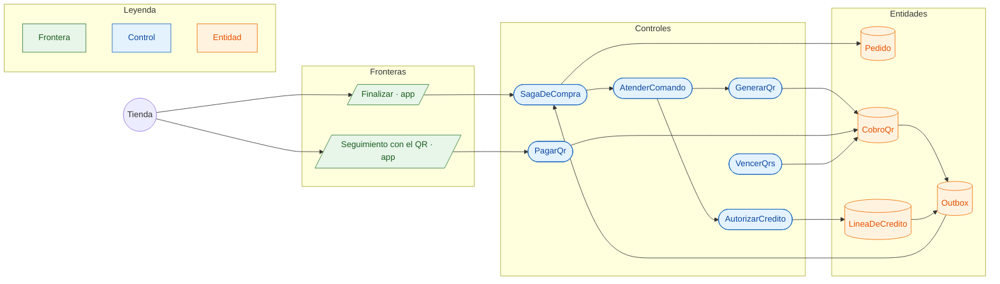

# CU-08 Pagar con QR, a crédito o contra entrega · robustez

**Actor:** Tienda · **Interfaz:** App (Finalizar, Seguimiento) · **Servicio:** Cobros, con Pedidos · **Dueño:** Andrés

Sale de `apps/app/src/pantallas/{Finalizar,Seguimiento}.tsx`, `services/cobros/src/aplicacion/{atender-comando,cobros-qr,autorizar-credito}.ts` y `dominio/{cobro-qr,linea-de-credito}.ts`.

## Curso básico

1. En Finalizar, la tienda elige QR, Crédito o Contra entrega. Crédito se ofrece si `lineaDeCredito` tiene cupo para el total.
2. Pedidos reserva stock (CU-06) y manda el comando según el método.
3. Crédito: `AutorizarCredito` reserva el monto en la `LineaDeCredito` y publica `cobro.credito_autorizado`.
4. QR: `GenerarQr` crea el `CobroQr` (vence a los 30 minutos) y publica `cobro.qr_generado`; Seguimiento lo muestra.
5. La tienda paga: `PagarQr` lo marca `PAGADO` y sale `cobro.qr_pagado`. Contra entrega no pasa por Cobros en este paso.
6. El pedido queda `POR_CONFIRMAR` esperando al mayorista (CU-07).

## Cursos alternos

- Sin cupo: `LIMITE_DE_CREDITO_EXCEDIDO`; sale `cobro.rechazado` con el motivo y la saga libera el stock.
- QR vencido: `VencerQrs` lo marca y sale `cobro.rechazado`; intentar pagarlo da `QR_NO_SE_PUEDE_PAGAR`.
- Otra tienda intenta pagarlo: `SIN_PERMISO`.
- Si el mayorista rechaza después, `cobros.liberar_credito` o `cobros.devolver_qr` compensan. Repetir el comando no descuenta dos veces.
