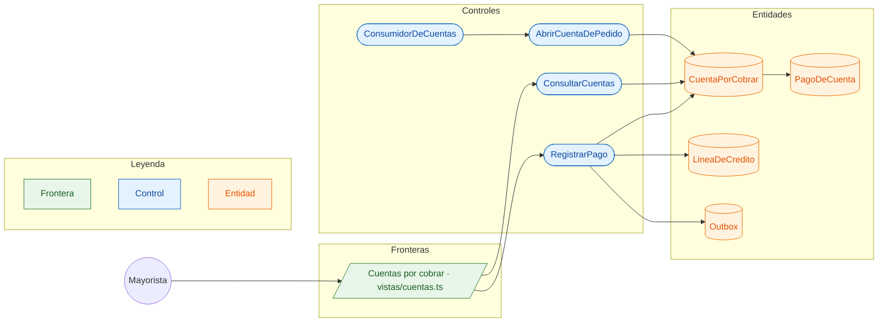

# CU-09 Registrar un pago de una cuenta por cobrar · robustez

**Actor:** Mayorista · **Interfaz:** Panel › Gestión (Cuentas) · **Servicio:** Cobros · **Dueño:** Andrés

Sale de `apps/panel-gestion/src/app/vistas/cuentas.ts`, `services/cobros/src/aplicacion/cuentas-por-cobrar.ts`, `dominio/cuenta-por-cobrar.ts` y `infraestructura/mensajeria/cuentas.rabbitmq.ts`.

## Curso básico

1. Al llegar `pedido.confirmado`, `ConsumidorDeCuentas` llama a `AbrirCuentaDePedido`: abre la cuenta si es a crédito o contra entrega.
2. El mayorista abre Cuentas; `ConsultarCuentas` trae lo que le deben, lo más atrasado primero.
3. Toca una cuenta, escribe el monto y la forma de pago. La vista envía `registrarPago` con un `pagoId` nuevo.
4. `RegistrarPago` comprueba que la cuenta sea suya y `CuentaPorCobrar.registrarPago` la deja `PARCIAL` o `PAGADA`.
5. Queda `cobro.pago_registrado` en el `Outbox`; si un crédito quedó `PAGADA`, `LineaDeCredito.saldar` devuelve el cupo.

## Cursos alternos

- Monto mayor que el saldo: `PAGO_MAYOR_QUE_EL_SALDO`. Dos cobros a la vez: lo frena el CHECK de la base.
- El mismo `pagoId` otra vez: no se cuenta dos veces.
- Cuenta de otro mayorista: `SIN_PERMISO`. Pedido sin cuenta: `CUENTA_NO_EXISTE`.
