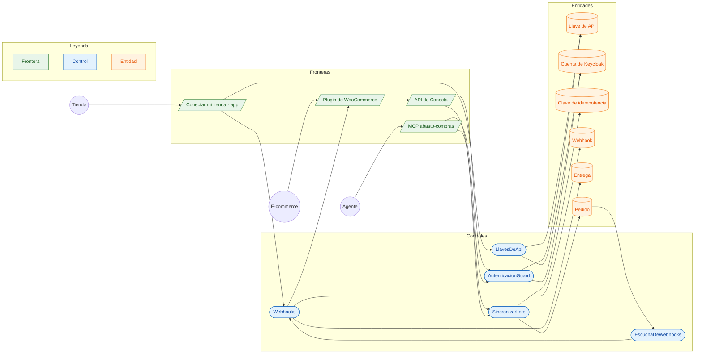

# CU-10 Conectar un e-commerce (API, WooCommerce, MCP) · robustez

**Actor:** Tienda, su e-commerce o un agente · **Interfaz:** App (Cuenta › Conectar mi tienda en línea), plugin de WooCommerce, MCP · **Servicio:** Conecta, Keycloak · **Dueño:** Andrés

Sale de `apps/app/src/pantallas/ConectarTienda.tsx`, `plugins/woocommerce-abasto`, `services/conecta/src/aplicacion/{llaves-de-api,webhooks,sincronizar-lote}.ts` e `interfaz/mcp/servidor-mcp.ts`.

## Curso básico

1. La tienda abre Cuenta › Conectar mi tienda en línea y saca una llave. `LlavesDeApi` crea una cuenta de Keycloak con su `org_id` y guarda solo la huella. La llave se muestra una vez.
2. La pega en el plugin de WooCommerce, en su e-commerce o en un agente con MCP.
3. Cada llamada lleva la llave. `AutenticacionGuard` la busca, comprueba la huella y usa el token de esa cuenta: Pedidos y Catálogo ven a la misma tienda.
4. Lee el catálogo con los precios de la tienda (`GET /v1/productos` o `buscar_productos`). El plugin lo importa como borrador.
5. Cuando entra una venta, el e-commerce pide con una clave fija (`POST /v1/pedidos` o `crear_pedido`). `SincronizarLote` la reserva por empresa y crea el pedido.
6. La tienda registra una dirección de avisos. `EscuchaDeWebhooks` anota cada `pedido.*` y `cobro.*` de esa tienda y `Webhooks` lo manda firmado.

## Cursos alternos

- Llave inventada, revocada o con otro secreto: 401. Revocarla corta al momento, aunque hubiera un token guardado.
- Una llave no puede sacar otras llaves: 403.
- Reintento con la misma clave: `repetida` con la respuesta original. La misma clave con otro contenido: `conflicto`. Una clave que ya usó otra tienda: `CLAVE_EN_USO`, nunca el pedido ajeno.
- Dirección interna o sin https: `URL_INVALIDA`.
- Aviso que no llega: se reintenta a los 1, 5, 30, 120 y 720 minutos; después queda `fallida` y se reenvía desde la app o el Superadmin.
- Tienda suspendida: la saga rechaza el pedido con el motivo.
