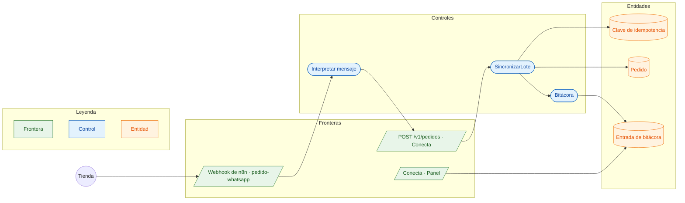

# CU-11 Pedir por WhatsApp · robustez

**Actor:** Tienda, por WhatsApp · **Interfaz:** WhatsApp → n8n · **Servicio:** Conecta, Pedidos · **Dueño:** Andrés

Sale de `infra/n8n/flujos/pedido-por-whatsapp.json` y `services/conecta/src/aplicacion/sincronizar-lote.ts`.

## Curso básico

1. Llega el mensaje con `mensajeId`, teléfono y texto, por ejemplo «2 cajas HP-0400, 1 docena HJ-0110».
2. n8n convierte cada línea en producto, presentación y cantidad, y deriva la clave del `mensajeId`: el mismo mensaje siempre da la misma clave.
3. n8n manda `POST /v1/pedidos` con `Idempotency-Key` y `X-Abasto-Origen: whatsapp`.
4. `SincronizarLote` reserva la clave, crea el pedido por el Router y anota la bitácora.
5. El mayorista lo ve en Panel › Conecta y en Pedidos.

## Cursos alternos

- WhatsApp reintenta el mensaje: `repetida`, misma respuesta, y en el Panel sale «Repetido: no se duplicó».
- Presentación que no existe: `rechazada` con el motivo, visible en el Panel.
- **Pendiente:** el flujo usa la tienda de prueba `donarosa@abasto.bo`. Falta conectar un número real de WhatsApp y buscar la tienda por su teléfono.
