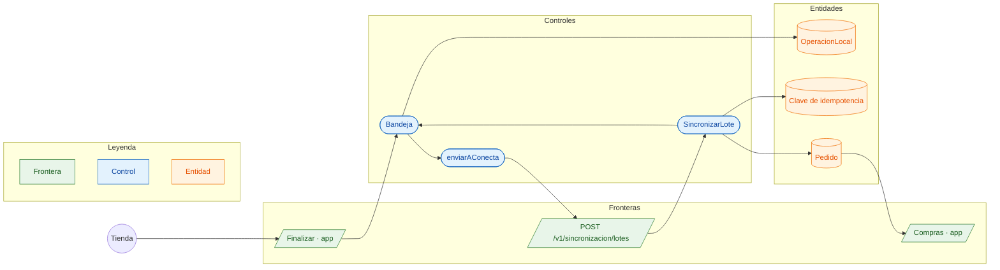

# CU-12 Hacer un pedido sin señal · robustez

**Actor:** Tienda · **Interfaz:** App (bandeja sin señal) · **Servicio:** Conecta, Pedidos · **Dueño:** Andrés

Sale de `apps/app/src/bandeja-pedidos.ts`, `packages/outbox-offline/src/bandeja.ts` y `services/conecta/src/aplicacion/sincronizar-lote.ts`.

## Curso básico

1. `Finalizar` crea una `OperacionLocal` por vendedor, con una clave UUID que no cambia.
2. La operación queda `pendiente` en el teléfono aunque no haya señal.
3. Al volver la señal, `Bandeja.sincronizar()` manda hasta 100 con `enviarAConecta`.
4. `SincronizarLote` reserva cada clave y aplica `crearPedido` por el Router.
5. La bandeja la marca `aplicada`; el pedido aparece en Compras.

## Cursos alternos

- Sin red: suben los intentos y se reintenta con la misma clave.
- Ya se había aplicado: `repetida`, misma respuesta. Otro contenido: `conflicto`.
- El servicio falla: se libera la clave para reintentar.
