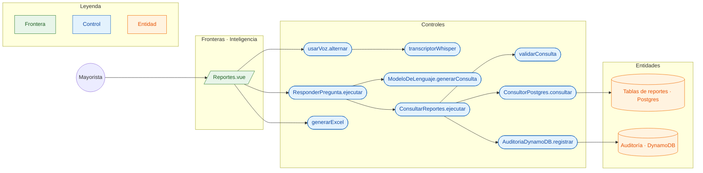

# CU-13 Preguntarle a los datos (texto o voz) · robustez

**Actor:** Mayorista · **Interfaz:** Inteligencia (Reportes) · **Servicio:** Asistente · **Dueño:** Jhoel

Sale de `apps/panel-inteligencia/src/componentes/Reportes.vue`, `voz/usar-voz.ts`, `voz/transcriptor.ts`, `services/asistente/src/reportes/aplicacion/{responder-pregunta,consultar-reportes}.ts`, `reportes/dominio/guardia-sql.ts` e `infraestructura/postgres/consultor.pg.ts`.

## Curso básico

1. El mayorista escribe una pregunta o la dicta; `usarVoz` graba y `transcriptorWhisper` transcribe en el navegador.
2. `Reportes.vue` envía `POST /v1/reportes/preguntas` con `{texto}`.
3. `ResponderPregunta` pide al `ModeloDeLenguaje` el SQL, la explicación y el gráfico.
4. `ConsultarReportes` valida con `validarConsulta`: una sola sentencia, solo `SELECT`, tablas y funciones permitidas.
5. `ConsultorPostgres` abre `BEGIN READ ONLY`, fija `statement_timeout` de 5 s y `abasto.org_id`, y consulta como `mcp_lector`.
6. Lee hasta 1000 filas; si hay más, marca `truncado`.
7. `AuditoriaDynamoDB` registra la consulta y su resultado.
8. La vista muestra la tabla, el gráfico y permite exportar a Excel con `generarExcel`.

## Cursos alternos

- Consulta rechazada: `ConsultarReportes` audita `rechazada` y lanza `ConsultaRechazada`; la API responde «No pude armar ese reporte: {motivo}».
- `org_id` inválido: «La sesión no tiene una empresa válida».
- Error de PostgreSQL: se audita `error` y no se devuelven filas.
- Más de 1000 filas: la respuesta trae `truncado: true`.
- La voz no está disponible en la app móvil: Reportes solo existe en Inteligencia (Vue).

## Pruebas que lo cubren

- `services/asistente/src/reportes/dominio/guardia-sql.spec.ts`: allowlist, una sentencia, tablas, funciones y conversiones.
- `services/asistente/src/reportes/aplicacion/responder-pregunta.spec.ts`: pregunta → SQL → resultado.
- `services/asistente/src/infraestructura/postgres/consultor.pg.e2e-spec.ts`: solo lectura, RLS y límite.
- `e2e/pruebas/panel.spec.ts`: Reportes en el Panel con la pregunta de ejemplo.
