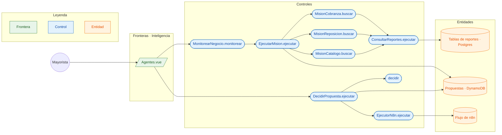

# CU-14 Aprobar la propuesta de un agente · robustez

**Actor:** Mayorista · **Interfaz:** Inteligencia (Agentes) · **Servicio:** Asistente · **Dueño:** Jhoel

Sale de `apps/panel-inteligencia/src/componentes/Agentes.vue`, `services/asistente/src/agentes/aplicacion/agentes.ts`, `agentes/dominio/agente.ts`, `reportes/dominio/demanda.ts`, `infraestructura/dynamodb/propuestas.dynamodb.ts`, `infraestructura/acciones/ejecutor.n8n.ts` e `interfaz/http/asistente.controllers.ts`.

## Curso básico

1. El mayorista abre Inteligencia → Agentes; `Agentes.vue` consulta `GET /v1/agentes` y `GET /v1/agentes/propuestas`.
2. Toca «Revisar ahora»: `POST /v1/agentes/monitorear` llama a `MonitorearNegocio.monitorear`.
3. `MonitorearNegocio` corre las tres misiones (`MisionCobranza`, `MisionReposicion` y `MisionCatalogo`) con `EjecutarMision.ejecutar`.
4. Cada misión consulta los reportes con `ConsultarReportes.ejecutar` y devuelve `Hallazgo[]`; `EjecutarMision` descarta los que ya esperan una decisión con la misma `clave` y guarda las nuevas con `PropuestasDynamoDB.guardar`.
5. `MonitorearNegocio` responde `{ total, agentes }`; la vista muestra cuántas propuestas nuevas dejó cada agente y recarga la lista.
6. El mayorista toca «Aprobar» o «Rechazar»; la vista hace `POST /v1/agentes/propuestas/:id/decision` con `{ aprobar }`.
7. `DecidirPropuesta.ejecutar` busca la propuesta, `decidir` la pasa a `aprobada` o `rechazada` y guarda la decisión.
8. Si se aprobó, `EjecutorN8n.ejecutar` hace `POST N8N_WEBHOOK_ACCIONES` con `idempotency-key` igual al id de la propuesta; n8n ejecuta la acción (por ejemplo, el WhatsApp de cobranza) y la propuesta sale de la lista.

## Cursos alternos

- Si la propuesta ya no está `pendiente`, `decidir` lanza `PropuestaYaDecidida`: «La propuesta {id} ya está {estado}».
- Si se rechaza, `decidir` la deja `rechazada`, se guarda y no se llama a `EjecutorN8n`.
- Si `N8N_WEBHOOK_ACCIONES` no está configurado, `EjecutorN8n` no falla: devuelve `{enviado:false, detalle:'n8n no está configurado (N8N_WEBHOOK_ACCIONES)'}` y deja un warning.
- Si una misión falla, `MonitorearNegocio` sigue con las demás y el resumen trae `{ agenteId, nuevas: 0, error }`; la vista muestra «no pudo revisar ({error})».
- Si nada es nuevo, el resumen trae `total: 0` y la vista dice «Todo en orden: ningún agente encontró algo nuevo.».
- `POST /v1/agentes/:id/ejecutar` corre una sola misión; para `analista` responde «El Analista no corre solo: hazle una pregunta en Reportes» y si el id no existe, «No existe el agente {id}».

## Pruebas que lo cubren

- `services/asistente/src/agentes/aplicacion/agentes.spec.ts`: las tres misiones, la clave que evita repetir, la decisión única, el resumen y la misión que falla sin frenar a las demás.
- `apps/panel-inteligencia/src/componentes/Agentes.spec.ts`: «Revisar ahora», el resumen por agente y «Todo en orden».
