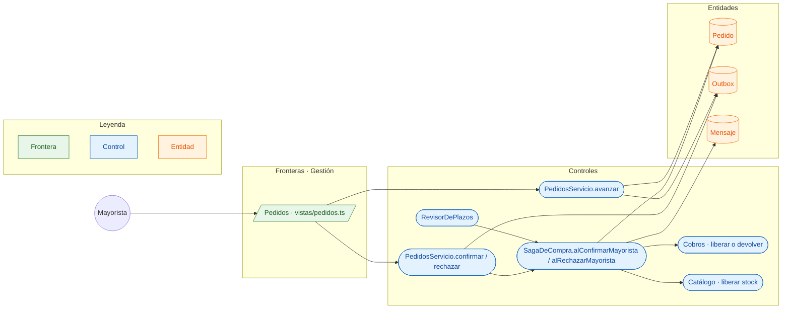

# CU-15 Preparar, despachar y entregar un pedido · robustez

**Actor:** Mayorista · **Interfaz:** Gestión (Pedidos) · **Servicio:** Pedidos · **Dueño:** Andrés

Sale de `apps/panel-gestion/src/app/vistas/pedidos.ts`, `services/pedidos/src/main/java/bo/abasto/pedidos/aplicacion/servicios/PedidosServicio.java`, `dominio/SagaDeCompra.java`, `dominio/Pedido.java` y `adaptadores/programado/RevisorDePlazos.java`.

## Curso básico

1. `VistaPedidos` consulta `MIS_VENTAS` y muestra los pedidos del mayorista.
2. Para un pedido `POR_CONFIRMAR`, el mayorista toca «Confirmar»; la vista envía `confirmarPedido(id)`.
3. `PedidosServicio.confirmar` busca el pedido entre sus ventas y llama a `SagaDeCompra.alConfirmarMayorista`.
4. La saga exige `ESPERANDO_MAYORISTA`, confirma el `Pedido` y deja `pedido.confirmado` en el `Outbox`.
5. Para avanzar, la vista envía `avanzarEntrega(id)`; `PedidosServicio.avanzar` llama a `Pedido.avanzarEntrega()`.
6. El pedido pasa por `EN_PREPARACION`, `DESPACHADO` y `ENTREGADO`, y cada paso deja `pedido.en_preparacion`, `pedido.despachado` o `pedido.entregado` en el outbox.
7. Si rechaza, `rechazarPedido(id, motivo)` entra en `COMPENSANDO` y emite `cobros.liberar_credito` o `cobros.devolver_qr`, `catalogo.liberar_stock` y `pedido.rechazado`.

## Cursos alternos

- Pedido ajeno: `PEDIDO_NO_EXISTE` («No existe ese pedido entre tus ventas»).
- Pedido sin saga: `SAGA_NO_EXISTE` («El pedido {codigo} no tiene saga»).
- Confirmar fuera de `ESPERANDO_MAYORISTA`: `PEDIDO_NO_ESPERA_CONFIRMACION` («El pedido {codigo} no está esperando confirmación»).
- Avanzar un pedido no confirmado o ya entregado: `NO_SE_PUEDE_AVANZAR` («El pedido {codigo} está {estado}: solo se avanza un pedido confirmado que todavía no se entregó»).
- Sin respuesta del mayorista en 2 h: `RevisorDePlazos` llama a `alRevisarPlazo` y compensa con «El mayorista no respondió a tiempo».
- La compensación espera `cobro.credito_liberado` o `cobro.qr_devuelto` y `stock.liberado`; cuando ambos llegan, la saga queda `COMPENSADA`.

## Pruebas que lo cubren

- `services/pedidos/src/test/java/bo/abasto/pedidos/dominio/SagaDeCompraTest.java`: confirmación, rechazo, plazo y compensación.
- `services/pedidos/src/test/java/bo/abasto/pedidos/PedidosIT.java`: confirmar, rechazar y avanzar por GraphQL.
- `e2e/pruebas/panel.spec.ts`: la vista de Pedidos del Panel.
