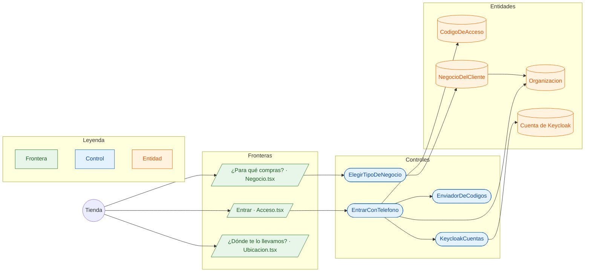

# CU-15 Registrarse como tienda · robustez

**Actor:** Tienda o persona · **Interfaz:** App (Entrar) · **Servicio:** Catálogo, Keycloak · **Dueño:** Andrés

Sale de `apps/app/src/pantallas/{Acceso,Negocio,Ubicacion}.tsx`, `apps/app/src/acceso.ts` y `services/catalogo/src/Catalogo/Aplicacion/EntrarConTelefono.php`.

## Curso básico

1. La persona escribe su celular. `pedirCodigo` guarda la huella de un código de 6 dígitos que dura 5 minutos y lo manda.
2. Escribe el código. La primera vez, `entrarConCodigo` pide también el nombre.
3. `EntrarConTelefono` crea la `Organizacion` y su cuenta de Keycloak en el grupo `clientes`, sin contraseña que recordar.
4. La app recibe una sesión larga: no vuelve a pedir el celular.
5. Elige para qué compra (hogar, tienda o productor) y su dirección. Queda en la base: al entrar en otro celular se carga solo.

## Cursos alternos

- Celular que no es de Bolivia: `TELEFONO_INVALIDO`. Pedir otro código muy pronto: `ESPERA`.
- Código incorrecto: `CODIGO_INCORRECTO`. Muchos intentos: `CODIGO_BLOQUEADO`. Venció: `CODIGO_VENCIDO`.
- Falta el nombre la primera vez: `NECESITA_NOMBRE`; el código sigue vigente.
- Cuenta suspendida por Abasto: `CUENTA_SUSPENDIDA`.
- **Pendiente:** el código se muestra en la app («Modo prueba»). Falta conectar WhatsApp para mandarlo de verdad (`EnviadorDeCodigos`).
