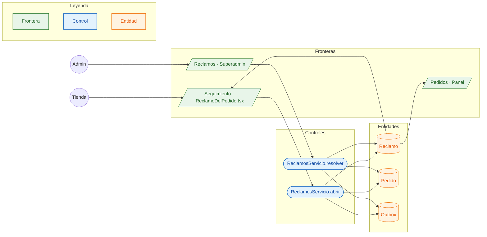

# CU-16 Reportar un problema con un pedido · robustez

**Actores:** Tienda, Admin · **Interfaz:** App (Seguimiento) → Superadmin (Reclamos) · **Servicio:** Pedidos · **Dueño:** Andrés

Sale de `apps/app/src/ReclamoDelPedido.tsx`, `apps/superadmin/src/pantallas/Reclamos.tsx`, `services/pedidos/src/main/java/bo/abasto/pedidos/aplicacion/servicios/ReclamosServicio.java` y `dominio/Reclamo.java`.

## Curso básico

1. En Seguimiento, la tienda toca «Tengo un problema con este pedido», elige qué pasó y, si quiere, lo cuenta.
2. `ReclamosServicio.abrir` comprueba que el pedido sea suyo, crea el `Reclamo` en `ABIERTO` y deja `pedido.reclamo_abierto` en el outbox.
3. El mayorista ve la marca «Reclamo» en su pedido del Panel; no lo resuelve él.
4. El admin abre Superadmin › Reclamos, habla con la tienda y hace la devolución a mano si corresponde.
5. Anota cuánto devolvió, cómo y qué le responde. `ReclamosServicio.resolver` deja el `Reclamo` en `APROBADO` y publica `pedido.reclamo_resuelto`.
6. La tienda lee la respuesta y lo devuelto en Seguimiento.

## Cursos alternos

- Pedido que la saga todavía procesa: `PEDIDO_EN_PROCESO`. Pedido de otra tienda: `PEDIDO_NO_EXISTE`.
- Repetir el reclamo (doble toque): devuelve el mismo; hay uno por pedido.
- Motivo «Otro» sin contar qué pasó: `DETALLE_REQUERIDO`.
- Abasto no le da la razón: `rechazar`, con la respuesta obligatoria (`RESPUESTA_REQUERIDA`).
- Lo devuelto pasa el total del pedido: `DEVUELTO_MAYOR_QUE_EL_TOTAL`. Dinero sin decir cómo: `FORMA_REQUERIDA`. Ya resuelto: `RECLAMO_YA_RESUELTO`.
- Resolver no mueve dinero, crédito ni cuentas por cobrar: solo lo anota.
