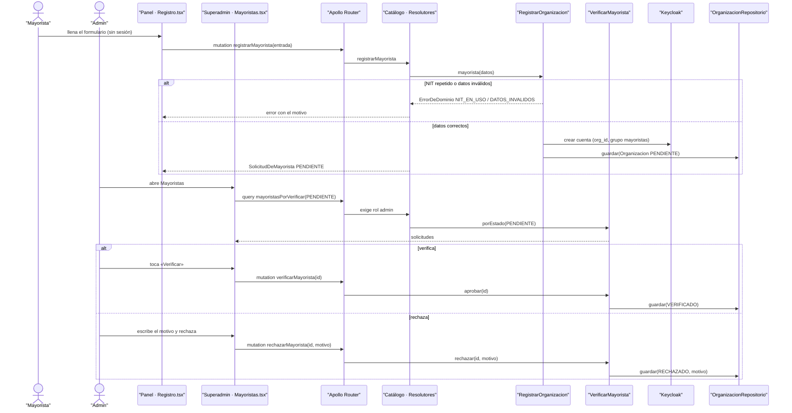

# CU-01 Registrarse como mayorista y ser verificado · secuencia

**Interfaz:** Panel `/registro` → Superadmin › Mayoristas · **Servicios:** Catálogo, Keycloak.
Sale de `apps/panel-shell/src/datos-de-registro.ts`, `apps/superadmin/src/mayoristas.ts` y `services/catalogo/src/Catalogo/Aplicacion/{RegistrarOrganizacion,VerificarMayorista}.php`.

