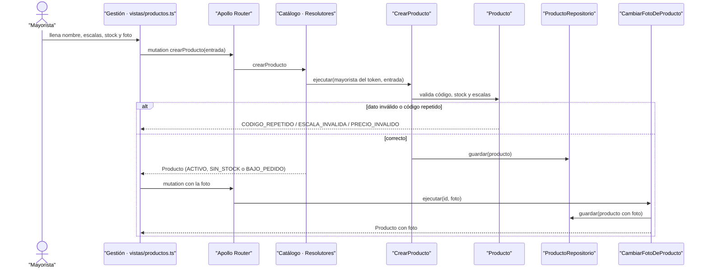

# CU-02 Publicar un producto con escalas y foto · secuencia

**Interfaz:** Panel › Gestión (Productos) · **Servicio:** Catálogo.
Sale de `apps/panel-gestion/src/app/vistas/productos.ts`, `services/catalogo/src/Catalogo/Aplicacion/{CrearProducto,CambiarFotoDeProducto}.php` y `Infraestructura/Fotos/AlmacenDeFotosEnDisco.php`.

