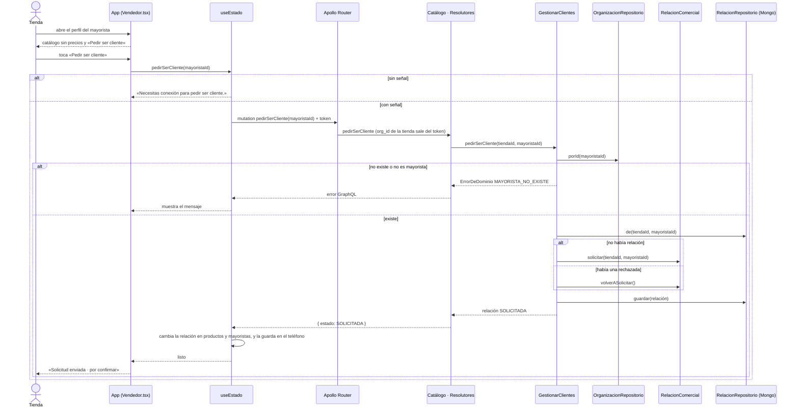

# CU-03 Pedir ser cliente de un mayorista · secuencia

Después, el mayorista aprueba desde Gestión › Clientes (CU-04). La próxima vez que la app trae el catálogo, `PoliticaDePrecios` le devuelve las escalas con el porcentaje de su lista.
