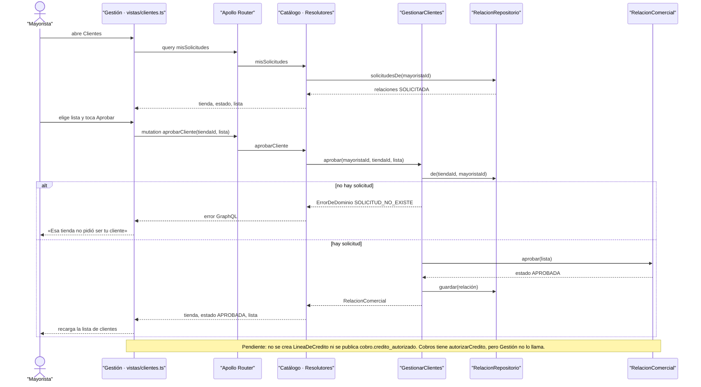

# CU-04 Aprobar un cliente con lista de precios y crédito · secuencia

**Interfaz:** Gestión → Clientes · **Servicios:** Catálogo y Cobros.
Sale de `apps/panel-gestion/src/app/vistas/clientes.ts`, `services/catalogo/src/Catalogo/Infraestructura/GraphQL/Resolutores.php`, `Aplicacion/GestionarClientes.php`, `Dominio/RelacionComercial.php` y `Dominio/Puertos/RelacionRepositorio.php`.

El rechazo usa la misma pantalla: `rechazarCliente(tiendaId)` llama a `GestionarClientes.rechazar`, que ejecuta `RelacionComercial.rechazar()` y guarda `RECHAZADA`. La tienda puede volver a pedir; `volverASolicitar()` no cambia una relación que ya está `APROBADA`.

El crédito no forma parte del camino actual: no hay evento en `contracts/asyncapi.yaml` que salga de esta aprobación, y `vistas/clientes.ts` solo consulta `MIS_SOLICITUDES`, `APROBAR_CLIENTE` y `RECHAZAR_CLIENTE`.
