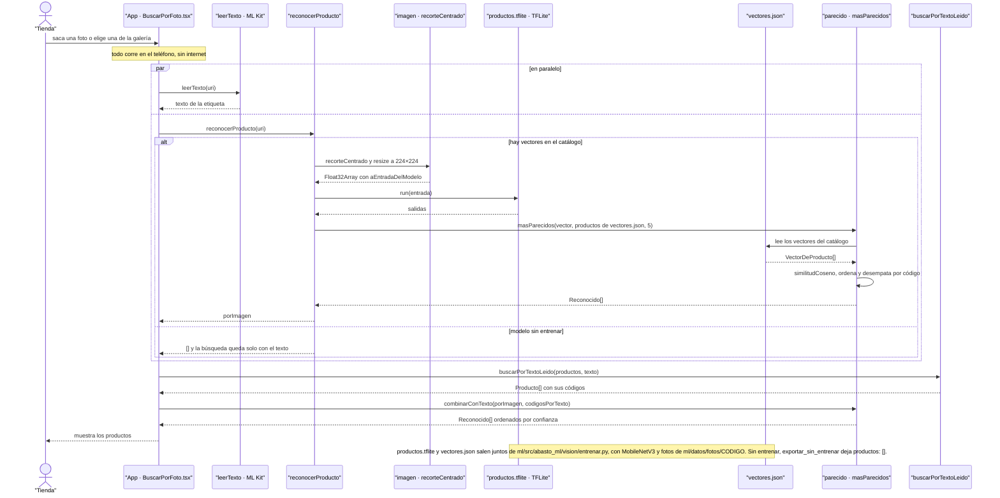

# CU-05 Buscar por foto (la IA) · secuencia

**Interfaz:** App → Buscar por foto · **Servicio:** Catálogo y ML en el teléfono.
Sale de `apps/app/src/pantallas/BuscarPorFoto.tsx`, `apps/app/src/ia/index.ts`, `ia/leer-texto.ts`, `ia/reconocer.ts`, `ia/parecido.ts`, `ia/imagen.ts`, `apps/app/assets/modelos/vectores.json` y `packages/comercio/src/catalogo.ts`.

`reconocerProducto` carga el modelo y `vectores.json` una sola vez y los deja en memoria. `masParecidos` descarta la confianza cero, ordena de mayor a menor y desempata por código. `combinarConTexto` reparte un bono de 0,25 entre los códigos que leyó ML Kit, así el texto sube a un producto que la imagen dejó segundo o agrega uno que la imagen no vio.

Hoy `BuscarPorFoto.tsx` llama a `leerTexto` y `buscarPorTextoLeido`; la llamada a `reconocerProducto` y `combinarConTexto` está pedida a Andrés en `docs/equipo/jhoel.md`, porque la pantalla es suya. En la vista web, `reconocer.ts` tiene un `.web.ts` que devuelve `[]`.
