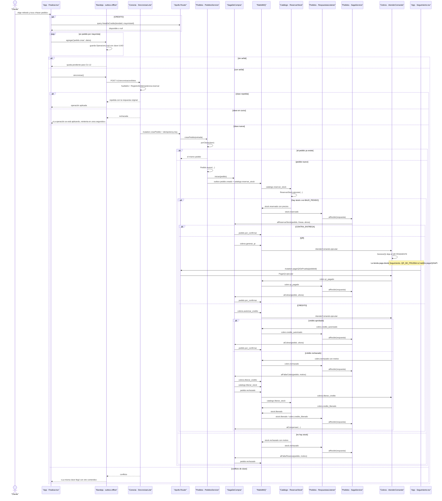

# CU-06 Hacer un pedido · secuencia

**Interfaz:** App → Carrito → Finalizar · **Servicios:** Conecta, Pedidos, Catálogo y Cobros.
Sale de `apps/app/src/pantallas/Finalizar.tsx`, `Seguimiento.tsx`, `packages/outbox-offline/src/bandeja.ts`, `services/conecta/src/aplicacion/sincronizar-lote.ts`, `services/pedidos/.../SagaDeCompra.java`, `SagaServicio.java`, `contracts/asyncapi.yaml` y `services/catalogo/src/Catalogo/Aplicacion/ReservarStock.php`.

- **Todo bien:** `stock.reservado` fija precios; contra entrega pasa directo a `ESPERANDO_MAYORISTA`, QR espera `cobro.qr_pagado` y crédito espera `cobro.credito_autorizado`. En los tres casos sale `pedido.por_confirmar`.
- **Stock insuficiente:** `stock.rechazado` → `alFallarReserva` → `pedido.rechazado`; no se cobra. No hay compensación porque todavía no había stock reservado ni cobro.
- **Cobro rechazado:** `cobro.rechazado` → `alFallarCobro` → `compensar`; se emiten `cobros.liberar_credito`, `catalogo.liberar_stock` y `pedido.rechazado`. Las respuestas `cobro.credito_liberado` y `stock.liberado` cierran `COMPENSANDO`.
- **QR vencido:** `VencerQrs` emite `cobro.rechazado` con «El QR venció sin que se pagara»; la saga libera el stock con `catalogo.liberar_stock`.
- **Plazo del mayorista:** `RevisorDePlazos` llama a `alRevisarPlazo` a las 2 h y compensa con «El mayorista no respondió a tiempo».
- **BAJO_PEDIDO:** la línea no descuenta stock; si hay que compensar, `LiberarStock` solo devuelve las líneas con `descontado = true`.
- La misma clave de Conecta devuelve la respuesta original; un conflicto no se aplica dos veces.
