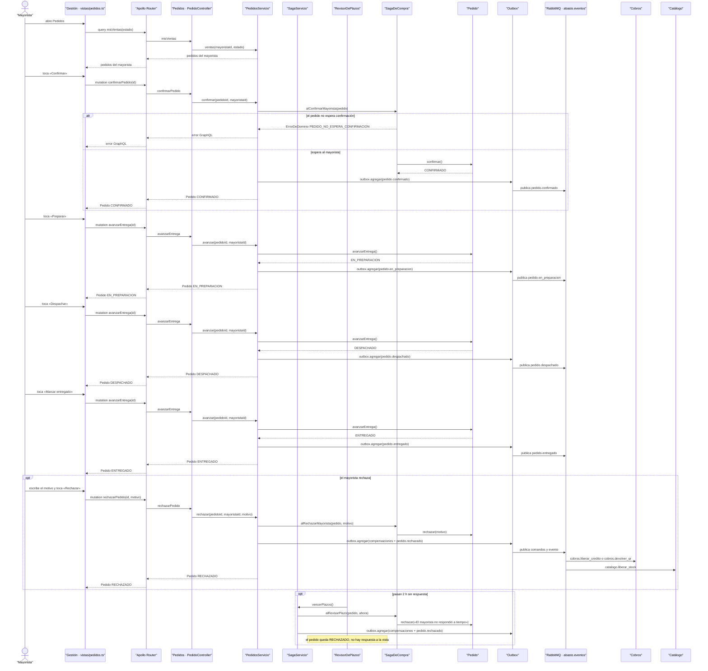

# CU-07 Confirmar o rechazar un pedido y entregarlo · secuencia

**Interfaz:** Gestión → Pedidos · **Servicio:** Pedidos.
Sale de `apps/panel-gestion/src/app/vistas/pedidos.ts`, `services/pedidos/src/main/java/bo/abasto/pedidos/adaptadores/entrada/graphql/PedidoController.java`, `aplicacion/servicios/{PedidosServicio,SagaServicio}.java`, `dominio/{Pedido,SagaDeCompra}.java` y `adaptadores/programado/RevisorDePlazos.java`.

`VistaPedidos` calcula el texto del botón con `SIGUIENTE_PASO`: `CONFIRMADO` → «Preparar», `EN_PREPARACION` → «Despachar», `DESPACHADO` → «Marcar entregado». Un pedido en otro estado no ofrece avance y `Pedido.avanzarEntrega()` responde `NO_SE_PUEDE_AVANZAR`.

Si el pedido no pertenece al mayorista, `PedidosServicio.delMayorista` responde `PEDIDO_NO_EXISTE` («No existe ese pedido entre tus ventas»). Si no tiene saga, `SAGA_NO_EXISTE` («El pedido {codigo} no tiene saga»). La compensación usa el orden inverso del `SagaDeCompra`: primero el cobro (`cobros.liberar_credito` o `cobros.devolver_qr`) y después el stock (`catalogo.liberar_stock`).
