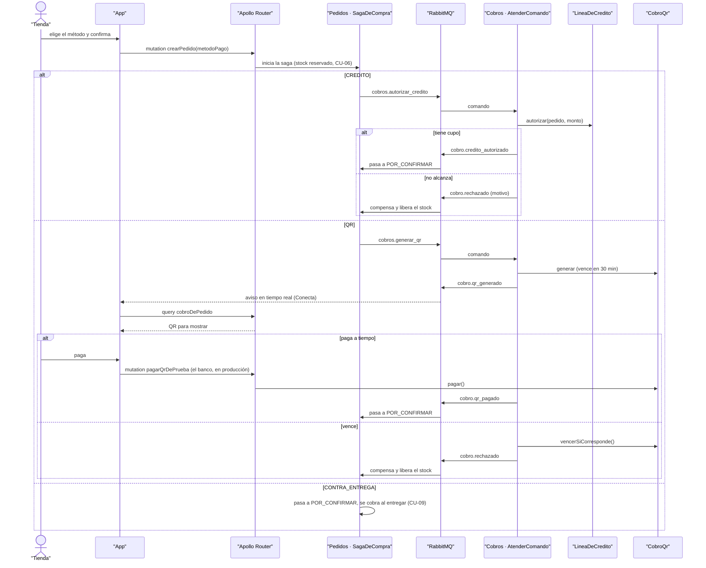

# CU-08 Pagar con QR, a crédito o contra entrega · secuencia

**Interfaz:** App (Finalizar, Seguimiento) · **Servicios:** Pedidos, Cobros.
Sale de `apps/app/src/pantallas/{Finalizar,Seguimiento}.tsx` y `services/cobros/src/aplicacion/{atender-comando,cobros-qr,autorizar-credito}.ts`.

