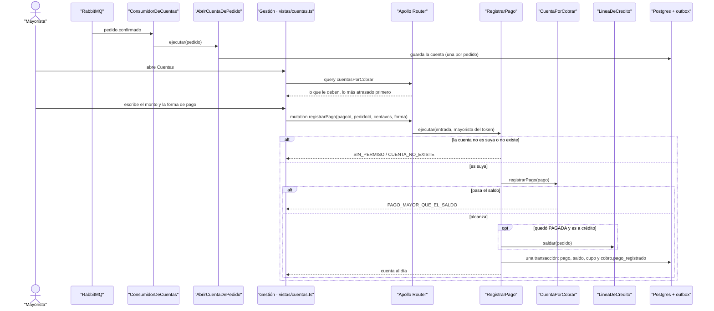

# CU-09 Registrar un pago de una cuenta por cobrar · secuencia

**Interfaz:** Panel › Gestión (Cuentas) · **Servicio:** Cobros.
Sale de `apps/panel-gestion/src/app/vistas/cuentas.ts`, `services/cobros/src/interfaz/graphql/cuentas.resolver.ts` y `aplicacion/cuentas-por-cobrar.ts`.

