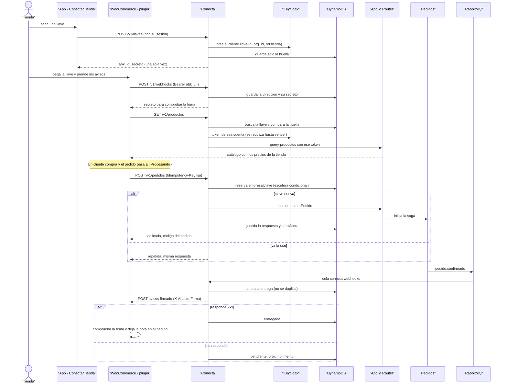

# CU-10 Conectar un e-commerce (API, WooCommerce, MCP) · secuencia

**Interfaz:** App, plugin de WooCommerce, MCP · **Servicios:** Conecta, Keycloak, Pedidos (por el Router).
Sale de `services/conecta/src/interfaz/http/integraciones.controller.ts`, `infraestructura/seguridad/autenticacion.guard.ts`, `aplicacion/{llaves-de-api,webhooks}.ts` y `plugins/woocommerce-abasto/includes/class-pedidos.php`.

Un agente hace lo mismo con `POST /mcp`: `buscar_productos` y `crear_pedido` pasan por el mismo guard y la misma idempotencia, y en la bitácora salen con origen `mcp`.
