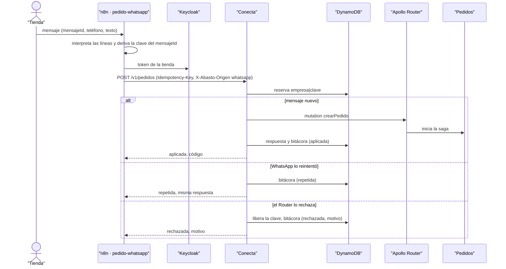

# CU-11 Pedir por WhatsApp · secuencia

**Interfaz:** WhatsApp → n8n · **Servicios:** Conecta, Pedidos.
Sale de `infra/n8n/flujos/pedido-por-whatsapp.json`, `services/conecta/src/interfaz/http/sincronizacion.controller.ts` y `aplicacion/sincronizar-lote.ts`.

