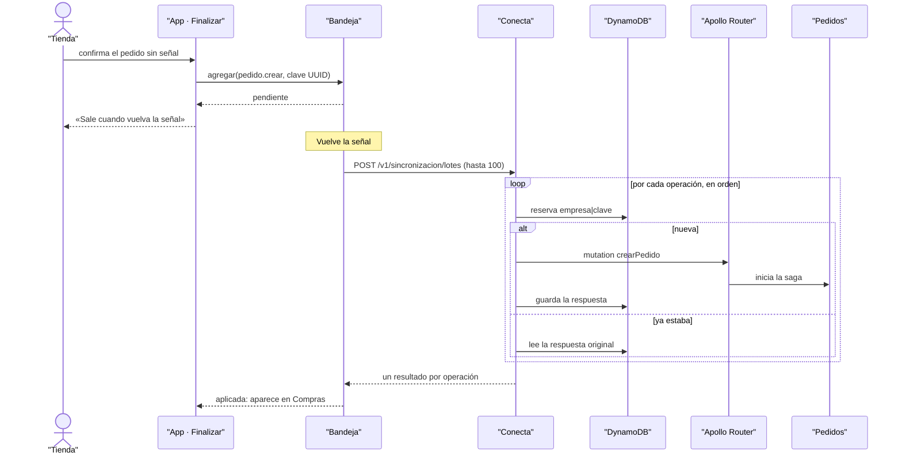

# CU-12 Hacer un pedido sin señal · secuencia

**Interfaz:** App · **Servicios:** Conecta, Pedidos.
Sale de `packages/outbox-offline/src/bandeja.ts`, `apps/app/src/bandeja-pedidos.ts` y `services/conecta/src/aplicacion/sincronizar-lote.ts`.

