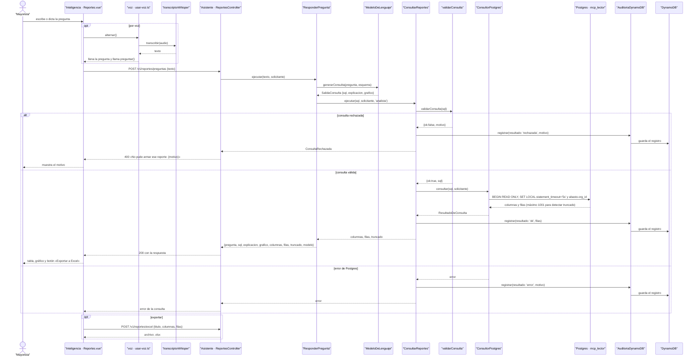

# CU-13 Preguntarle a los datos (texto o voz) · secuencia

**Interfaz:** Inteligencia → Reportes · **Servicio:** Asistente.
Sale de `apps/panel-inteligencia/src/componentes/Reportes.vue`, `voz/usar-voz.ts`, `voz/transcriptor.ts`, `services/asistente/src/reportes/aplicacion/{responder-pregunta,consultar-reportes}.ts`, `reportes/dominio/guardia-sql.ts`, `infraestructura/postgres/consultor.pg.ts` e `infraestructura/dynamodb/auditoria.dynamodb.ts`.

`ConsultorPostgres` usa el rol `mcp_lector` y la organización de la sesión; si `org_id` no cumple `^[a-z0-9_-]{1,40}$`, falla con «La sesión no tiene una empresa válida». La guardia es la primera barrera, pero no la única: la transacción es de solo lectura, tiene `statement_timeout` de 5 s, RLS por `abasto.org_id` y un máximo de 1000 filas. La auditoría se guarda en DynamoDB con la PK `AUDITORIA#<org>` y la SK `<fecha ISO>#<uuid>`.

El mismo `ConsultarReportes` lo usan los agentes y el MCP (`describir_reportes` y `consultar_reportes`); no hay una ruta que salte la guardia.
