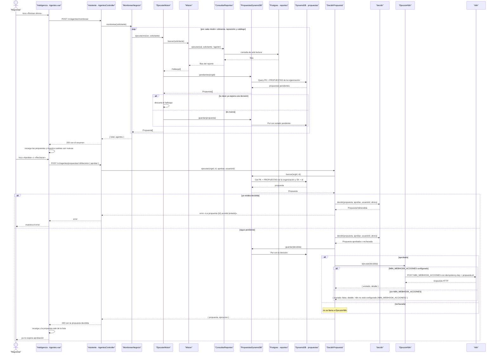

# CU-14 Aprobar la propuesta de un agente · secuencia

**Interfaz:** Inteligencia → Agentes · **Servicio:** Asistente.
Sale de `apps/panel-inteligencia/src/componentes/Agentes.vue`, `services/asistente/src/agentes/aplicacion/agentes.ts`, `agentes/dominio/agente.ts`, `reportes/dominio/demanda.ts`, `infraestructura/dynamodb/propuestas.dynamodb.ts`, `infraestructura/acciones/ejecutor.n8n.ts` e `interfaz/http/asistente.controllers.ts`.

Las tres misiones son `MisionCobranza` (vence mañana → recordatorio de WhatsApp), `MisionReposicion` (no alcanza para 7 días según la demanda del ML → pedido para 2 semanas) y `MisionCatalogo` (sin stock → pausar). `MonitorearNegocio` corre las tres en paralelo y, si una falla, las demás siguen: el resumen trae `{ agenteId, nuevas: 0, error }` para la que falló. `POST /v1/agentes/:id/ejecutar` corre una sola misión y rechaza al `analista` con «El Analista no corre solo: hazle una pregunta en Reportes».
