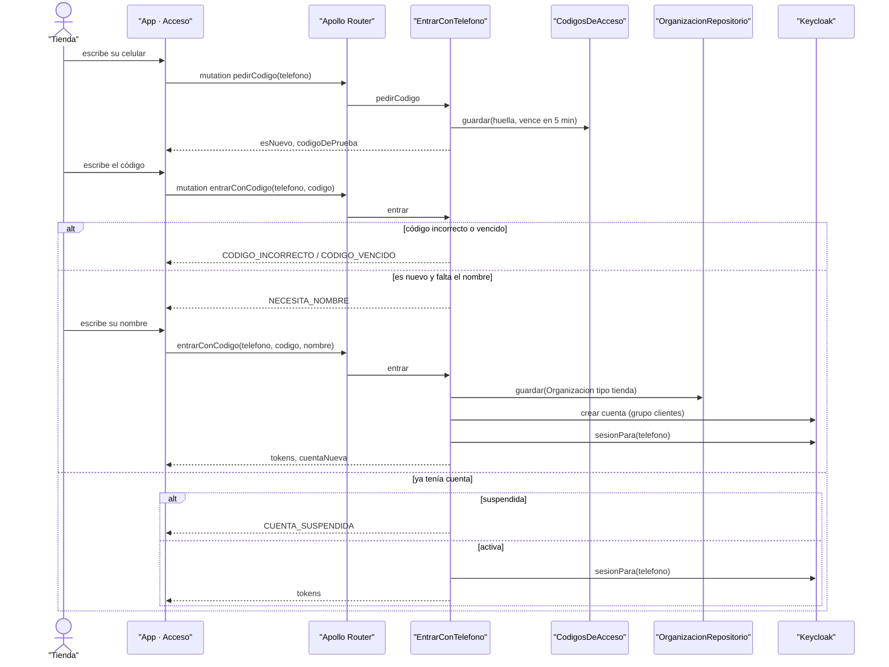

# CU-15 Registrarse como tienda · secuencia

**Interfaz:** App (Entrar) · **Servicios:** Catálogo, Keycloak.
Sale de `apps/app/src/acceso.ts`, `services/catalogo/src/Catalogo/Aplicacion/EntrarConTelefono.php` y `Infraestructura/Keycloak/KeycloakCuentas.php`.

