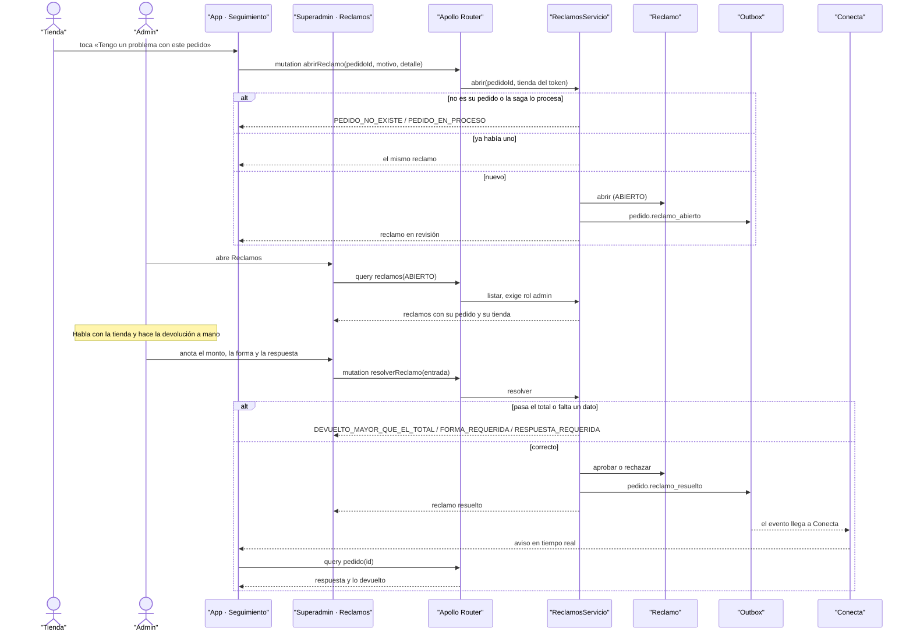

# CU-16 Reportar un problema con un pedido · secuencia

**Interfaz:** App (Seguimiento) → Superadmin (Reclamos) · **Servicio:** Pedidos.
Sale de `apps/app/src/ReclamoDelPedido.tsx`, `apps/superadmin/src/reclamos.ts`, `services/pedidos/src/main/java/bo/abasto/pedidos/adaptadores/entrada/graphql/ReclamoController.java` y `aplicacion/servicios/ReclamosServicio.java`.

Resolver no llama a Cobros: la devolución se hace afuera del sistema y aquí solo se anota.
